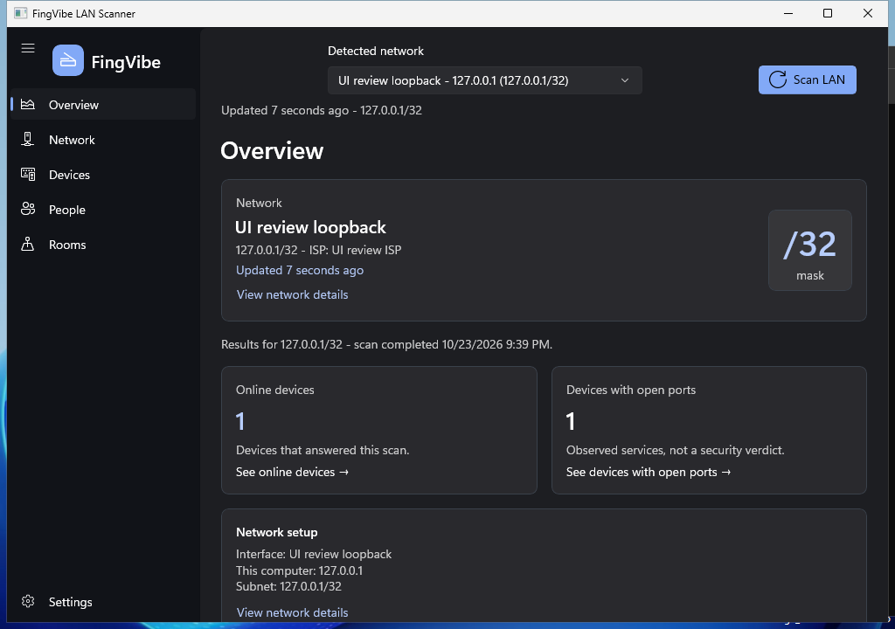

# FingVibe

FingVibe is a native Windows 11 LAN scanner built with C# and WinUI 3. It detects active IPv4 network interfaces, shows the machine address and subnet, and probes every usable address concurrently.

## Start page



Captured from the native app in UI-review mode using the local loopback host, not a real LAN.

## Features

- Native WinUI 3 desktop UI; WebView2 is restricted to the local Cloudflare speed-test host
- Fixed left navigation with Overview, Network, Devices, People, Rooms, Tools, and Settings pages
- [Manual Cloudflare internet speed test](docs/speed-test.md) in Tools, with native results and a per-run data-use disclosure
- Overview with local network identity, scan freshness, actionable online/open-port summaries, compact network setup, and project links
- Automatic local IPv4 and CIDR discovery
- Overview subnet-size badge and Network details explaining every IPv4 prefix, address capacity, and private, public, or special-purpose scope
- ISP-based network identity with a Network page showing public and local addresses plus approximate public-IP location (or **Unknown**)
- Device details page opened by clicking a device in the Devices table
- Local People and Rooms management with editable short names, assignments, searchable compact tables, and last-scan response summaries
- Independent person and room assignments saved by discovered MAC address, with short-name badges and full-name device filters
- Offline, evidence-backed OS and device-type detection with built-in Fluent icons and saved manual corrections
- Resizable Devices table columns and a Settings column selector (kept for the current session)
- Live appearance settings: Solid, Mica, Mica Alt, or Acrylic backdrops, plus Standard Light, Warm Light, Standard Dark, and True Black (OLED) themes
- Parallel ICMP scanning with up to 256 concurrent probes
- Device names from UPnP/SSDP, mDNS, reverse DNS, and NetBIOS
- MAC vendor lookup using locally cached IEEE registries, including private/randomized detection
- Bounded probes for common TCP services with compact Fluent port icons
- Live progress, cancellation, filtering, and sortable per-host results
- Compact results with subnet-aware IP emphasis, online/offline badges, and two-tone MAC addresses
- Numeric latency labels with green-to-red bars scaled across responding hosts (20% for fastest, 100% for slowest; equal times remain green at 20%)
- MAC address discovery for reachable devices when available
- Pull request build artifacts for Windows x64
- Automatically versioned GitHub Releases from `main`

## Run locally

Prerequisites:

- Windows 11
- .NET 8 SDK
- Visual Studio 2022 with the **Windows application development** workload, or the equivalent Windows SDK build tools

```powershell
dotnet restore FingVibe.sln
dotnet run --project src\FingVibe.App\FingVibe.App.csproj -p:Platform=x64
```

The scanner uses ICMP echo requests. Firewall rules and devices configured not to answer ICMP can cause an active host to appear unreachable. On first use, vendor detection downloads the official IEEE MA-L, MA-M, and MA-S registries and caches them under the current user's local application data for 30 days.

Overview shows the selected interface as the network name, with subnet and available ISP information beneath it. The freshness indicator describes the displayed scan, not continuous monitoring, and refreshes periodically. Restored or partial results retain their subnet and observation time; selecting another network explicitly identifies results from a different scan target. Cancel and progress appear only during a scan. Before the first scan, Overview provides guidance rather than unknown counts.

Select the online-device or open-port summary card to open the corresponding Devices results. This clears stale search/summary filters; the visible **Only devices with open ports** checkbox can be cleared to return to other results and combines with text search and **All / Alive**. Open ports describe observed services, not a security verdict. Overview does not count unused addresses as offline devices or track device history. The compact **About FingVibe** card opens the repository and creator's website in the external browser.

Without a saved theme preference, FingVibe starts with Standard Light or Standard Dark to match the Windows app mode. Appearance choices in **Settings** apply immediately and are saved to `%LOCALAPPDATA%\FingVibe\appearance.json` for the next launch; a saved theme, including Warm Light or True Black (OLED), takes precedence over Windows app mode. Ordinary Windows light/dark changes do not switch the theme while FingVibe is running. Unsupported backdrop materials fall back to a solid theme background without discarding your selection. Material rendering also follows Windows transparency settings; Windows high contrast takes precedence and uses system colors instead.

Public IP and ISP details are retrieved from `ipwho.is`. This optional display depends on internet access and sends the connection's public IP to that provider as part of the HTTPS request. LAN discovery and scanning continue to work when the lookup is unavailable.

Configured builds also show an ISP logo on the Network page, loaded asynchronously from Logo.dev using the original ISP name. Logo.dev receives that name and the caller's public IP, but no LAN addresses, device inventory, or scan results. Missing configuration, unavailable images, and failed or slow requests leave a generic network icon; the ISP text and scanning remain available. Name matching selects the provider's top result and can identify the wrong brand. UI-review mode never requests logos. See [ISP logo configuration](docs/isp-logos.md) for build setup and provider limitations.

The Overview network card shows A, B, or C for /8, /16, or /24 sizes; other sizes show their CIDR prefix. Network details explain all prefixes from /0 through /32, including class-size multiples/divisions and point-to-point or single-host networks. Counts below one million are exact; larger counts use M with two significant digits. Ordinary subnet counts exclude network/broadcast addresses, with a reserved suffix for /17 through /30; /31 assumes point-to-point use and /32 identifies one host. These capacity figures do not change the scanner's 65,534-address safety limit. Scope checks cover the whole subnet, distinguish private and special-purpose ranges (including APIPA/link-local), and flag mixed scopes. "Standard-size private" means a private /8, /16, or /24 subnet, not that other private prefix lengths are invalid.

Results dim complete network-prefix octets using the scanned subnet's CIDR; partially masked octets remain emphasized because they also identify hosts. Latency bars update as responses arrive and keep the same scale when filtering or sorting. Missing responses show a dash, not a performance bar. "Offline" means no ICMP response, not proof that a device is powered off. Select a row with the pointer or keyboard to highlight it; sorting preserves the selection. Hover over service icons for port numbers and service names.

The Devices toolbar has a Fluent inset **All / Alive** segmented switch, built with the Windows Community Toolkit `Segmented` control. A neutral recessed track surrounds a raised, softly rounded selected surface with blue accent text; the unselected option blends into the track. Colors adapt to light, dark, and Windows high-contrast themes. **All** is selected initially; **Alive** shows only online hosts. Both options combine with the text filter and apply to incoming scan results and saved results. Tab to the switch and use the Left/Right arrow keys to change the selection.

### Device identification

Devices show a native Segoe Fluent device icon beside their name. The **OS** and **Device type** columns can be sorted, resized, or hidden in Settings. Both detected and manually selected classifications are included in text filtering. Device details show the identification evidence and whether a value is user-selected. Unknown OS, device type, and vendor values use muted text in both the list and details.

Identification is best-effort and local. SSDP discovery uses the selected interface, and one shared multicast DNS-SD discovery window follows service announcements through SRV, TXT, and IPv4 address records to collect models without confusing proxy responses with the responding device. It listens for multicast replies as well as requested unicast replies. SSDP `SERVER` advertisements and bounded HTTP/SSH banner reads on already-open ports can identify OS-specific platform information. Merely running SSH, SMB, nginx, or Apache is not OS proof. The computer running the scanner is identified directly from its OS, and the selected interface's configured gateway is identified as a router.

Explicit device types/models outweigh service-only clues. When explicit evidence is absent, narrow product/manufacturer clues can suggest categories such as WD My Cloud/Synology/QNAP storage, Philips Lighting/Signify/Tuya smart devices, media devices, or game consoles. OS-specific discovered names, such as `Android-...`, are hints, not proof that the device is a phone. These inferred values are visibly marked **(likely)** in the list and details, with the supporting evidence shown in details. A generic TP-Link, Amazon, or Apple vendor, randomized MAC, or open SMB port alone does not determine an OS or device category. Conflicting or unsupported results remain **Unknown**; silent devices may still require manual correction. No fingerprinting cloud API is contacted; the existing vendor-registry downloads and optional public-network lookup are unchanged.

For otherwise unidentified SMB hosts, an observed ICMP response TTL of 127 or 128 together with open TCP 445 can suggest **Windows (likely)** and **Computer (likely)**. This is a combined heuristic, not definitive OS fingerprinting: it does not apply to known routers, NAS appliances, smart devices, or contradictory OS evidence. TTL alone, SMB alone, and Linux/macOS-style TTL values do not produce an OS guess.

Device details keep the OS, type, and icon visible above the network information and port-scan action. Expand **Identification evidence and corrections** below the network details to inspect the evidence, choose an operating system, device type, and/or a built-in icon, then select **Save identification**. **Automatic** restores detection for an individual field; **Use automatic detection** clears all three saved choices. The icon follows the effective device type unless an explicit icon is selected. Available types include Computer, Phone, Tablet, Router/access point, Printer, TV/media device, NAS/storage, Game console, IoT/smart device, and Unknown. Categories without reliable discovery evidence can be assigned manually; OS also offers Other.

Corrections are stored separately from automatic evidence in `%LOCALAPPDATA%\FingVibe\device-classifications.json`, keyed by MAC address, and apply after rescans, IP changes, and restarts. Saving requires a discovered MAC address. Private/randomized MACs may change and therefore lose their association with saved corrections. Load/save errors are shown in details; a failed load disables edits rather than overwriting existing corrections. Completed scan snapshots preserve automatic evidence and inferred-value markers. Older snapshots remain readable, but are not re-enriched when opening a new build: run **Scan LAN** again to collect current detection evidence.

### People and rooms

The **People** and **Rooms** pages manage manually named people and locations. Each entry has a full name, a unique 1–3-character short name within its category, and optional notes. New entries suggest initials from the first two words as you type (`Igor` → `I`, `Igor Iric` → `II`, `Living Room` → `LR`); editing the short name manually stops automatic updates. Device details can assign one person and one room independently; either can remain unassigned. The Devices table shows plain short-name text in optional **Person** and **Room** columns, with muted dashes for unassigned values, while filters and search match both short and full names. Hover over a short name or keyboard-focus it to access its full-name tooltip and accessible label.

People, rooms, and their assignments are saved separately from scan snapshots in `%LOCALAPPDATA%\FingVibe\people-rooms.json`. Assignments require a discovered six-byte MAC address and never use an IP address alone. Private or randomized MAC addresses may change, so their assignments are only retained when the same MAC is observed again. Deleting a person or room clears only that category's assignments; it does not delete devices or scan history. Last-scan response counts report devices that answered ICMP during the displayed scan, not human presence; no response does not prove a device is powered off. Load and save errors are displayed, and a failed load disables changes to protect the saved file.

## Test

```powershell
dotnet test tests\FingVibe.Core.Tests\FingVibe.Core.Tests.csproj
```

## Download builds

Pull requests affecting application code or validation infrastructure upload a `fingvibe-win-x64-pr-*` artifact from the **Pull request build** Actions run. Each successful same-repository build posts a new artifact-link comment, preserving earlier comments and links (artifacts expire after 14 days). Artifact names include the run attempt, so reruns do not replace earlier downloads. Documentation-only and ordinary test-only changes do not publish an app. Every push to `main` publishes a GitHub Release tagged `v1.0.<run number>` with a self-contained Windows x64 ZIP.

Keep the extracted app files together: `Assets\Scanner.ico` supplies the running window's title-bar and taskbar icon. The executable also embeds the same icon for File Explorer.

## Pull request review gates

Pull requests expose two review checks:

- `security-review` scans the repository for exposed secrets and fails on critical dependency vulnerabilities.
- `ui-ux-review` launches the tested WinUI app, exercises the primary **Scan LAN** action, verifies critical accessible controls, and embeds fresh screenshots of Devices and the affected views/states on the pull request.

The **Pull request build** workflow coordinates change planning, core/script tests, one Windows publish, native UI validation, and publication. Build and UI validation depend on the same successful test job; UI validation downloads the runnable artifact from that run rather than rebuilding it. UI-review mode is enabled only at runtime, so the downloaded app remains the normal executable. Superseded runs on the same PR are cancelled. Documentation-only changes skip tests/build/capture, while ordinary test-only changes run the regression tests without publishing or launching the app. Changes to the interactive screenshot regression tests run the native UI path as well. Workflows still start for every PR, and the `ui-ux-review` gate reports intentional skips or prerequisite failures rather than leaving a required check pending. Security scanning remains independent and runs on every PR.

Manual runs of **Pull request build** force tests, build, and UI validation, including optional `additional_scenarios`. Read-only jobs execute tests, build, and UI automation without write permissions or persisted Git credentials. Separate publishing jobs receive only the content/comment writes they need. Fork and untrusted-contributor restrictions remain in place; Dependabot runs do not post comments.

The UI check runs on GitHub's `windows-2025` image and uses its preinstalled WinAppDriver to launch and automate the native application in dark theme. It also exercises overview-card navigation (including keyboard activation), clearing stale filters and enabling/disabling the visible open-port filter. It runs automatically only for same-repository pull requests from trusted collaborators; fork pull requests are not executed. The workflow sets `FINGVIBE_UI_REVIEW=1`, which confines the smoke-test scan to the single loopback host `127.0.0.1/32`, allowing real discovery and enrichment to finish before capturing the hosted-runner review.

Before exercising the UI, the capture script restores and centers the application window inside the monitor's working area, shrinking it only when the desktop cannot fit its initial size. It captures the complete native window (including its title bar and edges) directly from the screen using DPI-aware physical-pixel bounds rather than WinAppDriver's screenshot endpoint. Off-screen, minimized, undersized (below 640 x 480), unfocused, moving/resizing, or blank captures fail the check instead of publishing a clipped image. The workflow logs the original bounds, monitor working area, DPI, and final capture dimensions for diagnosis.

The Windows screenshot regression tests deliberately place a patterned window off-screen and then oversize it. They verify that capture rejects clipping, fits the window on-screen, and preserves all four corner markers in a PNG whose dimensions match the complete window. Run them on an interactive Windows desktop with `pwsh -File tests\UiReviewScreenshot.Tests.ps1`.

When UI review runs, the capture plan always includes **Devices** after its scan/filter smoke test. The PR's merge-base diff selects additional views: page-local XAML changes select that page; device-details and network-identity code select their respective views; results/filter/column changes include the empty-results state and Settings. Tools/speed-test changes select **Tools** and **Speed test**, so a change adding that feature produces exactly those two screenshots plus Devices. Navigation-menu changes are demonstrated in Devices instead of capturing every existing page. Shared window layout and theme/appearance changes still select all scenarios; other application/core and review-pipeline changes use the Devices baseline unless a page-specific rule applies. New views must have explicit capture/navigation rules rather than silently falling back to unrelated screenshots.

Navigation verification is independent of screenshot selection: every supported scenario is exercised, even when only Devices is captured. Existing scan/filter, overview navigation, People/Rooms suggestions, and assignment smoke tests remain enabled. Each capture verifies the selected navigation item and visible page-specific controls; required navigation or capture failures stop the review instead of silently showing the wrong page.

The workflow logs selection reasons and uploads the capture plan, completed manifest, and all PNGs together. Available partial captures, WinAppDriver output, startup/crash diagnostics, and the smoke-test transcript are retained on failure; a completed manifest is written only after all required checks pass. Its existing PR screenshot comment is updated with labeled images, without repeating the detailed file-by-file selection reasons. Security/UI failure comments are still updated and cleared when resolved; only build-artifact comments are append-only. Manual runs can request extra scenarios through the comma-separated `additional_scenarios` input: `Overview`, `Network`, `DeviceDetails`, `People`, `PersonDetails`, `Rooms`, `RoomDetails`, `Tools`, `SpeedTest`, `Settings`, and `DevicesEmpty`. People and Rooms captures use in-memory review records instead of loading or changing saved user data. New pages or required states must be added to the scenario catalog, selection, navigation, and regression tests. Run the scenario regression tests with `pwsh -File tests\UiReviewScenarios.Tests.ps1`, and validation-planning/comment/gate regression tests with `pwsh -File tests\PrValidation.Tests.ps1`.

The workflow publishes screenshots to the `gh-pages` branch so the bot can embed the PNGs directly in its review comment. After the workflow creates that branch for the first time, open **Settings > Pages**, choose **Deploy from a branch**, select `gh-pages` and `/ (root)`, then save. Published image URLs use `https://<owner>.github.io/<repository>/ui-review/pr-<number>/run-<run-id>/<filename>.png`, keeping captures from different runs separate.

After both workflows have run at least once, configure them as required checks:

1. Open **Settings > Rules > Rulesets** and create or edit the branch ruleset for `main`.
2. Enable **Require status checks to pass**.
3. Add `security-review` and `ui-ux-review`.
4. Enable **Require branches to be up to date before merging**.

Do not merge when either check fails. A detected secret or critical vulnerability fails `security-review`; an app launch, rendering, screenshot, accessibility, or primary-interaction failure fails `ui-ux-review`.