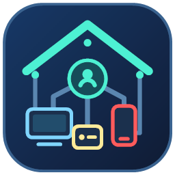
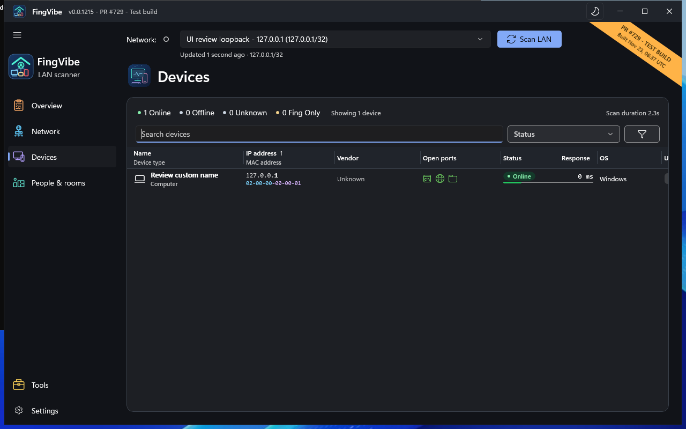

# FingVibe



**Discover your LAN. Get to know your devices.**

[](https://github.com/iricigor/fingvibe/releases/latest) [](https://github.com/iricigor/fingvibe/releases/latest) [](https://github.com/iricigor/fingvibe/releases) [](https://github.com/iricigor/fingvibe/actions/workflows/release.yml) [](src/FingVibe.App/FingVibe.App.csproj)

FingVibe is a native Windows 11 LAN scanner built with C# and WinUI 3.
Discover responding IPv4 devices, explore their services, and organize them
by person and room in a colorful desktop interface.

**[User manual](https://iricigor.github.io/fingvibe/)** - step-by-step guides,
screenshots, and troubleshooting.

## 📥 Download

**[Download the latest Windows x64 release](https://github.com/iricigor/fingvibe/releases/latest)**.
Run `FingVibe-<version>-win-x64-Setup.exe` to install for your Windows user without
administrator rights, or extract the ZIP and launch `FingVibe.App.exe` directly.
Keep all extracted files together. Downloads are unsigned, so Windows may show
unknown-publisher or SmartScreen warnings.
Official releases are self-contained; the .NET SDK is only needed to build from source.
For PR artifacts and build identification, see the [build reference](docs/reference.md#download-builds).

## 🖥️ Devices at a glance

<a href="docs/screenshots/manual/devices-readme.png"></a>

Nine invented sample devices, with **Scan LAN**, its network menu and the
network-monitor circle in the title bar. This is a native UI-review capture, not a
real LAN or real response measurements. The sample subnet differs from the safe
selected loopback target, so the notice at the bottom is intentional.
[Capture details](docs/manual/screenshots.md).

## ✨ Features

| | What you can do |
| --- | --- |
| 🔎 **Discover** | Scan the selected IPv4 LAN with ping, fresh ARP and validated mDNS/SSDP replies; browse saved initial results while background checks continue, or cancel. |
| 💻 **Identify** | Discover names through UPnP/SSDP, mDNS, reverse DNS, and NetBIOS; explore MAC vendors, evidence-backed OS/device types, and saved manual corrections. |
| 🌐 **Inspect** | View common TCP services, device details, public/local network identity, and scan-wide latency bars. |
| 👥 **Organize** | Assign people and rooms, review inferred virtual identities, explicitly link multiple MAC addresses as one device, and open the Room map. |
| **Import and retain** | Review a Fing Excel export; keep a persistent inventory with Online, Offline, Unknown, and Fing Only states. Search, filter, sort, and resize its columns. |
| **Review evidence** | Inspect Last seen, device and equipment Activity, scan observations, usage categories and read-only SQL reports. Saved evidence is not continuous presence. |
| **Watch and protect** | Opt in to scheduled scans and network health monitoring while the app is open; review new-device discoveries and local database backups. |
| 🎨 **Personalize** | Choose Light or Dark mode with three themes per mode, and Solid, Mica, Mica Alt, or Acrylic backdrops. |
| ⚡ **Measure** | Run a [manual Cloudflare speed test](docs/speed-test.md) with native results and a per-run data-use disclosure. |

### Your first scan

Select a network in the shared network picker, then choose **Scan LAN**.
**Overview** summarizes the displayed scan; **Devices** shows your persistent inventory.
Click a device to inspect its addresses, identification evidence, and services.
Hover over service icons for port numbers and names. Use search and the
**Person**, **Room**, and **Ports** filters to narrow the list.

Create entries on **People & rooms**, then assign devices from
device details. Names and notes are yours to manage; a device responding to a
scan does not establish that its assigned person is present. In **Settings**,
choose appearance options, hide columns you do not need, or opt in to
**Scheduled scans** while FingVibe is open.

Starting a scan retains the old results until the first durable checkpoint.
You can then browse initial results while background checks continue. Cancellation
or failure keeps the last committed observations as incomplete; it does not mark
unresolved devices Offline. Only a fully completed scan can do that for the same
network. Freshness describes saved evidence, not continuous monitoring; switching
networks identifies results from another target rather than silently relabeling them.

**Scanning limitations:** Ping, fresh ARP and validated service-discovery replies
from a device's own address can establish local response evidence. Silent,
sleeping, isolated or firewalled devices can still be missed. An unresolved
address gets one fresh ARP check and at most three ping attempts, with ten-second
waits before attempts two and three; confirmed addresses are not retried.
The extra checks take time and do not guarantee a device count.
Previously observed and imported devices remain in the inventory.
Identification is best-effort, open ports are not a security verdict, and
saved observations do not establish uninterrupted availability or human presence.
A **Full TCP port scan** runs only for one device after a warning each time; its
short timeout can miss sleeping or slow Wi-Fi devices.
The scanner limits a target to 65,534 usable addresses. An **Unknown** or
**(likely)** classification is intentional when evidence is absent or uncertain;
you can inspect the evidence and save a correction instead of relying on a guess.

**Privacy:** LAN discovery and identification use local probes. Vendor lookup
downloads and caches official IEEE registries. Optional public-IP/ISP lookup
contacts `ipwho.is`; configured ISP logos contact Logo.dev with the ISP name
and public source IP, not device inventory. Speed testing contacts Cloudflare;
opt-in monitoring and manual diagnostics send connectivity probes, provider
reports retrieve public status feeds, and stable builds check GitHub for updates.
See the [privacy guide](docs/manual/privacy.md), [ISP logo guide](docs/isp-logos.md),
and [speed-test disclosure](docs/manual/speed-test.md) for details.

**Local data:** Saved scans, appearance preferences, identification corrections,
and people/rooms data live under `%LOCALAPPDATA%\FingVibe`.
`device-inventory.sqlite` is authoritative; older JSON inventory files are
migration inputs, not synchronized copies. Ordinary assignments use a full MAC,
not just an IP; supported virtual and linked identities have their own shared
assignments. Load/save errors are shown rather than silently overwriting damaged
data. **Tools > Database backups** makes consistent local database copies;
see [backup, restore and data removal](docs/manual/data.md). These copies do
not protect against losing the same drive.

**Tools → [Import from Fing](docs/fing-import.md)** accepts a local `.xlsx` export, previews additions
and per-field conflicts, and preserves your customizations unless you explicitly
replace them. Create missing people/rooms on their management pages and analyze
again; import never creates entries automatically. **Fing Only** means never
observed locally, and imported IPs do not establish online presence.
See [inventory and import](docs/reference.md#inventory-and-fing-import) for status
semantics, supported exports, and storage migration.

### Tools and guides

The manual uses native screenshots with sample data or documented privacy redactions.

| Tool | Guide |
| --- | --- |
| [Import from Fing](docs/manual/import.md) | Review an Excel export and choose which changes to keep. |
| [SQL reports](docs/manual/sql.md) | Run a read-only example against saved inventory and history. |
| [Room map](docs/manual/people-rooms.md#view-the-room-map) | Open Tools > Room map to view saved rooms and assigned equipment; this is not discovered physical topology. |
| [History and Last seen](docs/manual/history.md) | Read scan evidence without inferring continuous presence. |
| [Discoveries and scheduling](docs/manual/scheduled-scans.md) | Review unfamiliar devices and opt in to background activity. |
| [Speed test](docs/manual/speed-test.md) | Measure internet download, upload, and latency with Cloudflare. |
| [Network health](docs/manual/network-checks.md) | Read monitoring verdicts, incident evidence, provider reports and manual diagnostics. |
| [Install and update](docs/manual/install.md) | Check for releases and update without discarding saved data. |
| [Version and support](docs/manual/support.md) | Find build identity and report a problem safely. |
| [Common problems](docs/manual/problems.md) | Check adapters, VPNs, firewall prompts, saved-data errors and WebView2. |

## 🚀 Run locally

Requires **Windows 11**, the **.NET 8 SDK**, and **Visual Studio 2022**
with the **Windows application development** workload (or equivalent Windows SDK build tools).

```powershell
dotnet restore FingVibe.sln
dotnet run --project src\FingVibe.App\FingVibe.App.csproj -p:Platform=x64
```

## 📚 Documentation and contributing

- **[User manual](https://iricigor.github.io/fingvibe/)** - step-by-step guides,
  screenshots, troubleshooting, privacy, and saved data in plain English.
  [Read the manual in this repository](docs/index.md).
- [Usage, identification, people/rooms, and persistence](docs/reference.md#run-locally)
- [Builds and native/core regression checks](docs/reference.md#test)
- [Contributor guide and module ownership](CONTRIBUTING.md)
- [Report a bug or request a feature](https://github.com/iricigor/fingvibe/issues/new/choose)

**Licensing:** This repository currently has no project license file. Choosing
one is an owner decision; dependency licenses do not license FingVibe itself.
