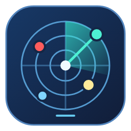
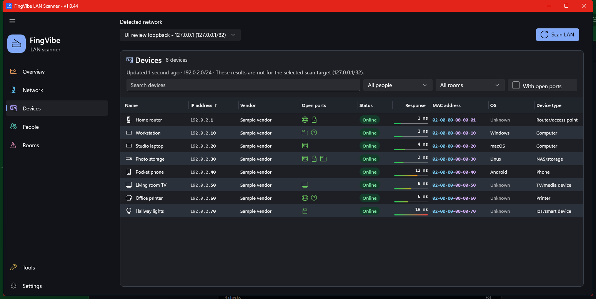

# FingVibe

**Discover your LAN. Get to know your devices.**

[](https://github.com/iricigor/fingvibe/releases/latest) [](https://github.com/iricigor/fingvibe/releases/latest) [](https://github.com/iricigor/fingvibe/actions/workflows/release.yml) [](src/FingVibe.App/FingVibe.App.csproj)

FingVibe is a native Windows 11 LAN scanner built with C# and WinUI 3.
Discover responding IPv4 devices, explore their services, and organize them
by person and room in a colorful desktop interface.

## 📥 Download

**[Download the latest Windows x64 release](https://github.com/iricigor/fingvibe/releases/latest)**,
extract the ZIP, and launch `FingVibe.App.exe`. Keep all extracted files together.
Official releases are self-contained; the .NET SDK is only needed to build from source.
For PR artifacts and build identification, see the [build reference](docs/reference.md#download-builds).

## 🖥️ Devices at a glance

<a href="docs/screenshots/devices.png"></a>

Native Devices-page capture in UI-review mode with deterministic sample data,
not a real LAN. [Capture details](docs/screenshots/README.md).

## ✨ Features

| | What you can do |
| --- | --- |
| 🔎 **Discover** | Detect IPv4 interfaces and subnets, scan with up to 256 concurrent ICMP probes, and follow progress or cancel. |
| 💻 **Identify** | Discover names through UPnP/SSDP, mDNS, reverse DNS, and NetBIOS; explore MAC vendors, evidence-backed OS/device types, and saved manual corrections. |
| 🌐 **Inspect** | View common TCP services, device details, public/local network identity, and scan-wide latency bars. |
| 👥 **Organize** | Assign people and rooms by MAC address; search, filter, sort, and resize device columns. |
| 🎨 **Personalize** | Choose four light/dark themes and Solid, Mica, Mica Alt, or Acrylic backdrops. |
| ⚡ **Measure** | Run a [manual Cloudflare speed test](docs/speed-test.md) with native results and a per-run data-use disclosure. |

### Your first scan

Select a network in the shared network picker, then choose **Scan LAN**.
**Overview** summarizes the displayed scan; **Devices** shows responding hosts.
Click a device to inspect its addresses, identification evidence, and services.
Hover over service icons for port numbers and names. Use search and the
**People**, **Rooms**, and **With open ports** filters to narrow the list.

Create people and rooms on their respective pages, then assign devices from
device details. Names and notes are yours to manage; a device responding to a
scan does not establish that its assigned person is present. In **Settings**,
choose appearance options or hide columns you do not need.

Refreshing retains the old list until a scan succeeds. Cancellation or failure
keeps the displayed results and reports the outcome. Freshness describes that
scan, not ongoing background checks; switching networks identifies results
from another target rather than silently relabeling them.

**Scanning limitations:** Only devices answering ICMP appear; firewalls or silent
devices can hide active hosts. Identification is best-effort, open ports are not
a security verdict, and scan results are not continuous monitoring or device history.
The scanner limits a target to 65,534 usable addresses. An **Unknown** or
**(likely)** classification is intentional when evidence is absent or uncertain;
you can inspect the evidence and save a correction instead of relying on a guess.

**Privacy:** LAN discovery and identification use local probes. Vendor lookup
downloads and caches official IEEE registries. Optional public-IP/ISP lookup
contacts `ipwho.is`; configured ISP logos contact Logo.dev with the ISP name
and public source IP, not device inventory. Speed testing contacts Cloudflare.
See the [reference](docs/reference.md#run-locally), [ISP logo guide](docs/isp-logos.md),
and [speed-test disclosure](docs/speed-test.md) for details.

**Local data:** Saved scans, appearance preferences, identification corrections,
and people/rooms data live under `%LOCALAPPDATA%\FingVibe`. Assignments and
corrections require a discovered MAC address, not just an IP; randomized MACs
can break those associations. Data stays separate from automatic scan evidence,
and load/save errors are shown rather than silently overwriting a damaged file.

## 🚀 Run locally

Requires **Windows 11**, the **.NET 8 SDK**, and **Visual Studio 2022**
with the **Windows application development** workload (or equivalent Windows SDK build tools).

```powershell
dotnet restore FingVibe.sln
dotnet run --project src\FingVibe.App\FingVibe.App.csproj -p:Platform=x64
```

## 📚 Documentation and contributing

- [Usage, identification, people/rooms, and persistence](docs/reference.md#run-locally)
- [Builds and native/core regression checks](docs/reference.md#test)
- [Contributor guide and module ownership](CONTRIBUTING.md)
- [Report a bug or request a feature](https://github.com/iricigor/fingvibe/issues/new/choose)
