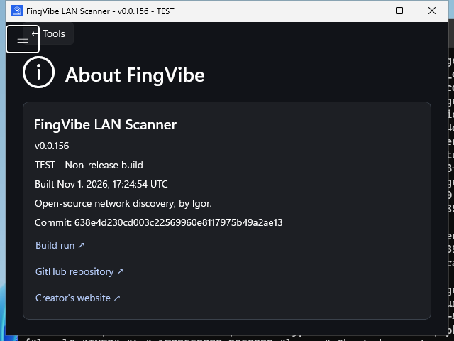

# About FingVibe

Open **Tools > About FingVibe** to identify the application you are running and
find its source. The page shows the version, build kind, build timestamp, and
commit, with links to the pull request and build run when those identifiers
are available. Repository and creator links open in your browser.

Native UI-review capture of a test build, not a released version or private LAN.
Build identifiers belong to the captured application and will differ in your
installation. [Capture provenance and reproduction](screenshots/README.md#tool-screenshots).

## When reporting a problem

Include the version and build identity from this page so the report can be
matched to the right source revision. A PR/test build is not an official
release; its diagonal test-build ribbon is intentional. Missing timestamp or
commit metadata is shown as unavailable rather than guessed.

See [Download builds](reference.md#download-builds) for release versus PR
artifacts, build timestamps, and where to obtain the Windows executable.
