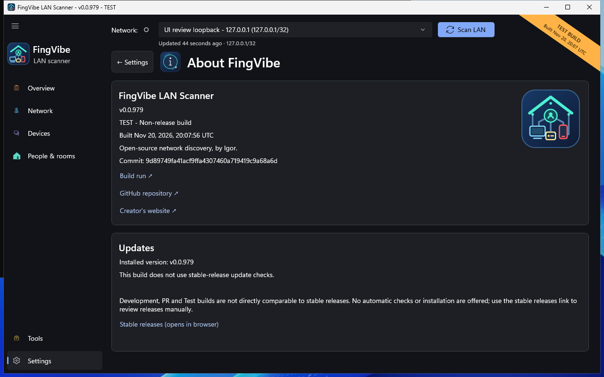

# About FingVibe

Open **Settings > About FingVibe & updates**, or the **About FingVibe** card on
Overview, to identify the application you are running and
find its source. The page shows the version, build kind, build timestamp, and
commit, with links to the pull request and build run when those identifiers
are available. Repository and creator links open in your browser. Settings stays
selected; **Back to Settings** returns focus to the About row without resetting
your preference sections. Official stable builds check for newer stable releases
automatically while open, and offer **Check for updates**. Downloads require
your action; installing a downloaded Setup requires confirmation and closes
FingVibe normally. Portable copies use manual ZIP replacement. PR, Test and
Development builds do not check for updates or compare their versions with
stable releases. See [update checks and downloads](manual/navigation.md#check-for-updates)
and [installation and updates](manual/install.md).

Current native UI-review capture with the actual Test build's Updates state.
Not an official released executable or private LAN.
Build identifiers belong to the captured application and will differ in your
installation. [Capture provenance and reproduction](manual/screenshots.md).

## When reporting a problem

Include the version and build identity from this page so the report can be
matched to the right source revision. A PR/test build is not an official
release; its diagonal test-build ribbon is intentional. Missing timestamp or
commit metadata is shown as unavailable rather than guessed.

See [Download builds](reference.md#download-builds) for release versus PR
artifacts, build timestamps, and where to obtain the Windows executable.
