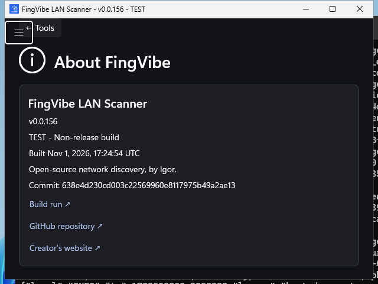

# About FingVibe

Open **Settings > About FingVibe & updates**, or the **About FingVibe** card on
Overview, to identify the application you are running and
find its source. The page shows the version, build kind, build timestamp, and
commit, with links to the pull request and build run when those identifiers
are available. Repository and creator links open in your browser. Settings stays
selected; **Back to Settings** returns focus to the About row without resetting
your preference sections. No update checks or download actions are included.

Historical native UI-review capture of a test build before About moved from
Tools to Settings; the identity content is unchanged. Not a released version or private LAN.
Build identifiers belong to the captured application and will differ in your
installation. [Capture provenance and reproduction](screenshots/README.md#tool-screenshots).

## When reporting a problem

Include the version and build identity from this page so the report can be
matched to the right source revision. A PR/test build is not an official
release; its diagonal test-build ribbon is intentional. Missing timestamp or
commit metadata is shown as unavailable rather than guessed.

See [Download builds](reference.md#download-builds) for release versus PR
artifacts, build timestamps, and where to obtain the Windows executable.
