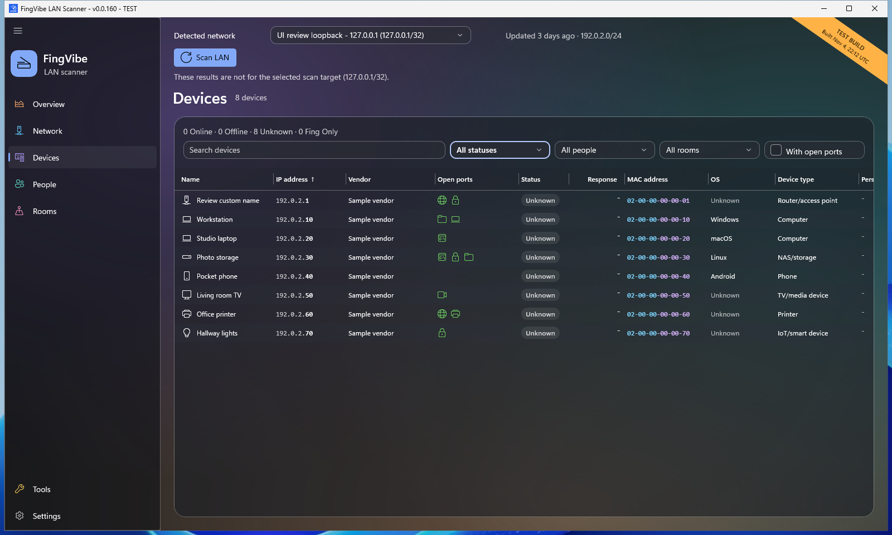
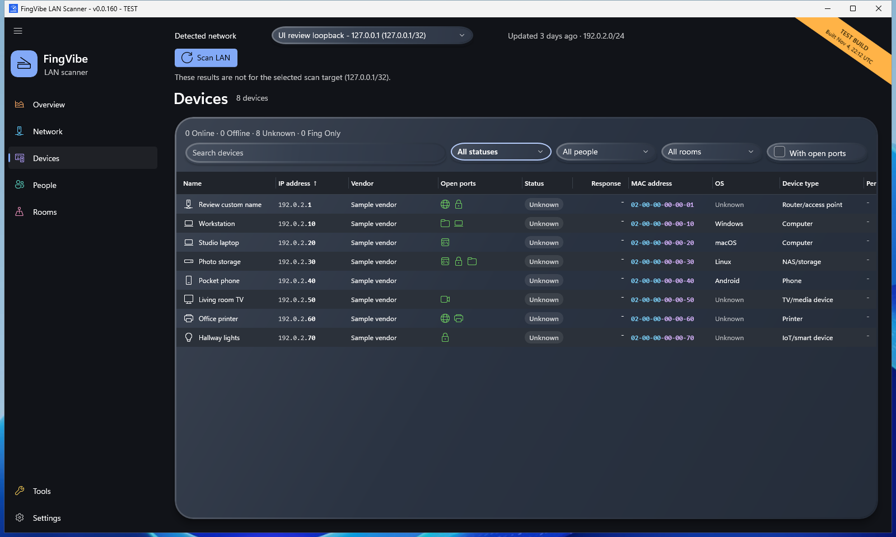
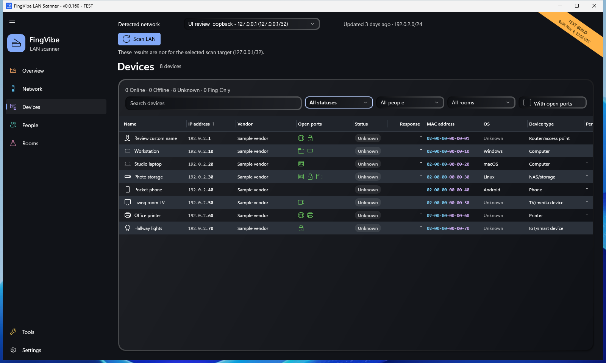

# Experimental appearance archive

This prototype explores independent appearance settings with Glass, Clay, and
Neumorphic surfaces. **Experimental, not merged:** this archive preserves
[PR #143](https://github.com/iricigor/fingvibe/pull/143), not a shipped feature.
The original branch and PR are retained unchanged by this archive.

**Source:** [revision-named ZIP](fingvibe-source-deae2a19c2cc8218183f08b777347215b7fa31e6.zip)
at `deae2a19c2cc8218183f08b777347215b7fa31e6`.
[SHA-256 and provenance](evidence/source-manifest.json):
`fcd5df9c7fe7b6b2fd3fca7e53dface25fea9338368e55d6f29b18488d2848b2`.

Dark Devices previews use **Standard** colors throughout. Glass requests
**Mica Alt**; Clay and Neumorphic use **Solid**. Native materials remain subject
to Windows support and transparency settings; see the recorded evidence.

| Glass | Clay | Neumorphic |
| --- | --- | --- |
|  |  |  |

[Implementation, extraction, validation, and limitations](IMPLEMENTATION.md)
| [Complete 25-image comparison gallery](gallery/README.md)

The later uniform-base / stronger paired-shadow / debossed-input Neumorphic
refinement is **not implemented** in this source.
