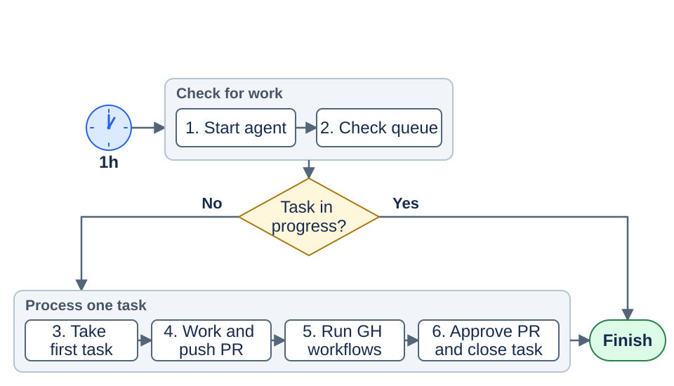
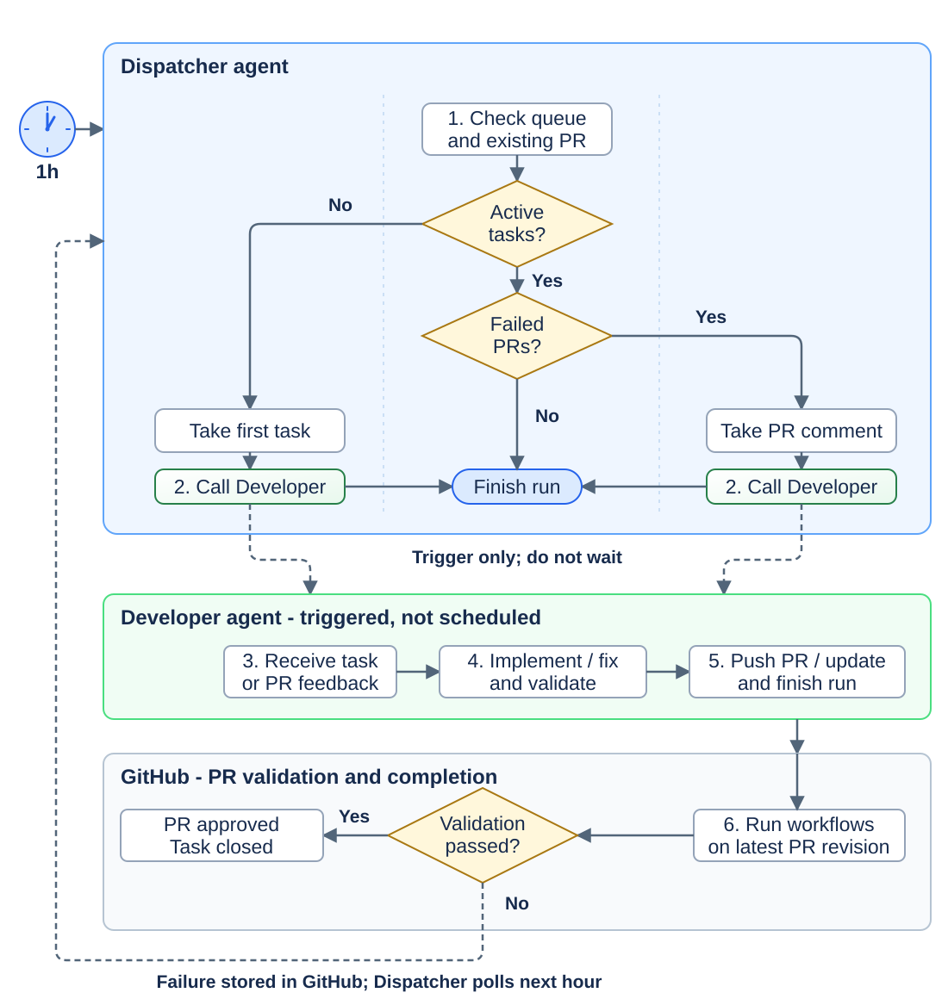
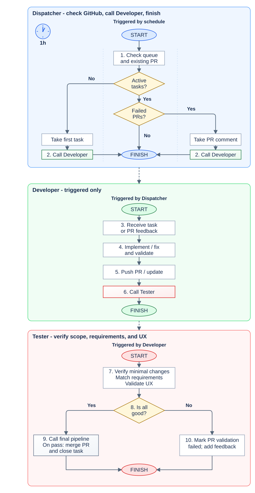
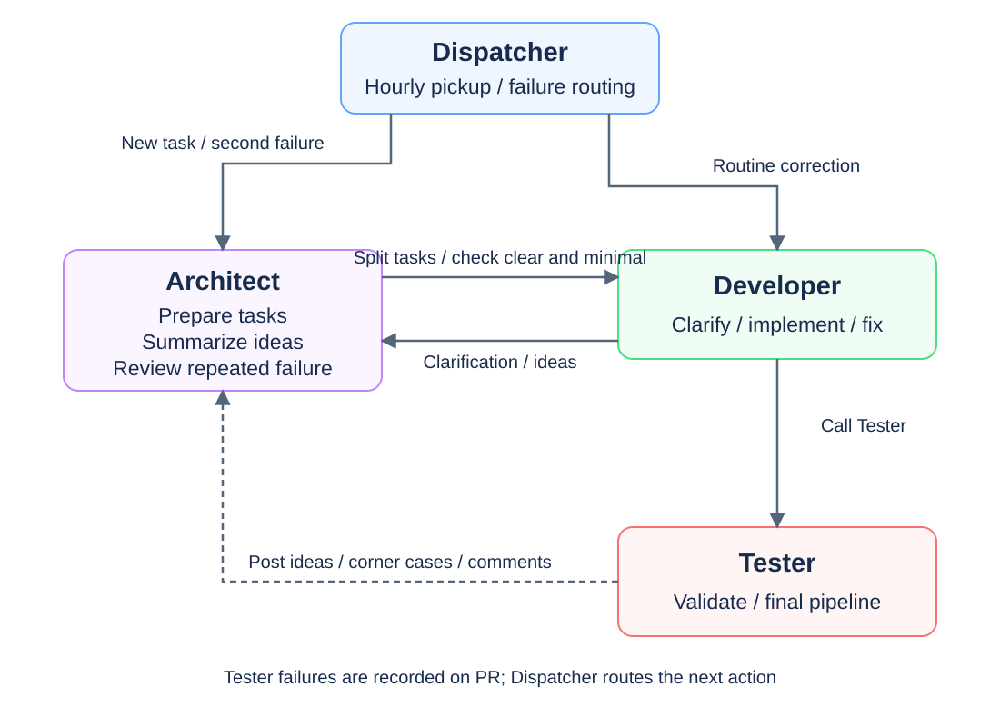
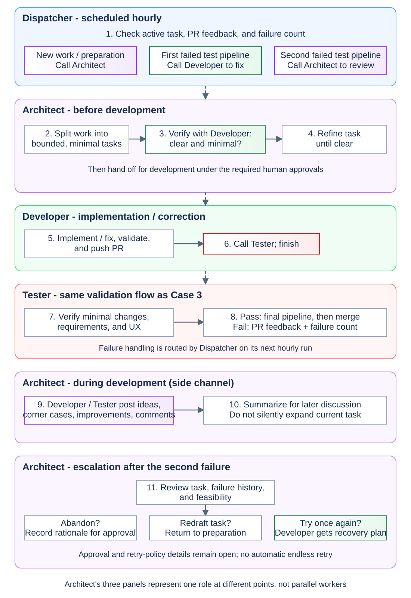

# Autonomous agentic loop - discussion draft

We are comparing simple agent workflows to decide how to automate task pickup,
development, validation, and PR feedback.

Published discussion record for [#216](https://github.com/iricigor/fingvibe/issues/216),
under [Epic #92](https://github.com/iricigor/fingvibe/issues/92). Complete the
remaining Architect discussion in [#217](https://github.com/iricigor/fingvibe/issues/217).

**Status:** These diagrams are design sketches, not implemented automation or
approved execution policy. The [development backlog contract](development-backlog.md)
remains authoritative for approval, ownership, one-task-in-flight reconciliation,
recovery, and merge/activation gates. A simplified diagram omitting a gate does
not remove it. The selected Architect profile still requires separate
implementation authorization and conflict assessment.

## Contents

- [Prerequisites](#prerequisites)
- [Case 1 - Single agent](#case-1---single-agent)
- [Case 2 - Dispatcher and Developer](#case-2---dispatcher-and-developer)
- [Case 3 - Dispatcher, Developer, and Tester](#case-3---dispatcher-developer-and-tester)
- [Case 4 - Adding Architect](#case-4---adding-architect)

## Prerequisites

- Design target: all agents run on the local PC inside GitHub Copilot desktop
  app automations; all code is stored in GitHub.
- Agent-to-agent calls and run-state visibility still need verification in that
  environment. The arrows describe desired handoffs, not established API support.

## Case 1 - Single agent

1. **Start hourly.** A scheduled trigger starts the agent every hour.
   The diagram shows one run, from the circle left of step 1 to Finish at the lower right,
   with both groups arranged as left-to-right rows;
   the schedule starts the next run without a return arrow.
2. **Check the queue.** Decide whether any task is already in progress. If yes, finish this run
   without taking another task. Wait for the next hourly trigger.
3. **Take the first task.** When no task is in progress, pick the first task
   from the queue.
4. **Do the work.** Implement the task and push a pull request.
5. **Run workflows.** The PR triggers the GitHub workflows. The task remains
   in progress while they run.
6. **Complete the cycle.** Once all workflows are done, the PR is approved
   and the task is closed. The next hourly run can take another task.

This is a discussion draft of the simplest successful path, not an implemented
automation or a change to repository policy. Failure handling, approval actors,
and merge behavior are intentionally left for later discussion.

## Case 2 - Dispatcher and Developer

A scheduled Dispatcher checks GitHub and triggers a Developer for either a new
task or a correction to the existing PR, then finishes without waiting.

### Dispatcher

1. **Check GitHub every hour.** Are there active tasks?
   If no, take the first task. If yes, check for failed PRs:
   take the failed PR's comment, or finish if none failed.
2. **Call Developer** with the task or PR comment, then finish without waiting.

### Developer

3. **Receive the task or PR comment.** Developer runs only when called,
   never on a schedule.
4. **Implement or fix, then validate.**
5. **Push the PR or update the same PR, then finish.**

### GitHub validation

6. **Run workflows on the latest PR revision.** If validation passes, approve
   the PR and close the task. If it fails, Dispatcher picks up the PR comment
   on its next hourly run and calls Developer to fix it.

The task stays active through development, validation, and corrections;
finishing an agent run does not finish the task.

**Colors:** Blue = Dispatcher, green = Developer, gray = GitHub.
Dashed arrows show calls and feedback polling, not direct GitHub triggers.

**Still to decide:** How the desktop app calls Developer, how failed checks
produce a PR comment, retry limits, and who approves/merges the PR. Corrections
must stay on the same task and PR, avoid concurrent workers and duplicate or
stale feedback, and escalate persistent failures or scope changes to a human.
This is a discussion draft, not implemented automation or activation approval.

## Case 3 - Dispatcher, Developer, and Tester

Dispatcher calls Developer, Developer calls Tester and finishes, and failed
tests return to Developer through Dispatcher.

### Dispatcher

1. **Check GitHub every hour:** active task, PR workflows, and Tester result.
2. **Call Developer, then finish without waiting:**
   - No active task: take the first task and call Developer.
   - Active task with failed workflows or Tester feedback: call Developer
     with the PR feedback.
   - Otherwise: finish.

### Developer

3. **Receive the task or PR feedback.**
4. **Implement or fix, then validate.**
5. **Push the PR or update.**
6. **Call Tester, then finish without waiting.**
   Developer does not wait for workflows or Tester to finish.

### Tester

7. **Verify the PR:** changes are minimal and within scope, meet the
   requirements, and pass UX validation.
8. **Is all good?**
9. **Yes:** call the final pipeline. If it passes for the reviewed revision,
   merge the PR and close the task.
10. **No:** mark PR validation failed and add actionable PR feedback.

Both branches end at **Finish run**. There is no transition from step 9 to
step 10; final-pipeline failure handling is left out of this diagram.

If tests fail, Dispatcher reads the feedback on its next hourly run and calls
Developer for the same task and PR. Developer fixes it and calls Tester again.

### Completion

The task stays active until the final pipeline passes and the PR is merged.
Corrections go to the same PR and receive a fresh Tester review.

**Colors:** Blue = Dispatcher, green = Developer, red = Tester,
gray = GitHub. All three agents run locally; only Dispatcher is scheduled.
Call boxes use a gradient in the destination's color: green for Developer,
red for Tester, and gray for the final GitHub pipeline.
Dashed arrows connect agent containers; call-box colors identify the handoff steps.
Shapes: ellipses = start/end, diamonds = decisions, rectangles = processing,
and shaded rectangles = calls to other agents or pipelines.

**Still to decide:** The UX rubric, final pipeline contents, trusted validation
status and merge permissions, feedback reporting, the supported agent-call
mechanism, duplicate-run prevention, and retry limits.
This draft does not authorize native UI automation on the user's desktop;
isolated local UI testing remains deferred (DI-002).
Tester can use GitHub Actions UX evidence for the current revision. This is a
proposed merge policy, not implementation or activation approval.

## Case 4 - Adding Architect

Architect prepares tasks with Developer, summarizes ideas during the work,
and reviews what to do after a second Tester pipeline failure.

### Agent overview

### Draft steps

### Dispatcher

1. **Check GitHub hourly.** Send new work to Architect for preparation.
   After the first Tester pipeline failure, call Developer with PR feedback.
   After the second failure, call Architect for escalation instead.
   Otherwise finish. Every handoff ends the Dispatcher run without waiting.

### Architect - before development

2. **Split work into bounded tasks.** Keep each task minimal and focused.
3. **Verify with Developer:** is the task clear, and is the proposed change
   minimal? This is clarification, not the start of implementation.
4. **Refine until clear**, then hand off for development under the required
   human approvals. Splitting or clarification does not grant readiness.

### Developer

5. **Implement or fix, validate, and push the PR.**
6. **Call Tester directly, then finish without waiting.** Architect is not
   a mandatory implementation-review gate.

### Tester

7. **Verify minimal changes, requirements, and UX**, as in Case 3.
8. **Pass:** call the final pipeline, then merge and close only after it passes
   for the reviewed revision. **Fail:** mark PR validation failed with feedback
   and record the failure so Dispatcher can route the next action.

### Architect - during development

9. **Developer or Tester can post additional ideas:** corner cases,
   improvements, and comments.
10. **Architect summarizes them** for later discussion. Posting an idea is a
    side channel, not an automatic stop, implementation request, or scope change.
    A current-task blocker still needs explicit feedback and resolution.

### Architect - escalation

11. **After the second Tester pipeline failure, review the task and failures:**
    consider abandoning the task, redrafting it, or trying once again with a
    focused recovery plan. Do not send it straight into another routine retry.

Abandonment and material redrafting remain proposals for human approval under
the existing contract. A further attempt must stay within authorized scope and
the agreed retry policy; review is not permission to retry indefinitely.

**Colors:** Blue = Dispatcher, purple = Architect, green = Developer,
red = Tester. Call boxes use the destination's light gradient.

**Still to decide:** What counts as a Tester pipeline failure (including
infrastructure failures), whether the count resets after redrafting, where
ideas and summaries live, who approves the escalation outcome, and what happens
if the extra attempt fails. The supported desktop handoff mechanism also needs
verification. Architect's three panels show one role at different points, not
concurrent workers. Existing approval gates and the deferred local-UI-testing
constraint remain unchanged. This draft implements or activates no automation.

### Tester UI/UX discussion to complete

Tester should examine UI organization and user expectations, and whether UX
supports the intended journey or could reduce unnecessary steps. Review needs
a target user, an agreed workflow, and current-revision rendered evidence;
an agent's preference alone is not evidence of a defect.

The proposed distinction is **blocking findings** for unmet requirements,
regressions, or violations of agreed UI/UX standards, versus **non-blocking
improvement suggestions** sent to Architect for summarization. This distinction
was discussed but not yet confirmed. Task #217 must settle it alongside the
Architect flows; publication does not approve it or expand current task scope.
