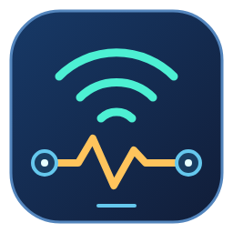

# README logo proposals

Three original FingVibe brand-mark proposals are available for selection in
[PR #112](https://github.com/iricigor/fingvibe/pull/112). They do not replace the
application's `Scanner.ico` or set a browser favicon.

| 1. Network radar | 2. Connected devices | 3. Signal pulse |
| --- | --- | --- |
|  |  |  |
| Emphasizes discovery. | Emphasizes the device inventory. | Emphasizes responsiveness and Vibe. |

Each proposal has a self-contained SVG master and a transparent **256x256 PNG**.
The dark blue tile gives the colorful details consistent contrast on both
GitHub light and dark backgrounds; the area outside the rounded tile is
transparent. No fonts, external images, scripts, or remote resources are used.

The README's final mark will display at **128x128**, right-aligned near its
title, after the user explicitly selects an option. Until then, no proposal is
silently treated as the selected logo.

To regenerate a PNG, render its SVG at 256x256 with a transparent background
using an SVG-capable renderer. Do not change the SVG's viewBox or stretch the
aspect ratio. Check the exported size, transparent corners, and 128px rendering
on both light and dark backgrounds before replacing the PNG.
