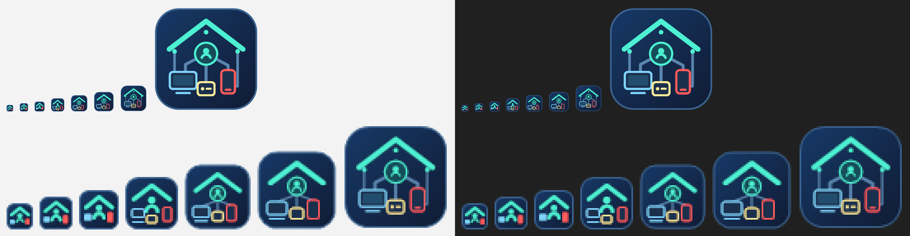

# Application icon: Connected home

FingVibe's application icon is the **Connected home** design: a home-shaped
local network that connects a person and their devices. @iricigor selected it
from the [page and tool icon concepts](../icon-concepts/README.md) (Rooms,
`rooms-color.svg`) on 2026-11-13 for
[task #348](https://github.com/iricigor/fingvibe/issues/348). On 2026-11-16 the
user also asked to use it as the README logo, the navigation pane's brand tile
(top left of the app) and a large icon at the top right of the About page. The
documentation site logo, navigation and page icons and the other concept icons
are unchanged.



## Masters and frames

Each frame size is drawn from the vector master tuned for it, so small icons
use simplified, pixel-aligned geometry instead of a downsampled 256 px image.

| Master | Frames | Detail |
| --- | --- | --- |
| [connected-home.svg](connected-home.svg) | 64, 256 px | Roof, walls, person hub, connection lines, laptop, phone and hub device |
| [connected-home-48.svg](connected-home-48.svg) | 40, 48 px | Roof, person hub, three short links and three devices; walls omitted |
| [connected-home-32.svg](connected-home-32.svg) | 32 px | Roof, person and three outlined devices; no connection lines |
| [connected-home-24.svg](connected-home-24.svg) | 20, 24 px | Roof, person and two solid device accents |
| [connected-home-16.svg](connected-home-16.svg) | 16 px | Roof, person and two solid device accents on a 16 px grid |

All masters keep the navy gradient tile, a lighter tile edge for contrast on
dark taskbars, teal roof and person, and the light blue, red and yellow device
colors. Compared with the concept, the full master enlarges the tile to reduce
empty padding, drops the faint decorative arc and uses heavier strokes.

## Regenerating the icon

Edit the SVG masters, then run:

```powershell
.\tools\New-ApplicationIcon.ps1
```

The script renders each master with Windows System.Drawing and writes
`src\FingVibe.App\Assets\Scanner.ico` with distinct 32-bit alpha frames at 16,
20, 24, 32, 40, 48, 64 and 256 px (PNG-compressed at 256 px, uncompressed
bitmaps below). It also refreshes `connected-home-preview.png` and these PNG
exports:

| Export | Master and size | Used by |
| --- | --- | --- |
| `src\FingVibe.App\Assets\ConnectedHome-48.png` | 48 px master at 96 px | Navigation pane brand tile (48 DIP, sharp at 100% and 200% scaling) |
| `src\FingVibe.App\Assets\ConnectedHome.png` | Full master at 256 px | About page icon (128 DIP) |
| `connected-home.png` | Full master at 256 px | README logo (shown at 128 px) |

The masters use
a deliberately small SVG subset: rectangles, circles, polylines, single
circular arc paths and one linear gradient, without transforms or groups. The
script rejects anything else.

Review the preview at actual size on both backgrounds before committing:
strokes must stay continuous, essential shapes visible, and corners transparent.
`tests\ApplicationIcon.Tests.ps1` checks the frame sizes and 32-bit format,
transparent corners, partial alpha, limited padding and distinct frames. It
also checks that the deployed `Assets\Scanner.ico` and the frames embedded in
`FingVibe.App.exe` match the source icon.

The same file supplies the executable's embedded icon (File Explorer, Start
menu and installed shortcuts), the running window and taskbar icon, the
discovery notification image and the installer's setup icon. Windows may keep
showing a previous icon from its icon cache after an update; that does not
indicate a shipped asset defect, and FingVibe does not clear the cache.
