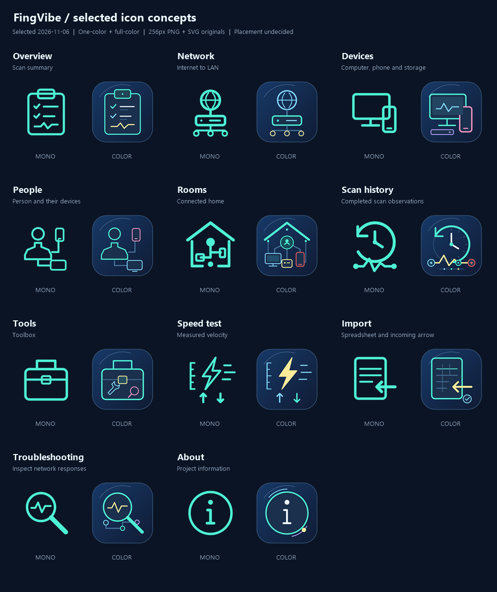

# Selected page and tool icon concepts

This is the design record selected by @iricigor on **2026-11-06**, preserved
through [task #182](https://github.com/iricigor/fingvibe/issues/182) under
[Epic #164](https://github.com/iricigor/fingvibe/issues/164).

**Concept selection is not adoption.** Where to use these icons is deliberately
undecided: documentation, README, inside the application, some combination, or
another surface. [Task #183](https://github.com/iricigor/fingvibe/issues/183)
holds that discussion for later; no placement, rollout, or implementation is
approved by this record. The current README logo, application icon, navigation,
and runtime assets remain unchanged. No project rename was selected.

## Selected family

[Open the full comparison PNG](comparison.png). The sheet shows reduced
previews; every individual PNG is **256 x 256 pixels**.

The subjects below describe design intent, not commitments about where icons
will appear. In particular, **Scan history** does not establish a new
navigation page. People represents device assignment, not inferred presence;
history represents scan observations, not continuous monitoring.

| Subject | Selected direction | Single color: PNG / SVG | Full color: PNG / SVG |
| --- | --- | --- | --- |
| Overview | **Scan summary**: clipboard with results and a response trace | [PNG](overview-mono.png) / [SVG](overview-mono.svg) | [PNG](overview-color.png) / [SVG](overview-color.svg) |
| Network | **Internet to LAN**: globe, gateway, and local endpoints; no horn-like antennas | [PNG](network-mono.png) / [SVG](network-mono.svg) | [PNG](network-color.png) / [SVG](network-color.svg) |
| Devices | Computer, phone, and storage | [PNG](devices-mono.png) / [SVG](devices-mono.svg) | [PNG](devices-color.png) / [SVG](devices-color.svg) |
| People | **Person and their devices**: distinct head, neck, and shoulders linked to a phone and screen | [PNG](people-mono.png) / [SVG](people-mono.svg) | [PNG](people-color.png) / [SVG](people-color.svg) |
| Rooms | **Connected home**: home outline around people/device connections | [PNG](rooms-mono.png) / [SVG](rooms-mono.svg) | [PNG](rooms-color.png) / [SVG](rooms-color.svg) |
| Scan history | Clock and linked observation/response motif | [PNG](scan-history-mono.png) / [SVG](scan-history-mono.svg) | [PNG](scan-history-color.png) / [SVG](scan-history-color.svg) |
| Tools | Toolbox with inspection instruments in the detailed version | [PNG](tools-mono.png) / [SVG](tools-mono.svg) | [PNG](tools-color.png) / [SVG](tools-color.svg) |
| Speed test | **Measured velocity**: lightning bolt, measurement ticks, motion streaks, and up/down arrows | [PNG](speed-test-mono.png) / [SVG](speed-test-mono.svg) | [PNG](speed-test-color.png) / [SVG](speed-test-color.svg) |
| Import | Spreadsheet with an incoming arrow | [PNG](import-mono.png) / [SVG](import-mono.svg) | [PNG](import-color.png) / [SVG](import-color.svg) |
| Troubleshooting | Magnifying glass inspecting a network response | [PNG](troubleshooting-mono.png) / [SVG](troubleshooting-mono.svg) | [PNG](troubleshooting-color.png) / [SVG](troubleshooting-color.svg) |
| About | Information mark with circular accents | [PNG](about-mono.png) / [SVG](about-mono.svg) | [PNG](about-color.png) / [SVG](about-color.svg) |

## Visual language and assets

- **Single color, less detail:** teal `#4DF0D3` artwork on a transparent
  background, with fewer details and heavier strokes.
- **Full color, full detail:** rounded navy gradient tiles with teal, light
  blue, yellow, and occasional pink/purple/red accents; transparent corners
  outside the tile.
- Rounded caps and joins, simple geometric outlines, and related connection
  motifs tie the family together.

Each subject has two self-contained SVG masters with `width="256"`,
`height="256"`, and `viewBox="0 0 256 256"`, plus corresponding transparent
256px PNG exports: **22 SVGs and 22 individual PNGs**, with one additional
comparison PNG. The SVG artwork uses no fonts, external images, scripts, or
remote resources. Comparison labels are rasterized and are not part of the
individual icons.

The preserved files are the selected original concept outputs, not redesigned
production assets. They were drawn as vector geometry and exported by a
Windows System.Drawing renderer at 4x resolution, then downsampled to 256px;
monochrome exports retain only the teal RGB color, with alpha for edge
antialiasing. Equivalent SVG rendering may differ slightly at antialiased
edges. The SVGs are the editable masters: to regenerate a PNG, render its SVG
at 256px on a transparent background without stretching the viewBox.

Before any later adoption, agree the actual surfaces, variants, sizing,
theme/high-contrast behavior, and accessibility requirements. Legibility at
small navigation sizes is not established by these 256px concepts.

## Selection history

The original Concepts round introduced Discovery radar, Connected home, and
Scan history. Connected home and Scan history were retained; Discovery radar
was not selected for this family.

The first page/tool round supplied the retained Devices, Tools, Import,
Troubleshooting, and About designs. Subsequent alternatives supplied Internet
to LAN for Network, Person and their devices for People, and Measured velocity
for Speed test. The final Overview round supplied the selected Scan summary.
Earlier dashboard, eye, summary-ring, and folded-map Overview proposals were
not selected. Unselected alternatives are not included in this collection.

This record is separate from the
[existing README branding decision](../README.md), which remains in effect.
