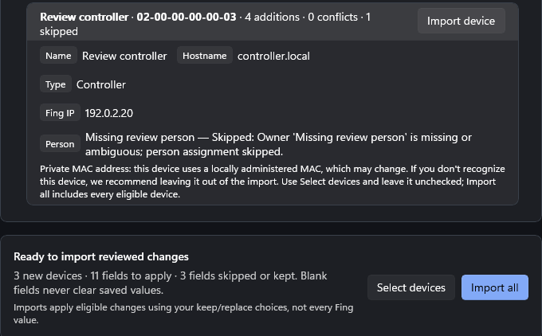

# Import from Fing

Open **Tools > Import from Fing** to bring device names, details, and assignments
from a local Fing Excel export into FingVibe. Review the proposed changes before
importing; analysis alone does not modify your inventory.

Native UI-review capture of reviewed changes from the built-in synthetic export,
not a real workbook or private inventory, cropped to the review cards to exclude
the test-build ribbon. The three sample devices and proposed
changes are illustrative. This scrolled view shows a skipped person assignment
and the final import controls; file selection and analysis are above it.
[Capture provenance and reproduction](screenshots/README.md#tool-screenshots).

## Review and import

1. Expand **How to export your devices from Fing** for export help. Use a Fing
   `.xlsx` workbook with a Devices sheet and MAC header, not CSV, PDF, or an
   arbitrary spreadsheet. Fing's export menus and availability vary by version
   and subscription.
2. Choose **Browse** or drag the workbook onto the file area. A different file
   clears the previous analysis. Review the **Analysis** groups for skipped
   records, classification warnings, and people/room references. A green
   filename chip means analysis succeeded, not that every field is approved.
3. If people or rooms are missing or ambiguous, open their management pages,
   create or correct the entries, then return and choose **Analyze again**.
   Import never creates people or rooms automatically.
4. Review **Changes and conflicts** by device/MAC. Existing customizations are
   kept by default; choose **Replace** only for individual fields you intend to
   overwrite. Empty imported fields do not erase saved values. Use **Select
   devices** to omit unrecognized entries, or **Import all** for all eligible
   devices, then import the reviewed changes.

## Identity and presence

Devices are matched by a valid six-byte MAC address, not IP. Invalid MACs and
all duplicate-MAC rows are skipped with explicit warnings. Locally administered
or randomized MACs remain importable, but can make long-term identity uncertain.
Owner and Location require one trimmed, case-insensitive full-name match to a
managed person or room.

**Fing Only** means the MAC has never been observed in a local FingVibe scan.
An exported IP is historical context, not proof that a device is online or
permission to probe it. Import does not migrate Fing events/timestamps or infer
who is present. Import errors are reported rather than silently discarded.

See the existing [inventory and Fing import reference](reference.md#inventory-and-fing-import)
for supported columns, file/row limits, conflict and classification precedence,
Online/Offline semantics, and storage migration.
