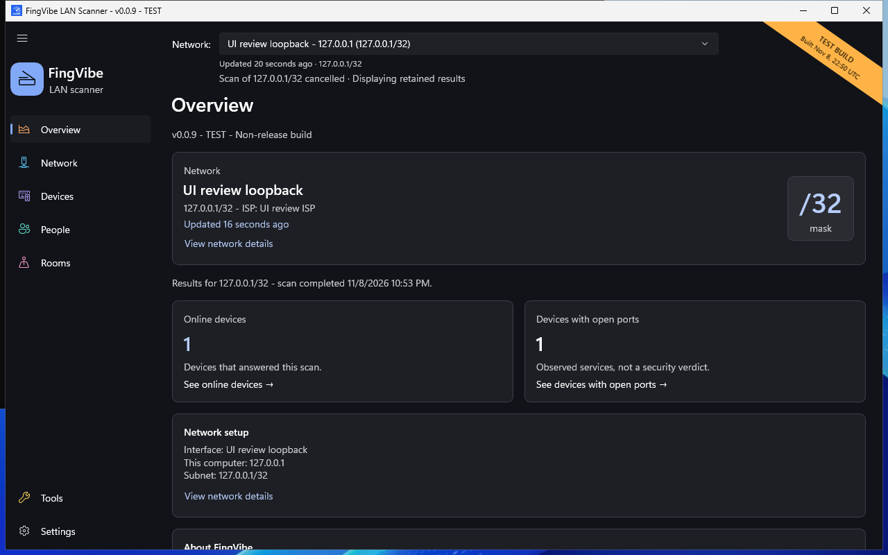

# FingVibe user manual

**Discover your local network. Understand and organize your devices.**

FingVibe is a Windows 11 application. It scans your local network, shows devices
that respond, and helps you organize them by person and room.

You do not need programming knowledge to use this manual.
Start with [Install and update](manual/install.md), then follow
[Your first scan](manual/first-scan.md).

| What would you like to do? | Start here |
| --- | --- |
| :material-download: Get FingVibe | [Install, update, or remove the app](manual/install.md) |
| :material-radar: Find devices | [Run your first scan](manual/first-scan.md) |
| :material-devices: Understand a result | [Device status, filters, and icons](manual/devices.md) |
| :material-account-group: Organize equipment | [People and rooms](manual/people-rooms.md) |
| :material-tools: Check a connection | [Network troubleshooting](manual/network-checks.md) |
| :material-shield-lock: Understand privacy | [Network requests and local data](manual/privacy.md) |

*Native Windows screenshot with safe test data. It shows a test build, not a
real home network. [Screenshot sources](manual/screenshots.md).*

## What this manual describes

This initial manual was checked against release **v1.1.107** on **2026-11-09**.
It describes available behavior, not planned features.
Your version is shown in **Tools > About FingVibe**.

**Activity grids and the Completed Scan Observations table are temporarily
unavailable in this version.** First/last-seen summaries, saved scan evidence,
and usage categories remain available. See [History](manual/history.md).

Select a screenshot to open it at full size. Screenshots may show a different
test-build number. Their application source
matches this release; sample values and test-only messages are not instructions.

!!! warning "A scan is a sample, not continuous monitoring"
    Online means a device responded in its latest applicable scan evidence. Offline does not
    prove a device is turned off. An assigned device does not prove its owner
    is present. Only scan networks you own or have permission to inspect.

## Find help

Use the search box to find a term or task. On a small screen, open the menu,
choose a section, then choose a chapter. [Common problems](manual/problems.md) gives practical
checks before you report a bug.

Downloads, source code, and issue reports are available in the
[FingVibe repository](https://github.com/iricigor/fingvibe).
