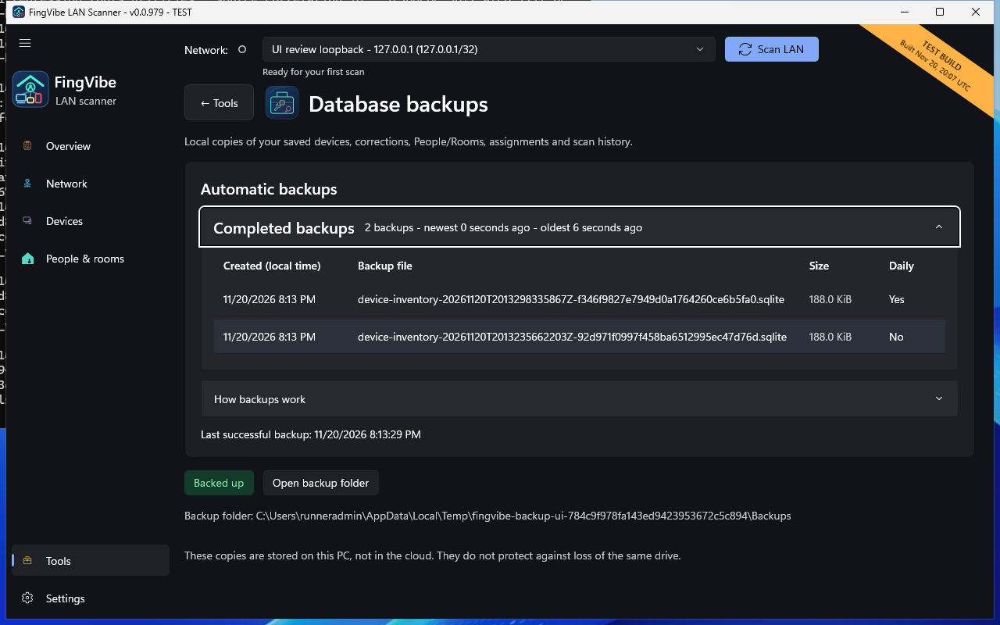

# Saved data and backups

FingVibe saves data under:

```text
%LOCALAPPDATA%\FingVibe
```

Press **Win+R**, enter that path, and press **Enter** to open the folder.
It is different from the installer folder under
`%LOCALAPPDATA%\Programs\FingVibe`.

## Important files

| File | Purpose |
| --- | --- |
| `device-inventory.sqlite` | Authoritative inventory, names, identification corrections, passively reported names/device IDs with last-received times, people/rooms, assignments, virtual identities, history, discovery baselines, declined possible-match MAC pairs, each device's latest mDNS/SSDP service-discovery evidence, and network health incidents with their observation gaps, recovery progress and saved deeper-diagnostic evidence (resolved incidents kept 90 days, at most 1,000). |
| `latest-scan.json` | Separate saved-scan cache, including service-discovery evidence and MAC-less responders for that scan. SQLite checkpoints are authoritative when present. |
| `appearance.json` | Appearance choices. |
| `device-table.json` | Column choices, widths, row density, previews, and Status filtering. |
| `navigation.json` | Wide-window navigation width/collapse preferences. |
| `periodic-scan.json` | Scheduled-scan choice and interval. |
| `network-monitor.json` | Opt-in background network-monitoring choice. |
| `router-wan.json` | Optional WAN values by Windows network profile. |

The folder can also contain cached vendor registries and older migration inputs.
Do not edit the SQLite database or remove individual records with another tool
as a normal way to change app data. Use FingVibe's own editors.

## Make a backup

**Tools > Database backups** keeps the newest seven successful copies plus the
newest copy from each of the seven most recent local dates with backups, in
`%LOCALAPPDATA%\FingVibe\Backups`. Overlapping copies count once. Daily copies
survive inactivity; seven newer backup days replace them, not seven calendar
days. It includes
saved devices, corrections, People/Rooms, assignments, history and the latest
committed scan checkpoint, but not preferences or caches.

Automatic backups start no earlier than 15 seconds after successful startup
loading/migration or a successfully saved complete scan (manual or scheduled).
Repeated events reset the pending delay; events during a backup request at most
one follow-up. **Back up now** bypasses the delay using the same serialized
mechanism. Leaving the page does not stop work. Closing the app cancels pending
work and requests cancellation without forcing a final backup. After a successful
manual backup, the button shows **Backed up** in muted green and stays disabled
for one minute from completion. Failed manual attempts show **Backup failed**
in muted red for the same one-minute interval, with actionable error details
remaining inline. The button then returns to normal for another attempt.
This session-only cooldown
survives navigation but does not delay automatic backups.

The button shows pending/running/outcome states; there is no separate idle-status
line. Inside **Automatic backups**, the page leads with the last successful copy
as a relative age (for example **Last successful backup: 48 minutes ago**; point
at it for the exact local time), then **Back up now** and **Open backup folder**,
then an initially collapsed **Completed backups** section with total count and
the relative ages of its newest/oldest copies, refreshed while visible.
The summary shares the heading row on wide windows and stacks on narrow windows.
Expand it to see striped rows newest first, with local creation times, a
calendar marker in the **Daily** column for each retained daily representative
(its tooltip and screen-reader text say **Daily recovery point**), right-aligned
sizes and the file name last. A row without the marker is a recent backup only;
the marker shows retention, not proof of a strict daily schedule.
**How backups work** starts collapsed and lists the policy as four labeled
lines: recent copies, daily copies, automatic backups and failure protection.
**Open backup folder** opens the local location. **How to restore a backup**
opens the [restore steps](#restore-a-database-backups-copy) below in your
browser. With no database yet, the app
waits for the first successfully saved scan instead of creating an empty one.
Failures are shown inline and in the app status; retry with **Back up now** or
the next normal trigger. If pruning fails, the new copy is kept and extra copies
remain until a later successful backup can prune them.

Copies use SQLite's consistent backup API, validation and safe publication,
not a live file copy. Backup duration and foreground-save contention depend on
database size and storage; 15 seconds is a delay, not a completion deadline.
These are local copies on the same PC, not cloud or drive-loss protection.
There is no restore, delete, folder-selection or retention-setting UI.

[](../screenshots/manual/database-backups.png)

*The database and backup folder are isolated runner fixtures. The displayed
temporary path is not your normal data folder. [Screenshot sources](screenshots.md).*

To preserve preferences too, make a manual whole-folder copy:

1. Close **all** FingVibe instances.
2. Wait until the app has finished closing.
3. Open `%LOCALAPPDATA%\FingVibe`.
4. Copy the **whole folder** to a separate, dated backup location.
5. Keep the copy private.

Copying the whole folder preserves database sidecar files if any remain, as well
as preferences. Do not copy only an open database while the app is saving.
The SQL editor's report output is not a complete backup.

History is retained without automatic age/count trimming.
The database and backups can grow over time.

## Restore a backup

There is no restore button. Keep the original backup unchanged and close all
instances before replacing any saved data.

### Restore a whole-folder copy

1. Close all FingVibe instances.
2. Make a separate copy of the current data folder first.
3. Move the current folder aside rather than merging files into it.
4. Restore the complete backup as `%LOCALAPPDATA%\FingVibe`.
5. Start a compatible current FingVibe release.
6. Check saved names, assignments, and preferences.
7. Run a new scan when you need current presence evidence.

Restoration replaces the saved state with the backup's state.
It does not merge later edits into an older copy.
Historical results are not live Online evidence.
If the restored database cannot be loaded, stop and keep both copies for diagnosis.

### Restore a Database backups copy

The automatic and **Back up now** copies contain the database only, not a
whole data folder.

1. Close all FingVibe instances and wait for them to finish closing.
2. Copy the current whole data folder to a separate safe location.
3. Copy the chosen `device-inventory-...sqlite` backup outside that folder.
4. Move `%LOCALAPPDATA%\FingVibe` aside; keep it intact for recovery.
5. Create a new `%LOCALAPPDATA%\FingVibe` folder.
6. Copy the chosen backup into it as **`device-inventory.sqlite`**.
7. Start a compatible current release and check names, assignments and history.

Do not merge in `latest-scan.json`, old databases or SQLite sidecar files from
the replaced state. The restored database's committed checkpoint supplies saved
scan evidence. Preferences start at their defaults; if needed, copy only the
preference JSON files listed above from the preserved folder while the app is
closed. A database copy cannot recover later edits or lost preferences.

If loading fails, stop and keep the preserved folder and backup for diagnosis.
Run a new scan when you need current response evidence.

## Older JSON files

Earlier versions stored inventory and metadata in JSON.
Supported legacy files are migration input, not synchronized copies of SQLite.
Original legacy files are left intact during migration.

Once SQLite is authoritative, editing old JSON does not update the app.
An invalid existing SQLite database does not safely fall back to stale JSON.
See [Common problems](problems.md#saved-data-cannot-be-loaded).

## Remove saved data

!!! warning "This removes your saved state"
    Removing this folder discards inventory, history, names, corrections,
    people/rooms, assignments, and preferences. Make a backup first.

1. Close all FingVibe instances.
2. Make a backup if you might need the data again.
3. Remove or move aside **only** `%LOCALAPPDATA%\FingVibe`.
4. Start FingVibe to create a new saved state.

Do not remove the broader `%LOCALAPPDATA%` directory.
Uninstalling the app alone preserves this separate data folder.

For errors, preserve the affected files before trying recovery.
Do not delete a damaged database just to hide the error.
