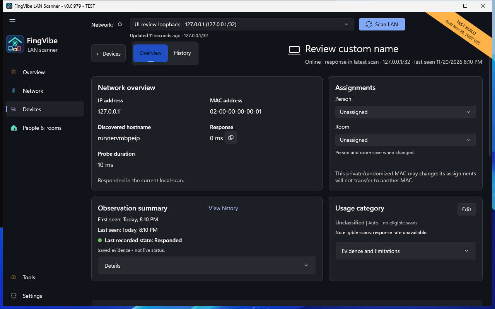

# Identify and inspect a device

Select a row on **Devices** to open its details.
Use the **Devices** return action when finished.

Device details has two segmented tabs beside **Devices**, with the device's
name and status grouped on the right. At narrow widths the tabs move below the header:

- **Overview** (selected each time you open a device): network overview,
  assignments, observation summary, usage category, possible matching MAC
  addresses, identification, and ports and services.
- **History**: Activity, scan observations and, for virtual and linked devices, MAC and address history.

Choose **View device history** in the summary, or select **History**, to switch.
With the keyboard, move focus to a tab and press Space or Enter. Switching tabs keeps unsaved
drafts, expanded sections and the observation page. Copy and the **Rename device**
pencil appear beside the name on hover or keyboard focus, without moving the header.

*Native test-build screenshot. The hostname belongs to the disposable CI runner;
addresses and metadata are safe review data. Lower sections require scrolling.
[Screenshot sources](screenshots.md).*

## Understand identification

**Network overview** shows the observed address, MAC address, hostname,
and available response measurements. **Device identification** shows the type,
operating system, vendor / manufacturer, family, model, and selected icon.
The detected MAC vendor is separate supporting registry evidence; it can differ
from the hardware manufacturer and is not changed by a correction.

FingVibe gathers local name and service evidence. It can also use a MAC prefix
to find the registered vendor. This does not reliably identify every device.

**(likely)** means the evidence suggests a classification but does not prove it.
**Unknown** is an intentional result when evidence is absent or conflicting.
Open **How this device was identified** to see why a value was selected.
Running a web server or file-sharing service alone does not identify the OS.

The same expander lists names reported by SSDP, mDNS, NetBIOS and reverse DNS,
plus supported UPnP, Google Cast, HomeKit, AirPlay and printer identifiers for
the address currently shown. Each saved value includes its source and the
completed scan time when it was last received. A missed reply keeps that value
and timestamp; new values of the same kind replace the saved set.

These are passively retained from replies the scanner already receives, with
no additional requests. Up to four distinct values per kind (128 characters
each) are stored locally, including virtual-device connection observations.
Earlier scans have no retroactive evidence. A shared name or ID does not prove
that two records represent the same device, and does not automatically link them.

## Merge MAC addresses

**Merge MAC addresses** appears on every device's **Overview**, directly above
**Device identification**. Its collapsed header shows what there is to do:

- **No suggestions** in pale gray: nothing looks like the same device. The
  expanded section offers **Choose device...** to link a record manually.
- **N possible matches** with a yellow link icon: another record may be the same
  physical device ([how matches are found](devices.md#possible-matching-mac-addresses)).
- **N MAC addresses** in green: you linked these records as one device.
- **N MAC addresses · N possible matches** in green and yellow, with a yellow
  link icon: a linked device with a new suggestion.
- **Not available for virtual devices** in pale gray. A virtual device groups
  changing private MAC addresses automatically, so it can't be linked. You can
  still name it and assign it to a person or room.

With suggestions, the section opens expanded when you open the device, including
from the Devices link icon. If you collapse it, it stays collapsed while that
device remains open; later refreshes do not reopen it.

It compares **This device** with **Selected other MAC address**
(*suggestion i of n*, or *chosen manually*): name, status, IP / MAC, and
vendor / OS / type. For a suggestion, *Suggested because …* states the reason
and that the suggestion does not establish physical identity.

- **Change device...** (or **Choose device...**, or **Add MAC address...** for
  a linked device) opens a searchable picker. **Suggested** lists suggestions
  strongest first with their reason; **Other devices** lists every other record
  or linked device that isn't part of a virtual device. A linked device appears
  once, tagged **N MAC addresses**; a linked device's own MAC addresses are never
  listed. Declined pairs are tagged **Declined** and can still be linked
  manually. Virtual devices can't be linked and aren't listed.
- **Decline suggestion** keeps the two records separate permanently. Both link
  icons for that pair disappear, other suggestions remain, and the next
  suggestion is shown. A declined pair is never suggested again, even if
  stronger evidence appears later. Declines survive restarts; if a save fails,
  the section shows the error and keeps the suggestion.

### Link two records as one device

**Choose the shared device data** lists each field with **This device**,
**Other MAC address** and the **Linked device value**: name, device type,
operating system and vendor / manufacturer; family, model and device icon when
either record has one; then Person, Room and usage category.

- Matching values are kept. Each differing value needs an explicit choice; you
  can also type the shared name. FingVibe never silently prefers the online or
  the first record.
- Matching automatic usage categories stay automatic. Differing categories need
  a choice, which is saved as the linked device's manual category.
- **Merge as one device** stays disabled until every difference is resolved.
  **Cancel** discards your choices without saving anything.
- If saving fails, the section shows the error and keeps your choices; nothing
  is linked and no suggestion disappears until saving succeeds.

MAC addresses, adapter vendors, IPs, ports and scan histories stay separate. No
source records are deleted.

After linking, the two records become [one row in Devices](devices.md#linked-devices),
and the section says **Linked by you**. It lists each MAC address with its IP,
adapter vendor, status and the date it was linked, and marks the representative
MAC address **Shown in Devices**.

### Add MAC addresses and combine linked devices

A linked device can hold more than two MAC addresses. In its expanded section,
**Add MAC address...** opens the same picker and **Choose the shared device
data** comparison, with the same explicit choices, **Cancel** and failed-save
behavior. **This device** shows the linked device's shared values.

- Choosing a record adds its MAC address.
- Choosing another linked device adds all of its MAC addresses. The device you
  have open keeps its identity, and the other linked device disappears only when
  the save succeeds.
- Every MAC address keeps its original linked date and its own saved name,
  identification, Person/Room and category for a later Unlink. The values you
  choose become the shared values, and **Restore … chosen when linked** returns
  to them.

A linked device gets suggestions as one device. Another record is suggested
when it matches any of its MAC addresses through that MAC address's own
evidence (the shared name or identification you chose is not evidence), and it
appears once with the strongest reason. MAC addresses of the same linked device
are never suggested to each other. Declining a linked device's suggestion
declines every current pair between them; a MAC address added later can be
suggested again.

### Edit a linked device

Use the existing name, identification, **Person**/**Room** and usage-category
editors in the linked device's Device Details; they change the shared values.
The confirmed name and identification are fixed
values: later scans update each MAC's own evidence, not the shared values.
**Restore name chosen when linked** and **Restore values chosen when linked**
return to the values confirmed when you linked the records.

Each MAC keeps its own saved name, identification, Person/Room and category
while linked, ready to restore if you unlink it. Activity and automatic usage
evidence use the linked device: any responding member makes a scan a response,
every eligible member must have a nonresponse for that scan to count as no
response, and otherwise the scan remains unknown. Members never observed on the
selected network do not contribute. Evidence collected before linking remains
part of the current members' combined history. The History tab's **Scan
observations** list and **MAC and address history** cover every member; see
[Linked-device history and tool targets](#linked-device-history-and-tool-targets).

### Unlink MAC addresses

In the expanded linked-device section, each MAC address has **Unlink**. Choose
it to review the inline confirmation, then choose **Unlink** again to save or
**Cancel** to leave everything unchanged.

The detached MAC becomes a separate device with its latest member-specific
name, identification, Person, Room and usage category. Imported and discovered
values received while linked remain available to it. With three or more MAC
addresses, the linked device keeps its current values and other MAC addresses.
With two, the remaining device keeps the linked device's current shared values
as ordinary saved values; a later Reset uses that MAC's normal imported or
discovered values. Every MAC keeps its addresses, vendors, observations and scan
histories. The detached MAC is permanently declined as an automatic suggestion
against every remaining MAC address, but it can still be linked manually.

After unlinking, Devices, Overview and People & Rooms show and count the
detached MAC address as a separate device again, and Device Details reopens on
the remaining device. Activity and usage evidence again use the detached MAC's
own history, including evidence collected while linked.

If saving fails, the section shows the error and keeps the linked device and
confirmation in place.

## Rename

1. Choose the **Rename device** pencil beside the device name.
2. Enter your preferred name.
3. Choose **Save**.
4. Check the save feedback.
5. Choose **Done** to close the editor.

A saved name is separate from the discovered hostname.
Choose **Use imported / discovered name** to remove your custom name.
Closing the editor is not a substitute for checking whether a save succeeded.

## Correct identification

1. Find **Device identification**.
2. Choose **Edit**.
3. Change the type, OS, vendor / manufacturer, family, model, or icon.
4. Choose **Save changes**, or **Cancel** to discard the draft.

Your saved corrections take precedence over imported values and automatic
evidence. Blank manufacturer/family/model fields inherit their original/default values.
**Automatic** uses automatic evidence when there is no mapped Fing value;
an imported option explicitly says it uses imported Fing OS/type.

**Reset saved identification** clears the six identification overrides.
It does not remove the device name, assignments, or original imported evidence.
An error leaves the draft visible so you can review it.

Names and corrections normally follow the device's MAC address, not its IP.
A changing MAC can break that association.

## Service discovery

**Service discovery (N)** appears below **Device identification** and above
**Ports & services** when the device advertised services. Each entry shows the
service and protocol (mDNS/DNS-SD or SSDP/UPnP), the advertised endpoint, any
advertised instance, name, manufacturer or model, an inferred role, the
observation time, and a separate **TCP verification** result.

- Advertisements are response evidence, not a verified identity or an exact
  hardware model. A role such as *Spotify Connect playback endpoint* or
  *Hue bridge service* describes a service, not the device's name or model.
- Advertised TCP ports are checked once per scan, only on the address that
  advertised them, with a 400 ms timeout. Only a port that answers is added to
  **Ports & services**; an unanswered port is labeled *not counted as open*.
- UDP endpoints (for example Matter commissioning) and SSDP descriptions are
  listed but not probed.

## Inspect services

The normal LAN scan checks 17 common TCP ports on each responding device.
For a currently responding address, **Scan additional ports** checks a curated
set of 193 additional TCP ports, and **Full TCP port scan** checks all 65,535.
See the [technical reference](https://github.com/iricigor/fingvibe/blob/main/docs/reference.md) for the exact port lists.

1. Confirm the device responded in the current local scan.
2. If several current addresses exist, select **Current address to inspect / probe**.
   For a linked device it lists every responding member as **MAC · IP**.
3. Review **Ports & services**.
4. Optionally select **Include UDP service checks**.
5. Choose **Scan additional ports**.
6. Read the outcome and endpoint details.

UDP service checks cover a small supported set, not every UDP port.
**No response** is inconclusive; it is not proof that a UDP port is open or closed.
Do not run probes against historical imported addresses.
The app prevents conflicting network measurements from running together.

### Full TCP port scan

Use **Full TCP port scan** only for a device you own or are authorized to scan.

1. Choose **Full TCP port scan**.
2. Read the warning: the scan sends 65,535 connection attempts, can take several
   minutes, and can trigger security monitoring or device logs.
3. Choose **Start full scan**, or **Cancel** to start nothing.
4. Watch the checked/total count. Open ports appear as soon as they answer.
5. Choose **Cancel full scan** to stop. Open ports already found are kept,
   and the status says coverage is incomplete.

Each attempt waits only 200 ms, so a sleeping or slow Wi-Fi device can be missed.
Rescan if an expected port is absent; the default and additional scans wait longer
for their ports. Ports outside the named lists appear as **Unlisted service**.
The full scan does not include UDP and never runs automatically.

Each compact service tile shows its service/port and endpoint with Copy.
Supported web endpoints retain a browser link; **Try HTTP/HTTPS** is tentative,
not confirmed application-protocol detection. UDP observations appear after checks
produce observations; no response remains inconclusive.
Copy controls appear beside populated values on hover or keyboard focus.
Copy only information you intend to share; MACs, names, and addresses can be private.

## Assign equipment

Choose a **Person** and **Room** in **Assignments**.
Each selection saves when changed; the categories are independent.
See [People and rooms](people-rooms.md).

**Usage category** normally shows its effective category, source and concise evidence.
Choose **Edit** for its separate draft and Save/Cancel actions. Expand
**Evidence and limitations** for counts, scope, qualifications and **Refresh usage evidence**.
Limited automatic evidence is provisional; a manual choice is not.
Changing that draft does not save it through the Person/Room controls.
See [Usage categories](history.md#usage-categories).

## Virtual-device details

For an inferred virtual identity, names, corrections, and assignments belong
to that identity and can follow its associated MAC changes.

On the **History** tab, expand **MAC and address history** for the member addresses, times, and preserved
evidence. Do not treat this association as proof of a physical device.
Fing import still matches full MAC addresses, not virtual names or prefixes.

## Linked-device history and tool targets

On a linked device's **History** tab, the **Linked device** card's **MAC and
address history** lists every member MAC address. The member shown in Devices
comes first. Each lists:

- **Confirmed by you on** the date you linked it. This is your confirmation,
  not an inference.
- Each connection: IP address, current response or previous connection, first
  and last seen, network and subnet.
- **Saved values Unlink restores**: that MAC's own name, identification,
  Person, Room and usage category. A renamed Person or Room shows its current
  name; a deleted one is restored as unassigned.

**Scan observations** shows one row per completed scan of the current members on
the selected network, using the [Activity rules](history.md): a response from any
member is a response; a scan counts as no response only when every member already
seen on that network recorded one; other scans are not listed. A scan never
appears twice.

**Current address to inspect / probe** lists every member MAC and IP address
that responded in the current scan as **MAC · IP**; addresses seen only
earlier are not listed. Port scans and UDP checks target the selected real
address, and their results are saved on that MAC's own record. Probing requires
the selected Windows network profile to match the address's network, as for a
virtual device. The choice applies only to this Device Details visit: it stays
selected across refreshes while that MAC/IP still responds, otherwise Device
Details shows the representative address and says so. Reopening Device Details
starts from the representative, and the member shown in Devices never changes.

## History availability

**Observation summary** sits beside Usage category, below Network overview and
Assignments. Cards align in two rows on wide windows and stack on narrow ones.
First/last-seen dates use local-calendar Today/Yesterday/day labels with time.
Historical aggregates remain marked; expand **Details** for exact timestamps,
scope and the latest recorded run. Saved evidence is not live status.

History reloads Activity on entry and relevant data/date/hour changes, without
a normal Refresh button. Failures offer **Retry**. Period and **Hours per square**
retain the requested window even with sparse history. Coverage counts dates with
eligible evidence; populated-square counts are not scan counts or continuous uptime.
Green/R means responded; amber/minus means scanned with no response, not absence.
A muted `?` marks no scan data; dim dots mark later today. A small trailing `?`
beside a weekday count marks unknown dates without changing its denominator.
Skipped DST hours show `N/A`. Scroll horizontally when needed to reach all hours.
For a linked device, each square combines the current member MACs under those
same response rules, including history collected before they were linked.
The newest-first **Scan observations** list retains paging and exact timestamps
in accessible row descriptions and tooltips.
See [History and usage categories](history.md).
