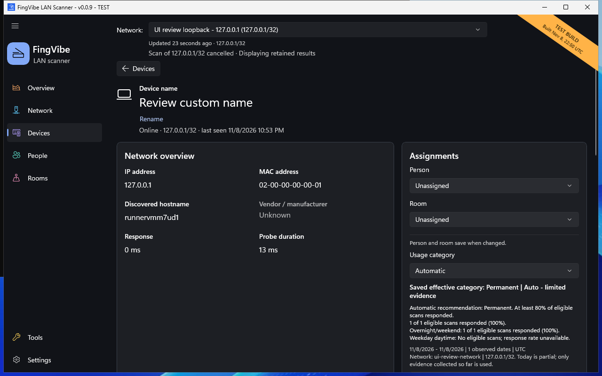

# Identify and inspect a device

Select a row on **Devices** to open its details.
Use the **Devices** return action when finished.

Device details has two segmented tabs beside **Devices**, with the device's
name and status grouped on the right. At narrow widths the tabs move below the header:

- **Overview** (selected each time you open a device): network overview,
  assignments, observation summary, usage category, identification, and ports and services.
- **History**: Activity, scan observations and, for virtual devices, MAC and address history.

Choose **View device history** in the summary, or select **History**, to switch.
With the keyboard, move focus to a tab and press Space or Enter. Switching tabs keeps unsaved
drafts, expanded sections and the observation page. Copy and the **Rename device**
pencil appear beside the name on hover or keyboard focus, without moving the header.

*Native test-build screenshot. The hostname belongs to the disposable CI runner;
addresses and metadata are safe review data. Lower sections require scrolling.
[Screenshot sources](screenshots.md).*

## Understand identification

**Network overview** shows the observed address, MAC address, hostname,
and available response measurements. **Device identification** shows the type,
operating system, vendor / manufacturer, family, model, and selected icon.
The detected MAC vendor is separate supporting registry evidence; it can differ
from the hardware manufacturer and is not changed by a correction.

FingVibe gathers local name and service evidence. It can also use a MAC prefix
to find the registered vendor. This does not reliably identify every device.

**(likely)** means the evidence suggests a classification but does not prove it.
**Unknown** is an intentional result when evidence is absent or conflicting.
Open **How this device was identified** to see why a value was selected.
Running a web server or file-sharing service alone does not identify the OS.

## Rename

1. Choose the **Rename device** pencil beside the device name.
2. Enter your preferred name.
3. Choose **Save**.
4. Check the save feedback.
5. Choose **Done** to close the editor.

A saved name is separate from the discovered hostname.
Choose **Use imported / discovered name** to remove your custom name.
Closing the editor is not a substitute for checking whether a save succeeded.

## Correct identification

1. Find **Device identification**.
2. Choose **Edit**.
3. Change the type, OS, vendor / manufacturer, family, model, or icon.
4. Choose **Save changes**, or **Cancel** to discard the draft.

Your saved corrections take precedence over imported values and automatic
evidence. Blank manufacturer/family/model fields inherit their original/default values.
**Automatic** uses automatic evidence when there is no mapped Fing value;
an imported option explicitly says it uses imported Fing OS/type.

**Reset saved identification** clears the six identification overrides.
It does not remove the device name, assignments, or original imported evidence.
An error leaves the draft visible so you can review it.

Names and corrections normally follow the device's MAC address, not its IP.
A changing MAC can break that association.

## Inspect services

The normal LAN scan checks ten common TCP ports.
For a currently responding address, **Scan additional ports** checks a curated
set of 100 additional TCP ports.

1. Confirm the device responded in the current local scan.
2. If several current addresses exist, select **Current address to inspect / probe**.
3. Review **Ports & services**.
4. Optionally select **Include UDP service checks**.
5. Choose **Scan additional ports**.
6. Read the outcome and endpoint details.

UDP service checks cover a small supported set, not every UDP port.
**No response** is inconclusive; it is not proof that a UDP port is open or closed.
Do not run probes against historical imported addresses.
The app prevents conflicting network measurements from running together.

Each compact service tile shows its service/port and endpoint with Copy.
Supported web endpoints retain a browser link; **Try HTTP/HTTPS** is tentative,
not confirmed application-protocol detection. UDP observations appear after checks
produce observations; no response remains inconclusive.
Copy controls appear beside populated values on hover or keyboard focus.
Copy only information you intend to share; MACs, names, and addresses can be private.

## Assign equipment

Choose a **Person** and **Room** in **Assignments**.
Each selection saves when changed; the categories are independent.
See [People and rooms](people-rooms.md).

**Usage category** normally shows its effective category, source and concise evidence.
Choose **Edit** for its separate draft and Save/Cancel actions. Expand
**Evidence and limitations** for counts, scope, qualifications and **Refresh usage evidence**.
Limited automatic evidence is provisional; a manual choice is not.
Changing that draft does not save it through the Person/Room controls.
See [Usage categories](history.md#usage-categories).

## Virtual-device details

For an inferred virtual identity, names, corrections, and assignments belong
to that identity and can follow its associated MAC changes.

On the **History** tab, expand **MAC and address history** for the member addresses, times, and preserved
evidence. Do not treat this association as proof of a physical device.
Fing import still matches full MAC addresses, not virtual names or prefixes.

## History availability

**Observation summary** sits beside Usage category, below Network overview and
Assignments. Cards align in two rows on wide windows and stack on narrow ones.
First/last-seen dates use local-calendar Today/Yesterday/day labels with time.
Historical aggregates remain marked; expand **Details** for exact timestamps,
scope and the latest recorded run. Saved evidence is not live status.

History reloads Activity on entry and relevant data/date/hour changes, without
a normal Refresh button. Failures offer **Retry**. Period and **Hours per square**
retain the requested window even with sparse history. Coverage counts dates with
eligible evidence; populated-square counts are not scan counts or continuous uptime.
Green/R means responded; amber/minus means scanned with no response, not absence.
Hatching marks no scan data; dim dots mark later today. Skipped DST hours remain
not applicable. Scroll horizontally when needed to reach all hours.
The newest-first **Scan observations** list retains paging and exact timestamps
in accessible row descriptions and tooltips.
See [History and usage categories](history.md).
