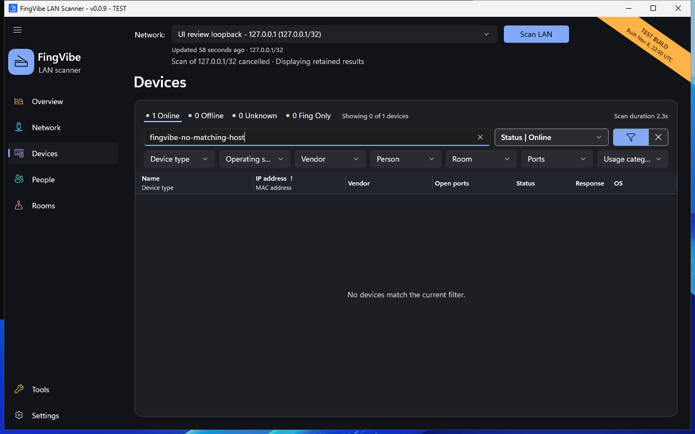

# Understand device results

Devices is a **persistent inventory**: a saved list of known devices.
It includes local observations and devices imported from Fing.
Unused IP addresses do not become device records.

## Device status

| Status | Meaning |
| --- | --- |
| Online | The device responded to ping, fresh ARP, or a validated mDNS/SSDP reply from its own address in its latest applicable scan evidence, including saved results. |
| Offline | A previously observed device did not respond in a later successful scan of the same identified network and subnet. |
| Unknown | No suitable local scan status is available. Restart alone does not make a known status Unknown. |
| Fing Only | The imported MAC address has never been observed in a local FingVibe scan. |

**Offline is not proof of power-off.** A device may be sleeping, blocking probes,
or outside the scan's reachable network. After restart, saved Online/Offline
statuses remain available, with their evidence age. Starting a scan retains
unresolved statuses; fresh responders become Online, but only full successful
completion can make nonresponders Offline on that same network. Cancellation
or failure retains prior statuses and committed positive results.
Online is scan-relative, not proof of continuous live presence.

Color supports the status text. Green, gray, or amber alone is not the meaning.
The totals describe the whole inventory, even when filters hide some rows.

## Search and filter

1. Enter a name, address, vendor, or other displayed information in **Search devices**.
2. Open **Status** to choose one or more statuses.
3. Choose the funnel icon to show more filters.
4. Select values in **Type**, **OS**, **Vendor**, **Person**,
   **Room**, **Ports**, or **Usage**.
5. Choose **Clear filters** beside the funnel to remove all restrictions.

Selecting several values within one category means "any of these."
Different categories combine: a device must match each selected category and
the search text. An empty selection means no restriction.

Unrestricted filter labels are quieter; a restricted filter uses normal-contrast
text and shows its selected values. The background and border stay the same,
and quieter filters remain interactive. Type, OS and Usage are short button
titles only: accessible names, full-value tooltips and table headings retain the
full category names.

Status dropdown choices supplement their labels and checkboxes with colored
dots: green Online, red Offline, gray Unknown and blue Fing Only. Its **Any**
choice has a four-segment circle using those same colors; the circle does not
represent an arbitrary multi-selection. High contrast uses system colors while
retaining labels and checkbox selection cues. These indicators do not change
the colors of inventory totals or device-row badges.

For example, select **Online**, a room, and **With open ports** to see responding
devices in that room with observed services. **Unassigned** finds devices with
no person or room. **Unknown** type or OS finds devices without that classification.

Hiding the second filter row does **not** clear it. The funnel count shows active
secondary categories. Status is remembered after restart; search and the other
categories are not.

**Any** means any known value, not every value. It appears immediately after
Unknown, Unassigned or Unclassified when that dropdown offers at least two
known choices. Selecting Any replaces individual choices; selecting an
individual choice replaces Any. Clearing the category still includes everything.
For Person/Room, Any means assigned; for Usage category, it excludes
Unclassified. For Vendor, it includes identified manufacturers and excludes
both Unknown and Randomized MAC. The threshold counts dropdown choices, not
devices. An active Any filter keeps its meaning when new values appear.
Status remembers Any after restart just as it remembers individual statuses.

*The sample search matches no device. It does not mean the inventory is empty.
[Screenshot sources](screenshots.md).*

## Usage category

The category uses one line. A small pin marks a manual override; an information
indicator marks a limited automatic estimate or unavailable evidence.
Unclassified is visually quieter, not a confirmed category or an error.
Hover for an explanation, or focus the category button and press Enter/Space
to open its details. They include the source, reason, eligible scan counts,
observation period and missing evidence. Loading and Unavailable remain explicit;
no eligible scans never produces a made-up percentage.

The column does not add a second row of repeated source text or change the
classification rules. See [History and usage categories](history.md#usage-categories)
for the rules and manual overrides.

## Sort and resize

Choose a column heading to sort ascending. Choose it again to reverse the order.
The **Name** heading has four states. Choose it repeatedly to cycle through
ascending and descending order ignoring emojis, then ascending and descending
order by the full name, and then start again. A small **Aa** beside the arrow
means emojis are ignored for sorting; the heading tooltip describes the current
order. Device names always keep their emojis on screen.
Combined columns keep separate heading actions for their fields.
Person and Room sort by full name, not by the short label.

Drag a column boundary to resize it. Use
[Settings](settings.md#choose-device-columns) to show, hide, or combine columns.
**Name** and **IP address** always remain visible.
The final visible column keeps a right-edge separator and resize handle.
Space beyond it is unused table space, not an automatically enlarged column.

## Response times and service icons

Response time is the measured ping delay in milliseconds (**ms**).
A smaller value means that ping returned faster, not that the device's internet
connection is faster. The response bars share one scale for the displayed scan.
Filtering does not change that scale.

Service icons represent observed ports, such as a web or file-sharing service.
Hover over an icon for the port number and name.
An open port is **not a security verdict**. It does not prove a service is safe,
unsafe, or running a particular operating system.

## Service discovery responders

Some devices ignore ping and ARP but announce services through mDNS/DNS-SD or
SSDP/UPnP. A fresh, valid reply sent by the device's own address during the
current scan also makes that device **Online**; there is no separate status.

- **Response** shows `--` because no ping time was measured.
- The name stays your saved name first, then the actual advertised host name,
  then the IP address. Service names and roles never replace names.
- **MAC unavailable** means the device answered without a usable MAC address.
  It stays visible for that scan but is not saved as equipment, matched by IP
  address, or given an invented MAC.
- In **Open ports**, verified ports stay on the left. A right-aligned
  service-discovery icon appears only for advertisements from the latest scan.
  Hover over or focus it for the advertised services and observation time;
  select it to open **Service discovery** in Device Details.

Stale, expired (goodbye), malformed, unrelated, or out-of-network announcements
never make a device Online. An address that is only mentioned in another
device's announcement is not treated as a responder.

## Last seen

**Last seen** shows the latest local presence evidence for the selected network.
**Online** in that column describes the displayed scan.
A relative age, such as `2 h ago`, describes saved evidence.

**Never** means an imported-only device has not been seen by a local scan.
**Unavailable** means suitable evidence is missing or cannot be read.
Hover or focus the value to see its exact time or explanation.
Age text refreshes while Devices is open; it does not run another scan.

## Possible matching MAC addresses

A small pale-yellow link icon at the right of a device's name means another
record on the same network may be the same physical device, for example a
laptop's Ethernet and Wi-Fi adapters. The icon has an accessible name and the
same explanation for keyboard users; its meaning does not depend on color.

Hover over or focus the icon to see up to three counterparts with their reasons,
such as *Possible matching MAC address: Rey (192.168.0.114). Same discovered
name.* Click it, or press Enter or Space while it has focus, to open that row's
Device Details with **Merge MAC addresses** expanded and in view
([review and decline](device-details.md#review-possible-matching-mac-addresses)).

FingVibe suggests a match only for this evidence, strongest first:

1. **This PC's network adapters:** both MACs belong to this computer's Ethernet
   or Wi-Fi adapters, read locally without network traffic.
2. **Same device ID:** both records reported the same UPnP device UUID, or the
   same mDNS device ID of the same kind.
3. **Same name:** a current name matches. Network host names (mDNS, NetBIOS,
   reverse DNS and Fing hostnames) compare by the part before the first dot, so
   `REY`, `rey.local` and `rey.fritz.box` match but `rey-2` does not. Other
   names, such as names typed in FingVibe or Fing and SSDP friendly names,
   compare in full, ignoring case and surrounding spaces. Reported names count
   only from the most recent scan that reported a name.

Names are ignored when empty, when they contain the record's IP address or its
MAC (or its last three MAC bytes), or when they are common defaults: `iPhone`,
`iPad`, `Android`, `Galaxy`, `localhost`, `raspberrypi`, `Chromecast`, `ESP`,
`espressif` and `Unknown`. Names do not match when both records have a clearly
known, different type, unless one is a computer or smart device; a
**(likely)** type never blocks a match.

Only records seen locally on the same identified network are compared. Fing Only
records, virtual devices and the MAC records they group are never suggested.
MAC prefix, adapter vendor, nearby IP addresses, open ports, response times and a
shared Person or Room are never evidence, and no confidence score is shown.
A suggestion is not proof of one physical device.

## Private and virtual devices

**Randomized MAC** is the display label for a locally administered MAC address.
It is not a known manufacturer and does not prove random generation or rotation:
the address may also have been assigned manually. Its explanation states this
limitation.

**Unknown** means FingVibe has not identified the manufacturer. This also covers
a raw IEEE registry entry of **Private**; the explanation preserves that
distinction without claiming that other information cannot identify the device.
Saved manufacturer corrections and imported brands still take precedence.

A multiple-PC icon can mark a **virtual device**: FingVibe's inferred identity
for certain sparse private-prefix observations across changing MAC addresses.
It does not mean a virtual machine. The association is an estimate, not proof
that several observations belong to one physical device.

When the row represents more than one saved MAC address, its chevron expands up
to three earlier addresses. Each line keeps that MAC's own IP address,
manufacturer, status and Last seen evidence. Additional addresses are
summarized; the complete history remains in Device Details. The chevron alone
changes expansion; choosing the rest of the row still opens Device Details.

Search can reveal an earlier MAC or IP address that is outside the three-line
preview. The matching row expands while the search is active, then returns to
its previous state when the search is cleared. Expansion also remains in
memory while sorting, filtering, scanning or moving between pages, and starts
collapsed when FingVibe restarts. Use Right Arrow or Left Arrow on a focused
row to expand or collapse it.

See [Device details](device-details.md#virtual-device-details).
