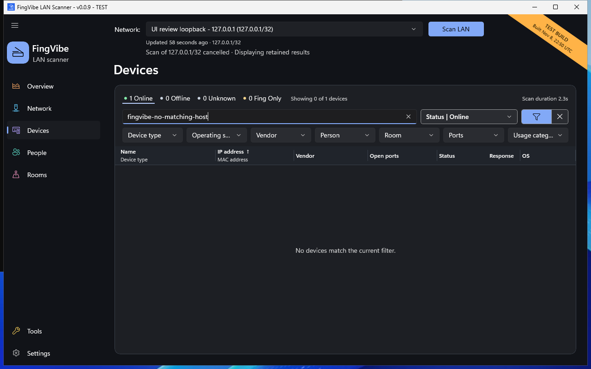

# Understand device results

Devices is a **persistent inventory**: a saved list of known devices.
It includes local observations and devices imported from Fing.
Unused IP addresses do not become device records.

## Device status

| Status | Meaning |
| --- | --- |
| Online | The device responded to fresh ping or ARP in this session's displayed scan. Initial saved results can show this while background checks continue. |
| Offline | A previously observed device did not respond in a later successful scan of the same identified network and subnet. |
| Unknown | There is no suitable current scan evidence, for example after restart or when results belong to another network. |
| Fing Only | The imported MAC address has never been observed in a local FingVibe scan. |

**Offline is not proof of power-off.** A device may be sleeping, blocking probes,
or outside the scan's reachable network. After restart, saved observations are
historical; they do not remain Online.

Color supports the status text. Green, gray, or amber alone is not the meaning.
The totals describe the whole inventory, even when filters hide some rows.

## Search and filter

1. Enter a name, address, vendor, or other displayed information in **Search devices**.
2. Open **Status** to choose one or more statuses.
3. Choose the funnel icon to show more filters.
4. Select values in **Device type**, **Operating system**, **Vendor**, **Person**,
   **Room**, **Ports**, or **Usage category**.
5. Choose **Clear filters** beside the funnel to remove all restrictions.

Selecting several values within one category means "any of these."
Different categories combine: a device must match each selected category and
the search text. An empty selection means no restriction.

For example, select **Online**, a room, and **With open ports** to see responding
devices in that room with observed services. **Unassigned** finds devices with
no person or room. **Unknown** type or OS finds devices without that classification.

Hiding the second filter row does **not** clear it. The funnel count shows active
secondary categories. Status is remembered after restart; search and the other
categories are not.

*The sample search matches no device. It does not mean the inventory is empty.
[Screenshot sources](screenshots.md).*

## Sort and resize

Choose a column heading to sort ascending. Choose it again to reverse the order.
Combined columns keep separate heading actions for their fields.
Person and Room sort by full name, not by the short label.

Drag a column boundary to resize it. Use
[Settings](settings.md#choose-device-columns) to show, hide, or combine columns.
**Name** and **IP address** always remain visible.

## Response times and service icons

Response time is the measured ping delay in milliseconds (**ms**).
A smaller value means that ping returned faster, not that the device's internet
connection is faster. The response bars share one scale for the displayed scan.
Filtering does not change that scale.

Service icons represent observed ports, such as a web or file-sharing service.
Hover over an icon for the port number and name.
An open port is **not a security verdict**. It does not prove a service is safe,
unsafe, or running a particular operating system.

## Last seen

**Last seen** shows the latest local presence evidence for the selected network.
**Online** in that column describes the displayed scan.
A relative age, such as `2 h ago`, describes saved evidence.

**Never** means an imported-only device has not been seen by a local scan.
**Unavailable** means suitable evidence is missing or cannot be read.
Hover or focus the value to see its exact time or explanation.
Age text refreshes while Devices is open; it does not run another scan.

## Private and virtual devices

**Private MAC** means a locally administered MAC address. It is not a known
manufacturer and does not prove that an address changes randomly.
**Private** as a vendor can mean an undisclosed IEEE registrant.

A multiple-PC icon can mark a **virtual device**: FingVibe's inferred identity
for certain sparse private-prefix observations across changing MAC addresses.
It does not mean a virtual machine. The association is an estimate, not proof
that several observations belong to one physical device.
See [Device details](device-details.md#virtual-device-details).
