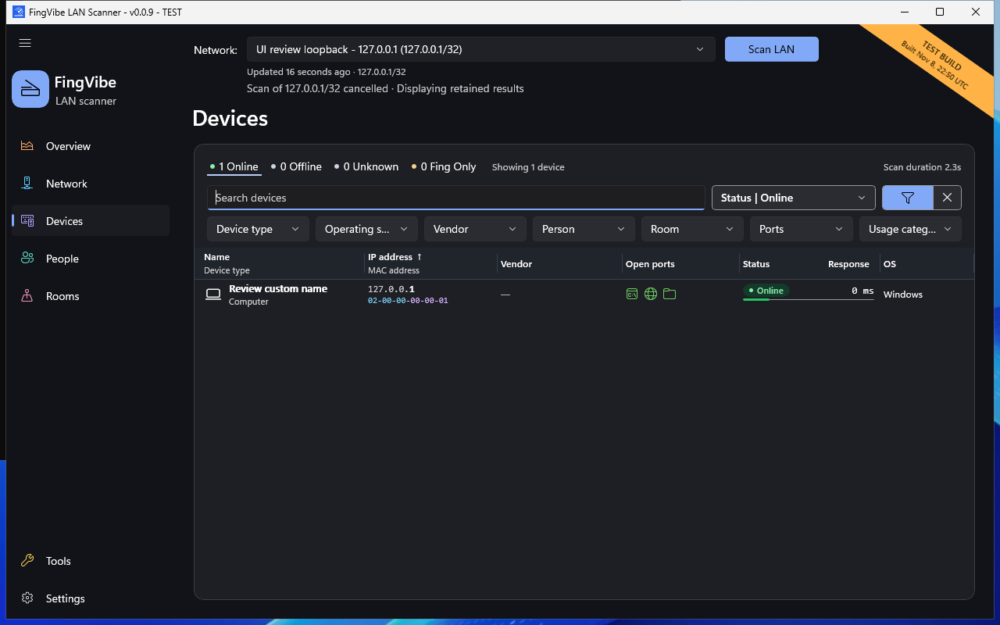

# Your first scan

A **LAN** is a local area network, such as the devices connected to your home
router. FingVibe scans IPv4 addresses on the network you select.

## Choose the network

1. Connect your PC to the network you want to inspect.
2. Open FingVibe.
3. Open **Devices** from the left menu.
4. Open the shared **Network:** picker near the top.
5. Select the Wi-Fi or Ethernet connection you want to scan.

The picker shows the adapter and its network range, for example
`192.168.1.0/24`. If you are unsure which adapter to use, compare it with your
active connection in Windows network settings.

Do not choose a VPN or virtual adapter just because it appears first.
Only scan a network you own or have permission to inspect.

## Run the scan

1. Choose **Scan LAN** on Devices.
2. Watch the progress and status beneath the network picker.
3. Wait for the scan to finish, or choose **Cancel scan** to stop it.
4. Select a device row to inspect the result.

Initial results become available before the background checks finish.
You can browse and filter them while those checks continue.
**Cancel scan** remains available if you visit another page.

*Safe loopback test data. This capture was taken after a cancellation test;
the retained-result message is intentional. [Screenshot sources](screenshots.md).*

## What happens during a scan

FingVibe first sends ping requests to usable addresses. A **ping** asks a device
for a small response. It then uses fresh **ARP** checks for addresses that did
not answer. ARP asks for an address match on the directly connected network.

If unconfirmed addresses remain, FingVibe waits ten seconds and tries ping
again. It can wait another ten seconds before the final ping attempt.
An address has at most three ping attempts and one fresh ARP check.
Devices already confirmed are not retried.

The later stages can take longer than the first results. A mostly silent
network can take more than twenty extra seconds, plus probe and save time.
The selected network cannot silently change to a different network mid-scan.

## Read the result safely

**Online** means a ping or ARP response in the latest applicable scan evidence,
including saved evidence. Unresolved devices keep their previous status during
a new scan; check the evidence age rather than assuming continuous presence.
An ARP-only response may have no ping response time; that is not an error.

Some active devices do not answer either check. Firewalls, sleeping devices,
guest-network isolation, and network configuration can affect discovery.
Two scans do not have to find the same number of devices.

FingVibe retains previously known and imported devices. The number of rows in
Devices is therefore not always the number that answered the latest scan.
See [Device status](devices.md#device-status).

## Cancel, fail, or change networks

Before the first saved checkpoint, cancellation or failure leaves the old
displayed results unchanged. After a checkpoint, FingVibe keeps the saved
observations but marks the scan incomplete. It does not mark missing devices
Offline from an incomplete scan.

Selecting another network does not turn old results into results for the new
network. Check the displayed subnet and freshness message before interpreting
the list. Run a new scan when you need observations for the selected network.

If the app reports a save error, do not assume the results were saved.
See [Common problems](problems.md).
