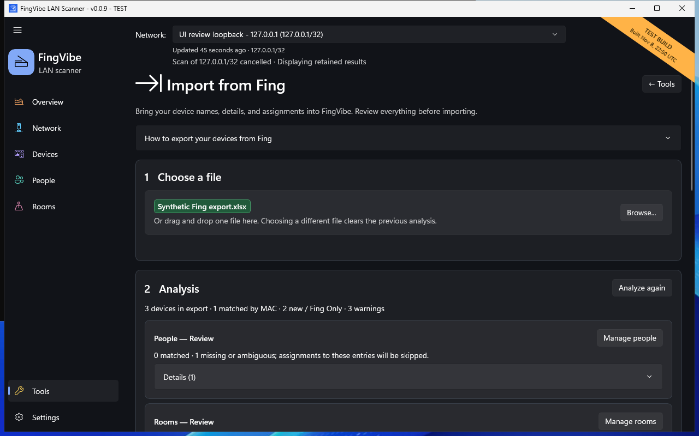

# Import from Fing

Use **Tools > Import from Fing** to bring device information from a Fing Excel
export into FingVibe. You review changes before saving them.
Analysis alone does not change the inventory.

## Prepare the export

Open **How to export your devices from Fing** for guidance.
Export menus and availability depend on your Fing version and subscription.

Use a local **`.xlsx` workbook** with a **Devices** sheet and a **MAC** header.
CSV, PDF, and arbitrary spreadsheets are not supported.

Supported optional columns include Name, Hostname, Type, Brand, Family, Model,
OS, OS Version, Owner, Location, and IP.
The limits are 10 MB compressed, 64 MB uncompressed, and 20,000 device rows.
Spreadsheet formulas are not executed.

## Analyze

1. Open **Tools > Import from Fing**.
2. Choose **Browse...**, or drag the workbook into the file area.
3. Read the **Analysis** groups.
4. Resolve missing or ambiguous people/rooms using their management pages.
5. Return and choose **Analyze again**.

*Synthetic export, not a real workbook. The green filename means analysis
succeeded; it does not approve every proposed change.
[Screenshot sources](screenshots.md).*

Owner and Location match the full names of existing People and Rooms.
Matching ignores letter case and surrounding spaces, but needs exactly one match.
Import never creates people or rooms automatically.

Invalid MACs and all rows sharing a duplicate MAC are skipped with warnings.
A valid private/randomized MAC can be imported, but its long-term identity
may be uncertain.

## Review conflicts

Find **Changes and conflicts** and review each device.
Existing customizations are kept by default.
Choose **Replace** only for a field you want to overwrite.
Empty imported fields do not erase saved information.

For example, if your saved name is **Kitchen printer** and the workbook has
**HP printer**, keep the saved name unless you intentionally want the replacement.

Manual identification corrections take precedence over imported classification.
Detailed original Fing values remain available in device details.
Unknown or uncertain mappings are not treated as proven classifications.

## Import the reviewed devices

Use **Import device** for one device or **Import all** for all eligible changes.
For a subset:

1. Choose **Select devices**.
2. Check the devices you recognize.
3. Review your keep/replace decisions.
4. Choose **Import selected (N)**.
5. Check **Imported this session** and any remaining preview items.

Selection starts empty. Import all does not automatically approve overwrites;
every save respects your field choices.
Each requested batch saves completely or not at all.
An error must not be treated as a partially successful import.

Changing the file or relevant saved data can invalidate the preview.
If the file changed or another app instance saved newer data, analyze again.

## Understand the result

Devices are matched by full MAC address, not IP.
**Fing Only** means no local FingVibe observation exists for that MAC.
The exported IP is historical context; it does not establish Online status
or authorize probing that address.

Import does not migrate Fing events, timestamps, or presence.
For precise format and precedence details, see the
[technical import reference](https://github.com/iricigor/fingvibe/blob/main/docs/reference.md#inventory-and-fing-import).
