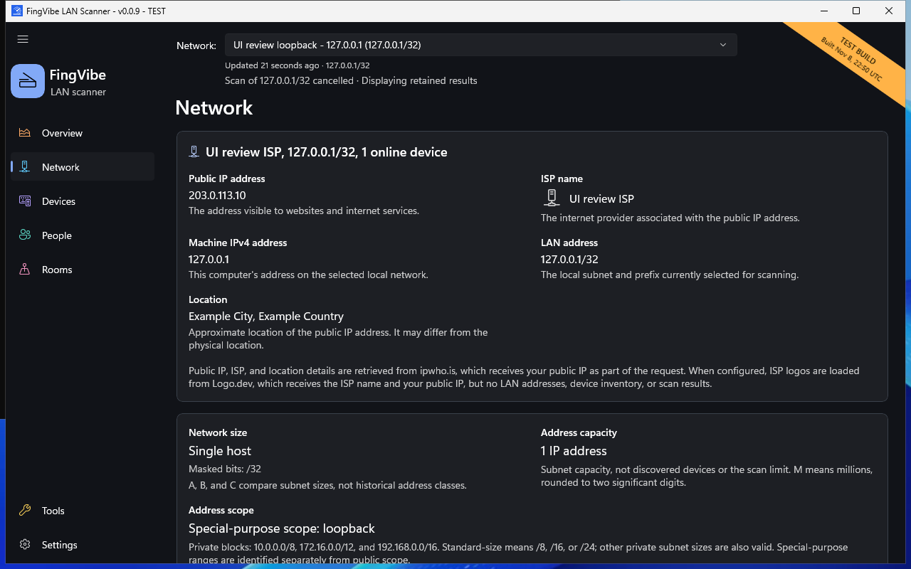

# Find your way around

The left menu switches pages. The **Network:** picker and scan status are shared
across pages. Changing pages does not automatically start another scan.

| Page | What it is for |
| --- | --- |
| :material-view-dashboard-outline: Overview | Read the displayed scan summary and open its device results. |
| :material-lan: Network | See local addressing, network size, and available public-IP/provider details. |
| :material-devices: Devices | Browse the persistent device inventory and start a LAN scan. |
| :material-account-group: People | Create people and manage equipment assignments. |
| :material-home-outline: Rooms | Create rooms and organize equipment by location. |
| :material-tools: Tools | Open import, SQL reports, diagnostics, speed test, and About. |
| :material-cog-outline: Settings | Change appearance, device-table options, and scheduled scans. |

These manual icons are visual hints, not exact copies of every Windows glyph.
The text labels remain the instructions.

## Overview

Overview describes the **displayed scan**, not a live network monitor.
Choose an online-device or open-port summary to open the corresponding
Devices results. These shortcuts clear older search and filter restrictions.

A card's subnet size describes address capacity, not how many devices are
connected. Before your first scan, follow the scan guidance rather than treating
unknown counts as measurements.

## Network

*The public address, provider, location, and loopback network are safe examples,
not measurements of the user's connection. [Screenshot sources](screenshots.md).*

The **Machine IPv4 address** is this PC's address on the selected network.
The **LAN address** includes the subnet prefix, such as `/24`.
The **Public IP address** is the address internet services see.

Public-IP, provider, and approximate location information needs internet access.
It can be unavailable while LAN scanning still works. The reported location is
not a precise physical location. See [Privacy](privacy.md).

The scanner accepts at most **65,534 usable addresses** in a target.
A larger network-size explanation does not remove that safety limit.

## Resize the menu

Drag the menu's right edge to change its width. A narrow menu becomes an icon
rail. Use the menu button to reopen the labels. Wide-window width and collapse
choices are remembered; automatic changes for a small window are not.

You can focus the divider and use **Left/Right** arrow keys.
Hold **Shift** for larger steps. Small windows may show an overlay menu.

## Return and use the keyboard

Device details has a **Devices** return action. Individual Tools pages have a
**Tools** return action. These return to the relevant page; they do not save an
unfinished draft unless the page explicitly says so.

Use **Tab** to move through controls, and **Enter** or **Space** to activate the
focused control. Checkboxes expose their selected state. Tooltips and accessible
names provide full values when table text is shortened.
