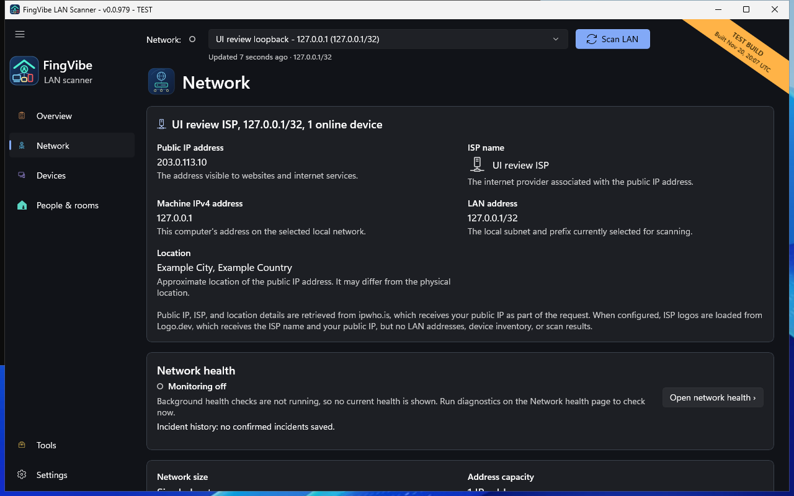

# Find your way around

The left menu switches pages. The **Network:** picker and scan status are shared
across pages. Changing pages does not automatically start another scan.

| Page | What it is for |
| --- | --- |
| :material-view-dashboard-outline: Overview | Read the displayed scan summary and open its device results. |
| :material-lan: Network | See local addressing, network size, and available public-IP/provider details. |
| :material-devices: Devices | Browse the persistent device inventory and start a LAN scan. |
| :material-account-group: People & rooms | Create people and rooms, manage equipment assignments, and open the Room map. |
| :material-tools: Tools | Open import, SQL reports, diagnostics, and speed test. |
| :material-cog-outline: Settings | Change appearance, device-table options and background activity; open About and updates. |

These manual icons are visual hints, not exact copies of every Windows glyph.
The text labels remain the instructions.

## Tools

Tool cards fill two equal-width columns, read left to right:
**SQL editor** and **Import from Fing**, then **Speed test** and
**Room map**, then **Network health** and **Database backups**.
Scroll down in a small window to reach later cards. Keyboard focus follows
that same order.

The Room map has no sidebar item. Open it from **Tools**, from the Rooms
section of **People & rooms**, or from the Network health diagram.
Its **← Rooms** action returns to room management, matching other subpage Back buttons.

## Overview

Overview describes the **displayed scan**, not a live network monitor.
Choose an online-device or open-port summary to open the corresponding
Devices results. These shortcuts clear older search and filter restrictions.
The **About FingVibe** card opens the same About page as Settings.

A card's subnet size describes address capacity, not how many devices are
connected. Before your first scan, follow the scan guidance rather than treating
unknown counts as measurements.

## Network

*The public address, provider, location, and loopback network are safe examples,
not measurements of the user's connection. [Screenshot sources](screenshots.md).*

The **Machine IPv4 address** is this PC's address on the selected network.
The **LAN address** includes the subnet prefix, such as `/24`.
The **Public IP address** is the address internet services see.

Public-IP, provider, and approximate location information needs internet access.
It can be unavailable while LAN scanning still works. The reported location is
not a precise physical location. See [Privacy](privacy.md).

The scanner accepts at most **65,534 usable addresses** in a target.
A larger network-size explanation does not remove that safety limit.

## Resize the menu

Drag the menu's right edge to change its width. A narrow menu becomes an icon
rail. Use the menu button to reopen the labels. Wide-window width and collapse
choices are remembered; automatic changes for a small window are not.

You can focus the divider and use **Left/Right** arrow keys.
Hold **Shift** for larger steps. Small windows may show an overlay menu.

## Return and use the keyboard

Device details has a **Devices** return action. Individual Tools pages have a
**Tools** return action. These return to the relevant page; they do not save an
unfinished draft unless the page explicitly says so.

About has a **Settings** return action that restores focus to its Settings row.
These single-line arrow-and-destination buttons stay at the left of the page
header, before the tabs or tool icon and title. Their normal minimum size matches
the individual **Overview** tab in Device details, not the padded tab group.
Longer destinations and enlarged Windows text can grow the buttons.

Use **Tab** to move through controls, and **Enter** or **Space** to activate the
focused control. Checkboxes expose their selected state. Tooltips and accessible
names provide full values when table text is shortened.

## Check for updates

Open **Settings > About FingVibe & updates**. Official stable builds check the
latest published stable GitHub release one minute after startup, then five minutes
after each completed check while FingVibe remains open. **Check for updates** uses
the same check and resets the next deadline to five minutes after completion,
including on failure. GitHub rate-limit delays take precedence. Checking never
downloads, installs, closes FingVibe, or interrupts scanning with a popup.

About distinguishes not checked, checking, current, newer version and failed
detection. A confirmed newer version shows small orange circles on **Settings**
and its **About** row, together with accessible and visible update text. Visiting
About does not clear them. A failed later check keeps the **Last confirmed**
version/time alongside the latest failure; only a successful no-newer result clears
the indicators. Development, PR and Test builds do not check or install updates:
their manual stable-release link warns that their versions are not comparable.

**Download Setup** is offered only for a verified per-user installation whose
registration, current directory, installed version and installer ownership match.
Otherwise **Download portable ZIP** uses the manual replacement path; an uncertain
or portable copy is never silently converted into an installation. Missing assets
lead to the release page instead. Downloads show progress, support cancellation
and reject incomplete/changed files. Completed files are saved under
`%LOCALAPPDATA%\FingVibe\Updates\<unique directory>`; downloaded executables retain
Internet security markings. A download failure popup links to GitHub Releases.

For a verified installation, **Restart and update** asks before closing FingVibe.
A bounded helper then waits for the application process to exit, rechecks the
downloaded Setup's identity and Internet security marking, runs the existing
per-user Setup silently enough to avoid the normal wizard, and reopens the
verified installation after Setup reports success. SmartScreen, Defender, UAC,
organization policy or cancellation may still require attention; no protection
is bypassed. The originating process identity, expected version, installer
identity and observed install/relaunch outcome are recorded under
`%LOCALAPPDATA%\FingVibe\Updates` so a later launch can distinguish an accepted
request or process launch from a completed installation. A setup or relaunch
failure is explicit and leaves the record for recovery; saved user data is
preserved. A helper-launch failure keeps FingVibe open and shows a failure
popup with only **OK**.
For ZIP updates, close FingVibe and replace your portable application files
manually, keeping your saved data; FingVibe does not unpack or overwrite them.
