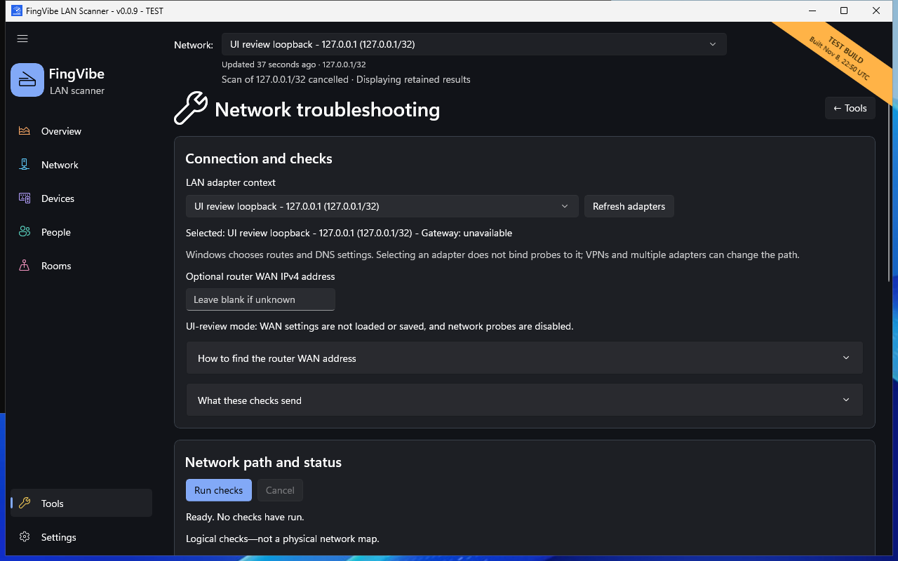
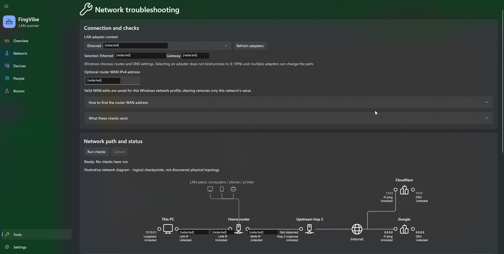

# Network troubleshooting

Use **Tools > Network troubleshooting** to run connection checks manually.
Opening the page does not send diagnostic probes.

## Run checks

1. Open **Tools > Network troubleshooting**.
2. Review the **LAN adapter context**.
3. Use **Refresh adapters** if your connection changed.
4. Leave the optional router WAN address blank unless you know it.
5. Read **What these checks send**.
6. Choose **Run checks**.
7. Read each checkpoint and the traceroute result.

*Safe UI-review ready state. Review mode disables actual diagnostic probes.
That test-only restriction does not apply to a normal release.
[Screenshot sources](screenshots.md).*

**Cancel**, leaving the page, changing its network context, or closing the app
stops the checks. A LAN scan, speed test, or device-service probe must finish
before another network measurement can start.

## What is checked

| Check | What a response can tell you |
| --- | --- |
| Loopback `127.0.0.1` | This PC's local network stack answered. |
| This PC's LAN IPv4 | The selected local address answered. |
| Gateway | The configured router/local gateway answered, if available. |
| Optional router WAN | The supplied address answered; it may not answer ping. |
| `1.1.1.1` and `8.8.8.8` | The public targets answered the requested IP check. |
| DNS | Name resolution for `example.com` succeeded through the tested resolver. |
| Traceroute | Some routers on the route toward `1.1.1.1` returned hop information. |

**DNS** translates a name into an address.
**Traceroute** asks for responses at successive routing steps.
Some routers do not answer these probes, even when they forward normal traffic.
An unanswered hop does not by itself locate a connection fault.

The checks use short timeouts. Traceroute stops after at most sixteen hops.
A completely unanswered run takes about 38 seconds plus Windows scheduling time.

Windows selects the actual routing and DNS context.
Choosing an adapter here does **not** bind all public checks to that adapter.
VPNs and multiple adapters can change the route.

## Router WAN address

**WAN** means the router's internet-facing side.
The WAN IPv4 may differ from the public address seen by a website, for example
with provider-side address sharing.

1. Open your router's administration page in a browser.
2. Sign in there, not in FingVibe.
3. Find **Internet**, **WAN**, or **Status**.
4. Copy the WAN/Internet IPv4 address into the optional field.

**Never enter router credentials into FingVibe.**
Leaving the field blank is valid. A valid edit saves for the current Windows
network profile; clearing it removes that profile's saved value.
The address may change later.

## Read the diagram

The diagram organizes logical checks. It is not a discovered physical network
map and does not prove that devices are directly connected to one another.
Read each label and status rather than interpreting colored lines alone.

*Earlier user-supplied ready-state screenshot, with approved address redactions.
No checks had run. Its exact application revision is unknown.
[Screenshot sources](screenshots.md#earlier-diagram-image).*

Public targets receive your public source address and relevant DNS query.
See [Privacy](privacy.md) and [Common problems](problems.md).
