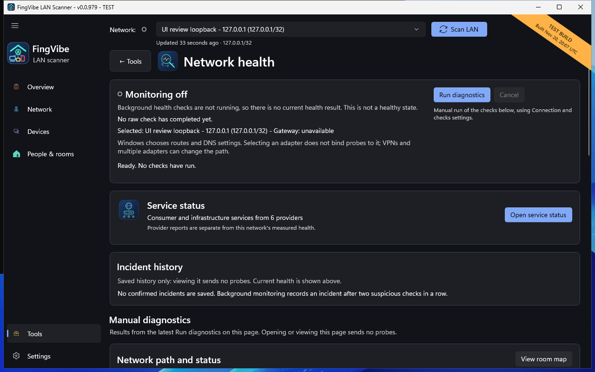
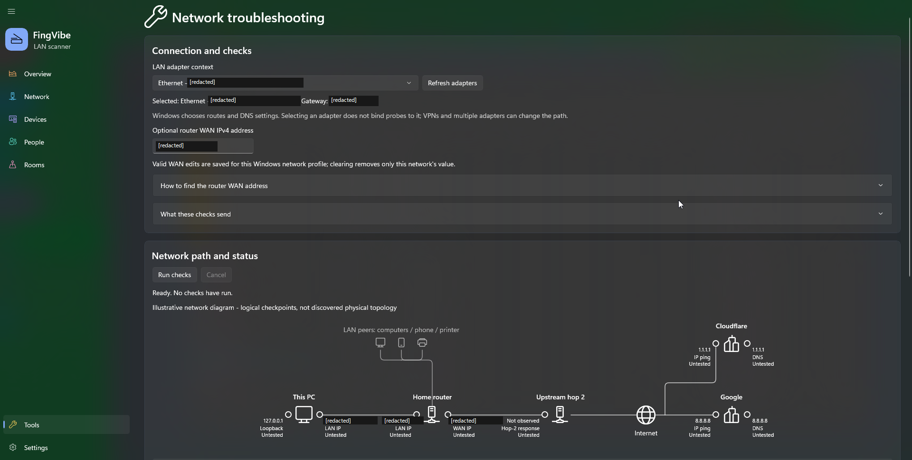

# Network health

Use **Tools > Network health** to run connection checks manually. The
**Open network health** button in the Network page's **Network health**
section opens the same page. Opening the page does not send diagnostic probes.

The top of the page shows the background monitoring state. With monitoring off,
it shows **Monitoring off**: no background checks run, so FingVibe shows no
current health result instead of implying that the network is healthy.
Turn monitoring on under **Settings > Background activity**
([Scheduled scans and monitoring](scheduled-scans.md)).

## Monitoring state and health verdicts

A small dot beside **Network:** in the header shows the monitoring state on every
page. Hover over it or focus it to read the state and last-check time, and select
it to open this page. The dot pulses briefly when a check starts; with Windows
animations turned off it stays still. The same state, with an explanation, appears
at the top of this page and in the Network page's **Network health** section.

| State | Dot | Meaning |
| --- | --- | --- |
| **Monitoring off** | Hollow grey outline | No background checks run. |
| **Monitoring paused** | Dashed grey outline | Windows is asleep; checks resume after a full minute. |
| **Monitoring on - no result yet** | Accent outline | Waiting for the first completed check. |
| **Learning - no problems found** | Green outline | No problem found while FingVibe learns normal latency. |
| **Healthy** | Filled green | No problem found against learned normal latency. |
| **Possible problem - verifying** | Amber outline | One suspicious check; FingVibe checks again within 30 seconds. |
| **Problem confirmed** | Filled red | The same symptom appeared in two consecutive checks. |
| **Uncertain - multiple network routes** | Dashed amber outline | Windows may route checks through another adapter or VPN. |
| **Monitoring on - last result not current** | Filled grey | No check has completed for over three minutes. |

FingVibe judges each completed check with these fixed rules:

- **Latency:** each target learns its normal latency from 20 healthy checks.
  A median above 20 ms (gateway) or 150 ms (`1.1.1.1`, `8.8.8.8`) is suspicious
  while learning; afterwards it must also exceed three times the learned normal
  latency. Learning pauses while that target is suspicious or has a problem.
- **ICMP probes unanswered:** two or more of five unanswered probes are
  suspicious only for a target that has answered before. A target that never
  answers is shown as limited visibility, not as an outage, because many
  networks block ICMP. Unanswered ICMP is not application packet loss.
- **DNS:** a Windows DNS failure is suspicious. A public resolver that does not
  answer while Windows DNS works is noted as possibly blocked, not as a DNS
  failure. Windows results may come from its cache.
- **Confirmation and recovery:** a problem is confirmed after two consecutive
  suspicious checks for the same symptom and target. While verifying or tracking
  a problem, checks run every 30 seconds. A problem clears after five consecutive
  healthy checks; an unhealthy check restarts that count. Cancelled, skipped and
  paused checks neither count nor restart it.
- **Context:** changing the selected network starts learning afresh. With more
  than one active gateway route (for example a VPN or a second adapter),
  FingVibe reports **Uncertain** instead of judging the selected LAN.

These are fixed defaults, not guarantees: a healthy verdict means only that these
checks found no problem. Latency baselines and unconfirmed suspicions are kept in
memory only. Confirmed problems and their recovery progress are saved as
incidents (see [Incident history](#incident-history)), so recovery counting
resumes on the same network after sleep, turning monitoring off or a restart.

Below the verdict, this page and the Network page list the latest raw results:
ping responses and latency range for the gateway, `1.1.1.1` and `8.8.8.8`, and
the Windows, Cloudflare and Google DNS results. Results kept while monitoring is
off or paused are marked as not current.

## Incident history

When monitoring confirms a problem, FingVibe saves it as an incident in the
**Incident history** section, newest first. Each network keeps at most one
active incident: further symptoms are added to it rather than creating a new
incident every 30 seconds. After recovery is confirmed, a new problem becomes a
new incident. Each entry shows its symptoms, when the problem was first observed
and confirmed, the network, and one of these states:

- **Ongoing:** still observed, with recovery progress (for example *2 of 5
  consecutive healthy checks*).
- **Recovered:** five consecutive healthy checks completed. The entry shows when
  recovery was observed and how long after the first observation; that is not an
  exact outage duration.
- **Recovery unknown:** FingVibe has not observed the network since an
  observation gap began, so it cannot say whether or when the problem ended.

Closing FingVibe, sleep, turning monitoring off and selecting another network
are recorded as observation gaps, never as recovery. When monitoring checks the
same network again, recovery counting continues from the saved progress; a
recovery that spans a gap is shown with its exact time as unknown. The Network
page's **Network health** section shows the ongoing or most recent incident.
Viewing history sends no probes and is separate from current health and manual
diagnostics, which remain available while monitoring is off.

Incidents are saved in the local device inventory database. Until that database
exists (it is created by the first saved inventory change, such as a completed
scan), new incidents are kept in memory with a visible note and saved later.
Load and save failures are shown on this page and in the Network summary.
## Service status

The **Service status** card below current health opens a separate page of
provider-published reports for six providers. Each provider has one everyday
(**Consumer**) and one **Infrastructure** entry: Microsoft Outlook.com and
Azure, Google Gmail and Google Cloud, Amazon.de shopping and AWS, Cloudflare
1.1.1.1 public DNS and CDN/network, Apple iCloud and Developer services, and
GitHub website/repositories and Actions. Use **All**, **Consumer** or
**Infrastructure** to filter the table, and **Back to Network health** to return.

Provider reports are not measurements of your connection, never change this
network's measured health, and the page sends no local network probes. Each row
keeps its state explicit: **No incidents reported**, an incident title such as
**Degraded service**, **Feed unavailable**, **Report outdated**, **Feed
unreadable**, **Official page only**, **Source pending** or **Feed not
connected**. Only **No incidents reported** comes from a current provider
report; every other state means FingVibe does not know the service's status.
Provider timestamps are shown separately from the local **Feed refresh** time.

Opening Service status retrieves a supported public feed when there is no
usable report younger than five minutes. **Refresh reports** explicitly
requests fresh data; there is no background or local-incident polling. Reports
are kept only in memory while FingVibe runs.

Supported sources are the Azure status RSS, AWS EC2 `us-east-1` health RSS,
Google Workspace and Google Cloud incident feeds, Cloudflare Status summary
components, and GitHub Status components. The scope shown with each result is
limited to the provider components or products represented by that feed: for
example Gmail, published Google Cloud products/locations, Amazon EC2 in
`us-east-1`, Cloudflare Recursive DNS or CDN/Network, and GitHub
website/repository components or Actions. A provider-wide health claim is not
inferred from one scoped feed.

Outlook.com and Amazon.de shopping have no approved status source and Apple's
pages are link-only, so those entries are never monitored. Every row links to
the provider's official status page or service, which opens in your browser.
If a request fails, an earlier usable report may be marked outdated; otherwise
the row reports the feed as unavailable. Unexpected response data is shown as
unreadable rather than healthy.

## Run diagnostics

1. Open **Tools > Network health**.
2. Review the **LAN adapter context** under **Connection and checks**.
3. Use **Refresh adapters** if your connection changed.
4. Leave the optional router WAN address blank unless you know it.
5. Read **What these checks send**.
6. Choose **Run diagnostics** at the top of the page.
7. Read each checkpoint and the traceroute result.

*Safe UI-review ready state of the earlier layout; the button is now named
**Run diagnostics** and sits above the diagram. Review mode disables actual
diagnostic probes. That test-only restriction does not apply to a normal release.
[Screenshot sources](screenshots.md).*

**Cancel**, leaving the page, changing its network context, or closing the app
stops the checks. A LAN scan, speed test, or device-service probe must finish
before another network measurement can start.

## What is checked

| Check | What a response can tell you |
| --- | --- |
| Loopback `127.0.0.1` | This PC's local network stack answered. |
| This PC's LAN IPv4 | The selected local address answered. |
| Gateway | The configured router/local gateway answered, if available. |
| Selected LAN peer | One randomly selected online device on this LAN answered; its IPv4 address and ping latency are shown, never its name. |
| Optional router WAN | The supplied address answered; it may not answer ping. |
| `1.1.1.1` and `8.8.8.8` | The public targets answered the requested IP check. |
| DNS | Name resolution for `example.com` succeeded through the tested resolver. |
| Traceroute | Some routers on the route toward `1.1.1.1` returned hop information. |

**DNS** translates a name into an address.
**Traceroute** asks for responses at successive routing steps.
Some routers do not answer these probes, even when they forward normal traffic.
An unanswered hop does not by itself locate a connection fault.

The checks use short timeouts. Traceroute stops after at most sixteen hops.
A completely unanswered run with a selected peer takes about 39 seconds plus Windows scheduling time.

Each run selects one eligible peer from existing online scan evidence for the
selected Windows network profile and subnet, excluding this PC and the gateway.
No extra discovery scan is started. The target stays fixed during that run;
running again selects afresh and can choose the same address.
If no eligible peer is available, scan the selected LAN first. Other diagnostics
still run. An unanswered peer is inconclusive: it may be asleep, filter ICMP, or
use client isolation. One peer never represents every LAN device and cannot
alone make the overall network unhealthy.

Windows selects the actual routing and DNS context.
Choosing an adapter here does **not** bind all public checks to that adapter.
VPNs and multiple adapters can change the route.

## Router WAN address

**WAN** means the router's internet-facing side.
The WAN IPv4 may differ from the public address seen by a website, for example
with provider-side address sharing.

1. Open your router's administration page in a browser.
2. Sign in there, not in FingVibe.
3. Find **Internet**, **WAN**, or **Status**.
4. Copy the WAN/Internet IPv4 address into the optional field.

**Never enter router credentials into FingVibe.**
Leaving the field blank is valid. A valid edit saves for the current Windows
network profile; clearing it removes that profile's saved value.
The address may change later.

## Read the diagram

The diagram organizes logical checks. It is not a discovered physical network
map and does not prove that devices are directly connected to one another.
Read each label and status rather than interpreting colored lines alone.
The selected peer sits above the router with its checkpoint below the icon.
Muted icons on the separate left branch are decorative, not additional probes.
Use **View room map** above the diagram to compare saved room assignments with
the selected network's latest evidence. That page is organizational and does
not replace these diagnostics or prove physical network topology.

*Earlier user-supplied ready-state screenshot, with approved address redactions.
No checks had run. Its exact application revision is unknown.
[Screenshot sources](screenshots.md#earlier-diagram-image).*

Public targets receive your public source address and relevant DNS query.
See [Privacy](privacy.md) and [Common problems](problems.md).
