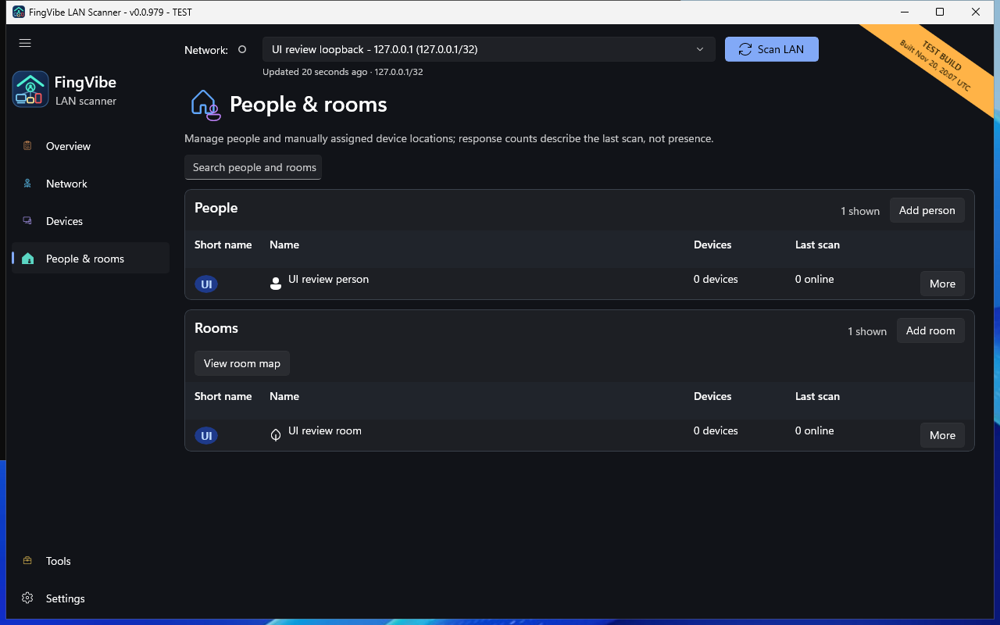
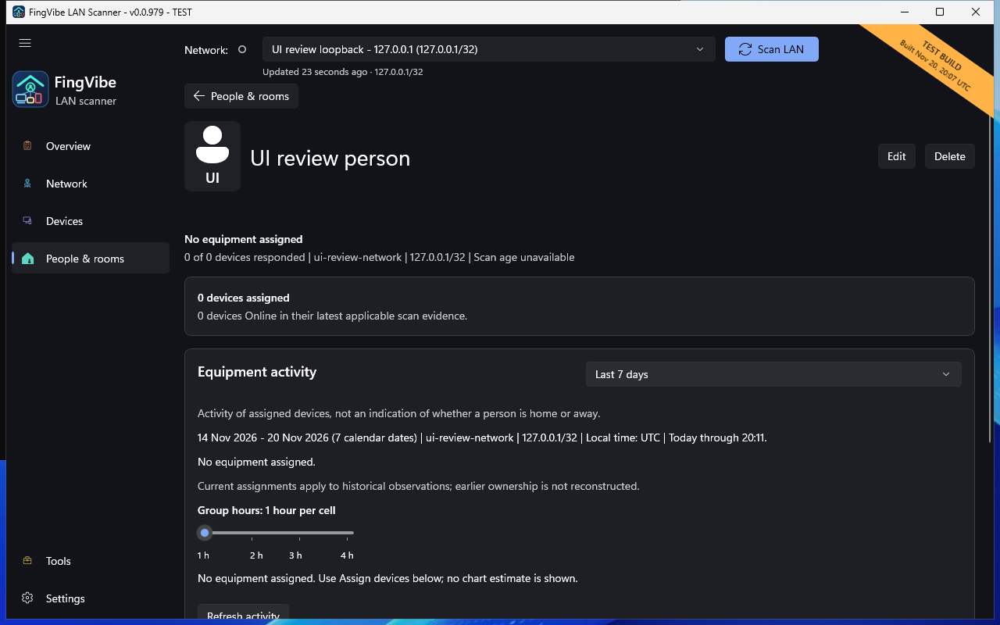
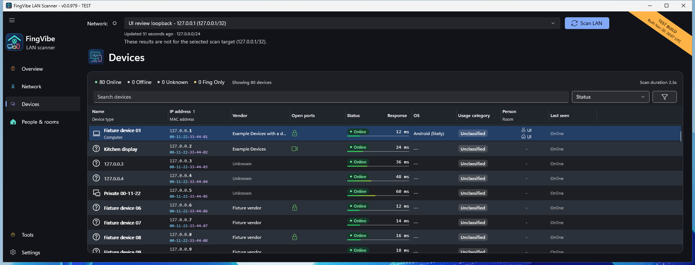
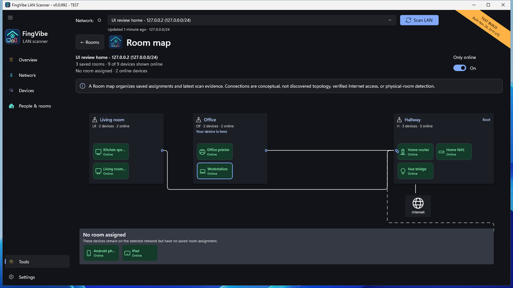

# People and rooms

Use **People & rooms** to label who uses equipment and where it belongs.
FingVibe does not automatically discover a device's owner or room.

## Create a person or room

1. Open **People & rooms**.
2. In the **People** or **Rooms** section, choose **Add person** or **Add room**.
3. Enter the full name.
4. Review the suggested short name.
5. Optionally choose an icon and enter notes.
6. Save the entry.

Short names contain one to three visible characters and must be unique within
People or within Rooms. For example, **Living Room** can use **LR**.
Editing a suggested short name stops its automatic updates.

*The person is a synthetic test entry, not a real user.
[Screenshot sources](screenshots.md).*

## Assign devices

From Devices:

1. Select the device.
2. Find **Assignments**.
3. Choose a **Person**.
4. Choose a **Room** if needed.
5. Check any save feedback.

Person and Room save independently when changed. Either can be **Unassigned**.
You can also open a person or room's details and choose **Assign devices**.

*This example has no assigned devices. The response count is not a presence
measurement for a person. [Screenshot sources](screenshots.md).*

*Both UI labels refer to invented review entries. Response counts and Last seen
do not establish a person's presence. Open the wide image at full size.
[Screenshot sources](screenshots.md).*

Assignments normally need a valid six-byte MAC address.
They do not follow an IP address alone. Randomized or changing MACs can lose
the link; supported inferred virtual identities keep their own assignments.

A [linked device](device-details.md#link-two-records-as-one-device) has one
shared **Person** and **Room** for all of its MAC addresses; changing either on
any of its MAC addresses changes it for the linked device. Each MAC's own earlier
assignment is kept for a later Unlink. A linked device counts once in person and
room device counts, the Room map, their online counts and the person's equipment
Activity. A response from any eligible member counts the linked device once; if
no member responds, all eligible members must have a recorded nonresponse
before the equipment is counted as not responding. Missing member evidence stays
unknown rather than proving absence.

## View the Room map

Open **People & rooms**, then choose **View room map** in the **Rooms**
section. You can also open the same page from the **Room map** card in
**Tools**, or from the **Network path and status** section in
**Network health**. **Back** returns to the page where you opened the map
and names it, even after you visit a room or device from the map.

*Invented rooms and scan evidence. Home router is the synthetic gateway.
Workstation's Ethernet and Wi-Fi MACs count once; its highlight identifies
**This PC**. The connectors are conceptual, not discovered physical topology.
[Screenshot sources](screenshots.md).*

The map includes all saved rooms, their assigned devices, and a separate
**No room assigned** area. Empty saved rooms remain visible. Room and device
sizes use bounded tiers, so counts do not turn into a proportional floor plan.
Orthogonal lines connect each router or fallback room anchor to the root
gateway entry; the **No room assigned** area uses a dashed line. Additional
routers in the root room connect locally to the gateway. The selected
network's gateway identifies the root room. This PC and its saved room have
separate highlights when that evidence is available.
Connector bends are rounded to make the room relationships easier to follow.

**Online**, **Offline**, and **No local scan evidence** describe the latest
saved result for the selected network. They do not prove physical presence.
The Internet symbol and room arrangement describe organization and conceptual
connection, not discovered cable, Wi-Fi, mesh, or Internet topology.

Choose a device tile or room name to open its existing details page. The Back
action reads **Back to Room map** and returns to the same scroll and keyboard
focus position. If the saved membership changed while details were open,
FingVibe selects a valid nearby device or room instead. Completed scans and
assignment changes refresh the retained map without moving unchanged items.

**Only online** starts on and hides offline devices and devices without local
scan evidence while preserving the room layout. Turn it off to show every
relevant device again. Use the **Rooms** Back action to return to the existing room
management page. Narrow
windows keep normal-size device icons and allow horizontal and vertical
scrolling. With larger Windows text sizes, room headers and device tiles grow
taller so labels stay inside them.

## Find, edit, or delete

Use **Search people and rooms** to filter both sections at once. Open an entry to review its assigned
equipment. Use its edit action to change the name, icon, or notes.

Each section keeps its count and Add action visible when empty or when nothing
matches the search. If saved inventory cannot be loaded, the error remains
visible and both Add actions are disabled until the data is available.

Deleting a person clears that person's device assignments.
Deleting a room clears only that room's assignments.
Neither action deletes devices or scan history.

The Devices table can show short Person and Room labels.
Their tooltips give the full names. Filters and search also match full names.

## Interpret counts

**Last scan** counts devices that responded in the displayed local scan.
It does not show whether a person is home, a room is occupied, or a device
is continuously connected.

Your entries and assignments are saved locally.
If a load or save fails, read the error before making further changes.
See [Saved data](data.md).
