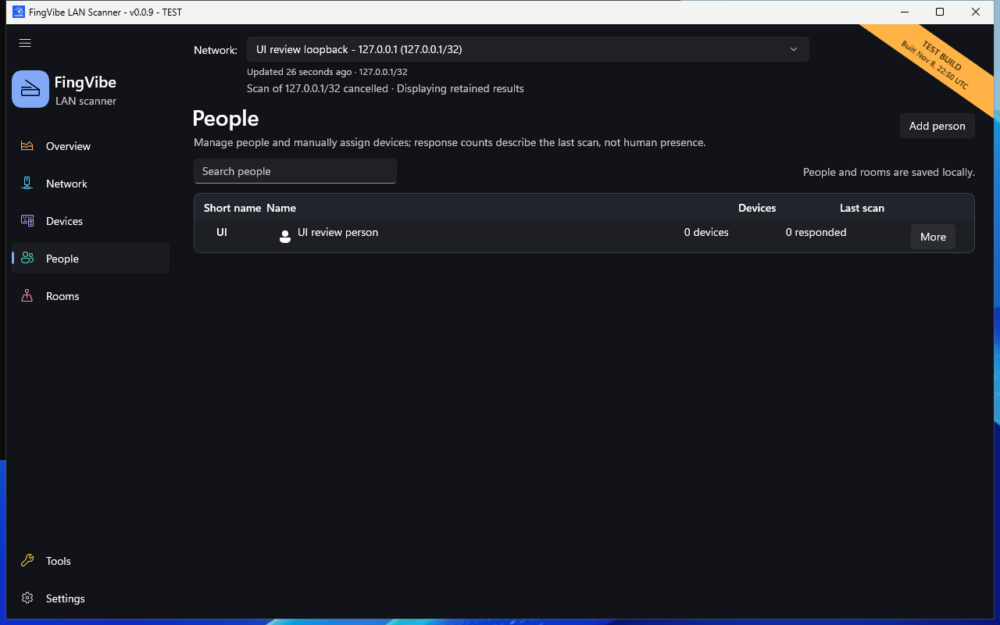
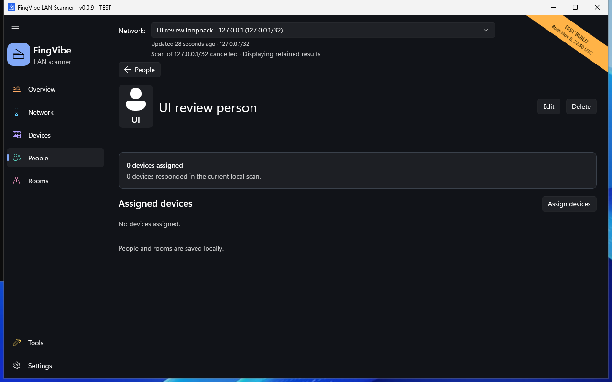

# People and rooms

Use **People** and **Rooms** to label who uses equipment and where it belongs.
FingVibe does not automatically discover a device's owner or room.

## Create a person or room

1. Open **People** or **Rooms**.
2. Choose **Add person** or **Add room**.
3. Enter the full name.
4. Review the suggested short name.
5. Optionally choose an icon and enter notes.
6. Save the entry.

Short names contain one to three visible characters and must be unique within
People or within Rooms. For example, **Living Room** can use **LR**.
Editing a suggested short name stops its automatic updates.

*The person is a synthetic test entry, not a real user.
[Screenshot sources](screenshots.md).*

## Assign devices

From Devices:

1. Select the device.
2. Find **Assignments**.
3. Choose a **Person**.
4. Choose a **Room** if needed.
5. Check any save feedback.

Person and Room save independently when changed. Either can be **Unassigned**.
You can also open a person or room's details and choose **Assign devices**.

*This example has no assigned devices. The response count is not a presence
measurement for a person. [Screenshot sources](screenshots.md).*

Assignments normally need a valid six-byte MAC address.
They do not follow an IP address alone. Randomized or changing MACs can lose
the link; supported inferred virtual identities keep their own assignments.

## Find, edit, or delete

Search the People or Rooms page by name. Open an entry to review its assigned
equipment. Use its edit action to change the name, icon, or notes.

Deleting a person clears that person's device assignments.
Deleting a room clears only that room's assignments.
Neither action deletes devices or scan history.

The Devices table can show short Person and Room labels.
Their tooltips give the full names. Filters and search also match full names.

## Interpret counts

**Last scan** counts devices that responded in the displayed local scan.
It does not show whether a person is home, a room is occupied, or a device
is continuously connected.

Your entries and assignments are saved locally.
If a load or save fails, read the error before making further changes.
See [Saved data](data.md).
