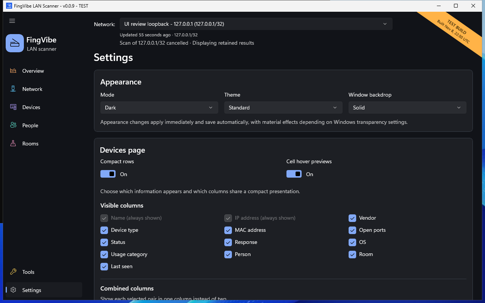

# Appearance and table settings

Open **Settings**. Appearance changes apply immediately and are saved for your
next launch. Read any save warning before assuming a choice was stored.

*Native test-build screenshot. Combined-column and schedule settings continue
below the visible area. [Screenshot sources](screenshots.md).*

## Choose appearance

1. Select **Mode**: Light or Dark.
2. Select a **Theme**.
3. Select a **Window backdrop**.

Light mode offers **Standard**, **Warm**, and **Colorful**.
Dark mode offers **Standard**, **True Black (OLED)**, and **Colorful**.
Changing mode keeps Standard or Colorful; Warm and True Black map to each other.

Backdrop choices are **Solid**, **Mica**, **Mica Alt**, and **Acrylic**.
Solid shows the theme colors most directly.
Windows transparency settings and platform support affect material backdrops.
If a backdrop is unavailable, the app uses a solid background without forgetting
your selection.

On first launch without a saved preference, the app follows Windows app mode.
A saved preference takes precedence. Ordinary Windows light/dark changes do not
switch FingVibe's theme while it is running.

Windows high contrast takes precedence over decorative colors.
The app also respects Windows animation preferences for supported effects.

## Choose device columns

Find **Devices page** in Settings.

**Visible columns** controls which optional columns appear.
Name and IP address are always shown.
**Combined columns** places related values in one table column.

For example, **IP/MAC** places the IP above the MAC.
**Person/Room** stacks the two assignments.
If only one member is visible, it remains a normal column.
Combined columns keep their applicable sort actions.

Resize columns from Devices. Separate and combined widths are remembered
independently.

## Row density and previews

**Compact rows** uses less vertical space. Turn it off for Standard/relaxed rows.
Both layouts can grow to accommodate larger text.

**Cell hover previews** reveals full shortened values after a short pointer
pause. Keyboard focus exposes the full values too.
Turning previews off restores ordinary value tooltips.
Service, status, and explanation tooltips remain available.

## Reset columns

**Reset columns** restores default column visibility, combinations, and widths.
It does not reset row density, hover-preview choice, or the saved Status filter.
Use **Clear filters** on Devices to clear filtering.

If preferences cannot be loaded, Settings reports the problem and protects the
unreadable file from being overwritten. See [Common problems](problems.md).

Scheduled scans are configured separately in
[Scheduled scans and discoveries](scheduled-scans.md).
