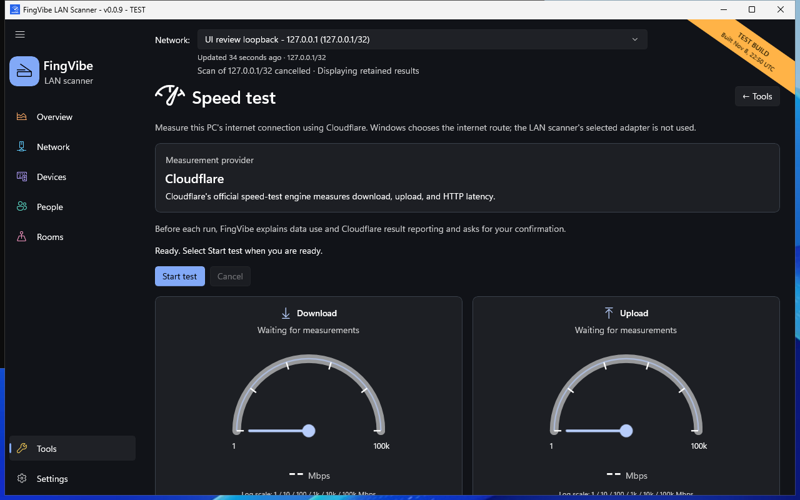

# Speed test

The speed test measures **this PC's internet connection**, not transfer speed
between your LAN devices. It uses Cloudflare.

!!! warning "Internet data use"
    A test can transfer more than 1 GB on a fast connection. FingVibe does not
    impose a data cap. Review the disclosure before every run, especially on a
    metered or mobile connection. Results are reported to Cloudflare.

## Run a test

1. Open **Tools > Speed test**.
2. Finish or cancel any other active network measurement.
3. Choose **Start test**.
4. Read the data-use and Cloudflare reporting disclosure.
5. Confirm only if you want to use that data and send the results.
6. Wait for the completed result, or choose **Cancel**.

*Native test-build ready state. No live test was run for this screenshot,
and no measured result is implied. [Screenshot sources](screenshots.md).*

## Read the measurements

**Download** measures receiving data from the internet.
**Upload** measures sending data.
Both are shown in **Mbps**: megabits per second, not megabytes per second.

**HTTP latency** is the measured delay for the engine's web requests.
It is different from a LAN device's ping response.

Gauge values during the run are **provisional** estimates.
Use the completed result for the final measurement.
The gauge scale is logarithmic: equal visual spacing does not mean equal
increments in Mbps. Numeric values remain the important readings.

The provider location is shown as unavailable when the engine does not supply it.
The app does not guess a serving location.

## Cancellation and failures

Cancel, leaving the page, and closing the app use the same stop path.
A cancelled run is not a completed result.
If an error occurs, read the message before retrying.

Windows chooses the internet route. The LAN scanner's selected adapter does
not bind this test. Wi-Fi signal, VPNs, other downloads, and provider conditions
can change measurements.

The test needs Microsoft Edge WebView2 and access to
`https://speed.cloudflare.com`. LAN scanning can work even when this optional
tool cannot. See [Speed test problems](problems.md#the-speed-test-does-not-start).

Only Cloudflare testing is available here.
Azure testing remains deferred; it is not an alternative button or configuration.
See [Privacy](privacy.md) for the requests involved.
