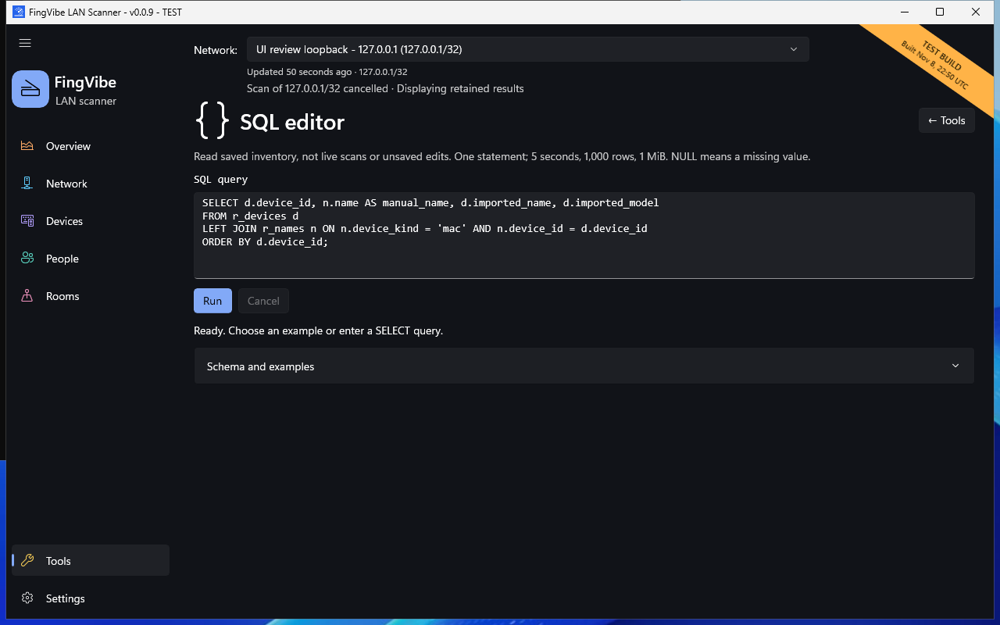

# SQL reports

The **SQL editor** reads saved inventory and history.
SQL is a query language for asking questions about data.
You can start with a built-in example without writing a query yourself.

## Run an example

1. Open **Tools > SQL editor**.
2. Expand **Schema and examples**.
3. Read an example and choose **Use example**.
4. Choose **Run**.
5. Read the result columns and the status message.
6. Choose **Cancel** if you need to stop the query.

[](../screenshots/manual/sql.png)

*Safe test-build capture. No result rows are shown in this ready state.
[Screenshot sources](screenshots.md).*

A **schema** describes available tables/views and columns.
Use the listed reporting views, whose names start with `r_`.
They are more suitable than internal storage tables.
**List of tables** separately lists the supported underlying tables and their
descriptions. Select a table to see its columns. This does not grant access to
other database tables or change the editor's read-only limits.

Run and Cancel stay beside the right-aligned status. The result table fills the
available content width; scroll it horizontally when there are many columns.

## A simple equipment report

This example lists current saved assignments, not human presence:

```sql
SELECT a.device_kind, a.device_id,
       p.name AS person, r.name AS room
FROM r_assignments a
LEFT JOIN r_people p ON p.person_id = a.person_id
LEFT JOIN r_rooms r ON r.room_id = a.room_id;
```

`LEFT JOIN` keeps a device's assignment row even if a person or room is missing.
`NULL` means a missing value, not the word "NULL" stored as a name.

## What the editor can and cannot do

The editor accepts **one read-only SELECT statement**, including supported
common table expressions. It cannot edit, delete, attach, or create databases.
Unsupported commands and functions produce an error.

It reads a consistent snapshot of **persisted data**.
It does not read unsaved drafts or continuously changing scanner objects.
A committed partial scan can update saved aggregates, but
`r_scan_history` contains completed-scan history only.

| Limit | What to expect |
| --- | --- |
| 5 seconds | A query that exceeds the time budget reports an error. |
| 1,000 rows | More rows produce explicit result truncation. |
| 1 MiB of results | Oversized results stop at a whole-row boundary with feedback. |
| 64 columns | Wider requests fail explicitly. |
| Long cell values | The UI can shorten previews separately from result completeness. |

Do not treat a truncated result as the full dataset.
Use a narrower query, selected columns, or a `WHERE` condition.

Missing inventory, a busy database, or invalid SQL is an error, not an empty
successful report. Let a save finish before retrying a busy query.
Leaving the tool or closing the app cancels pending work.

## Advanced reporting

MAC and virtual identities are different kinds of records.
Summing both can count overlapping evidence twice.
Stored observation times are not a continuous availability log.

For reporting views, exact limits, timestamp rules, and safe joins, use the
[SQL reporting reference](https://github.com/iricigor/fingvibe/blob/main/docs/sql-reporting.md).
