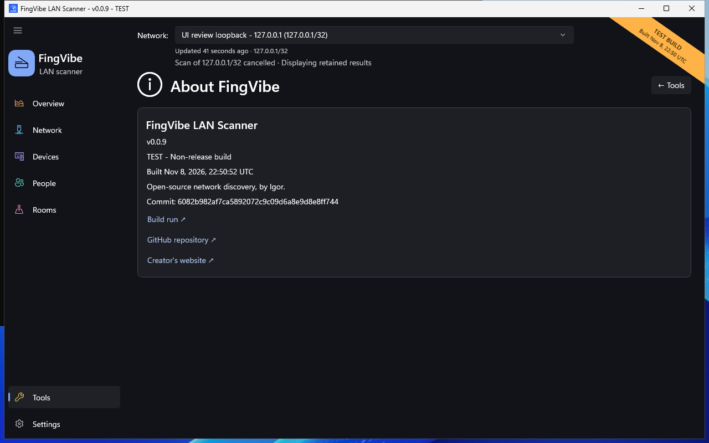

# Version and support

Open **Tools > About FingVibe** to identify the running application.
The page shows version, build kind, build time, and commit when available.
Source, build, and creator links open in your browser.

*The values identify the screenshot's test build, not your installation.
[Screenshot sources](screenshots.md).*

## Release versus test build

Official releases come from
[GitHub Releases](https://github.com/iricigor/fingvibe/releases/latest).
They do not show a test-build ribbon.

PR artifacts are experimental builds and show the PR identity.
Other test builds show **TEST**; local developer builds show **DEV**.
Acknowledging the diagonal ribbon hides it until closing the app.
The title and About page still retain build identity.

If metadata is missing, the app says it is unavailable rather than guessing.
A Release compilation setting alone does not make a build an official release.

## Report a problem

1. Check [Common problems](problems.md).
2. Search the [existing issues](https://github.com/iricigor/fingvibe/issues).
3. Open the [bug-report form](https://github.com/iricigor/fingvibe/issues/new/choose).
4. Include the app version/build identity and Windows version.
5. Describe the steps, expected result, actual result, and exact error.
6. Include a privacy-safe screenshot if it helps.

For scan problems, say which kind of adapter you used, whether the scan finished,
whether a VPN was active, and whether filters were applied.
Compare identities rather than posting only different device totals.

Do not upload your inventory database, private Fing workbook, credentials,
unredacted names/addresses, or router login details.
See [Privacy](privacy.md#share-screenshots-safely).

## Request a feature

Use the same issue chooser and explain the problem you want to solve.
Describe the desired outcome and a practical example.
Maintainers organize requests into the repository's Epic backlog;
submitting a request does not mean it is approved or scheduled.

## Documentation corrections

Report the page link, the unclear/outdated sentence, and the app version.
Screenshots with a test label may use sample values; that alone is not a bug.
Incorrect workflow instructions or inaccessible visuals are useful findings.
