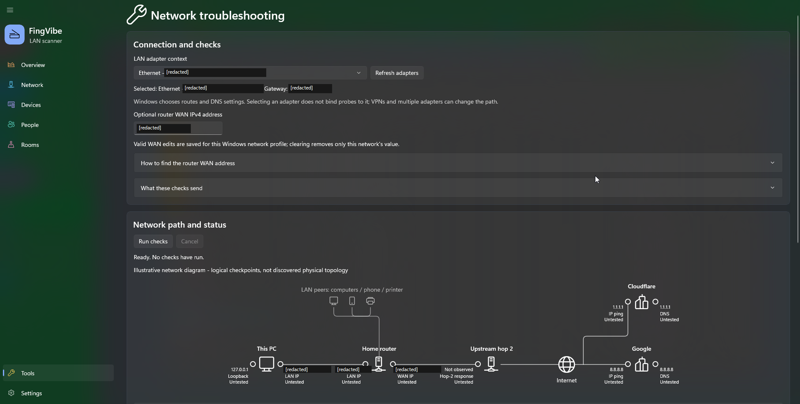

# Network health

Open **Tools > Network health**, or choose **Open network health** in the
**Network health** section of the Network page; both open the same page.
Review the LAN adapter context and select **Run diagnostics**. Use
**Refresh adapters** after changing connections.
The top **Current health** card states **Monitoring off**: background health
checks are not available yet, so the page never implies a healthy network
without a check. No diagnostic probes run automatically. Run is blocked while a LAN scan,
Cloudflare speed test, or another diagnostic run is active or stopping.
Cancel, Back, navigation, a changed selected network context, and window close
stop probes safely. Windows network-status notifications that leave the selected
adapter, IPv4/subnet, gateway, and network-profile identity unchanged preserve
active checks, results, and animation. Notifications are coalesced, and an
awaited cancellation cannot reset a newer run or selection. If context
verification fails, the page stops active work and reports the error while
retaining existing results as potentially stale.
**Run diagnostics**, **Cancel**, and run progress appear in the current-health
card at the top. Below it, **Manual diagnostics** shows **Network path and
status**, **Detailed checkpoint diagnostics**, **Traceroute**, and
**Connection and checks** in bordered cards. Network-request disclosure and
interpretation notes are expandable within their relevant cards.

User-supplied native screenshot of the earlier Network troubleshooting layout,
showing **Connection and checks** together with
the complete **Network path and status** diagram, without the top-right
test-build ribbon. The diagram is unchanged on the Network health page; the
current-health card now sits above it and connection settings below it. Network-specific LAN, subnet, gateway, and WAN addresses
were redacted with the user's approval. This is the ready state: no diagnostic
checks have run, and the diagram is illustrative, not discovered topology.
[Capture provenance and reproduction](screenshots/README.md#tool-screenshots).

## Checks and network requests

The independent checkpoints are loopback (`127.0.0.1`), this PC's selected LAN
IPv4, the configured gateway when available, one random online LAN peer,
an optional router WAN IPv4,
both `1.1.1.1` and `8.8.8.8`, and DNS. Each public provider has separate
IP-ping and DNS-query results. DNS tests resolve **example.com**, a stable
reserved example domain, using Windows' configured resolver and direct UDP
port 53 queries to Cloudflare and Google. A configured resolver can answer
from cache; that check does not prove a new packet reached a DNS server.
Truncated UDP replies are reported explicitly; TCP DNS fallback is not tested.

ICMP probes have a **1.5-second timeout** and a 32-byte payload. Traceroute sends
one probe per hop toward `1.1.1.1`, up to **16 hops**, stopping when the destination
responds. DNS operations also have a 1.5-second deadline. A fully unanswered run
takes approximately 39 seconds with a peer, plus Windows scheduling overhead. Hops show
responding IPs and available timings; TTL-expired response timings are elapsed
probe time, while successful echoes use Windows' ICMP round-trip timing.
Unanswered hops and an incomplete trace are explicit.

Each run takes one fresh random selection from existing online inventory
evidence scoped to the selected Windows network-profile identity and subnet.
This PC, the gateway, offline devices, unscoped evidence and other networks are
excluded. Devices filters do not affect the candidate pool; no extra discovery
scan runs. The selected IPv4 stays fixed for that run and may be chosen again
next time. Only its IP, ping state and successful latency are displayed, never
its name. No eligible peer is explicitly unavailable with scan-first guidance;
other checkpoints still run. No response is inconclusive (sleep, ICMP filtering
or client isolation), and one peer alone does not make the overall summary
unhealthy.

Public providers receive your public source address and DNS query. Windows
chooses the routing and configured DNS context; selecting a LAN adapter does
**not** bind these probes to it. VPNs and multiple adapters can alter the path.
No new public-IP lookup service is contacted by this tool. FingVibe's existing
optional Network-page public-IP/ISP lookup is unchanged.

## Optional router WAN address and persistence

Leaving WAN blank does not prevent a run. Open the router administration page
in a browser, usually at the displayed gateway address. Sign in there, find
**Internet**, **WAN**, or **Status**, and copy the **WAN/Internet IPv4 address**,
not the LAN address. Never enter router credentials into FingVibe.

Valid edits are saved immediately in the current user's
`%LOCALAPPDATA%\FingVibe\router-wan.json`, using atomic JSON replacement.
Clearing removes only that network's value. Invalid input does not overwrite a
previously saved valid address. Load/save errors are visible; a failed load
disables persistence to protect existing settings.

The key is the **Windows Network List Manager network-profile GUID** associated
with the selected adapter's interface GUID. It is not the PC's LAN IP, subnet,
gateway IP, interface name, or one global value. Different Windows network
profiles with identical private addressing retain independent WAN addresses;
returning after a restart restores the profile's value. If Windows cannot
uniquely identify the network, persistence is explicitly unavailable and no
other profile's value is reused. Windows controls profile identification;
if it recreates or conflates profiles, FingVibe cannot establish a stronger
physical-network identity. Router WAN addresses can change, so the field remains
editable. A genuine selected-network context change cancels results and
refreshes the context. Unrelated or duplicate Windows notifications do not.
Deferred notifications from programmatic WAN loading or adapter selection do
not masquerade as user edits and clear results.

## LAN diagram

The screenshot above includes the complete diagram, from LAN peers and this PC
through the router and upstream hop to the internet and both public providers.
[Open the diagram and controls at full size](screenshots/network-troubleshooting.png).
Hollow ports and **Untested** labels are deliberate: this capture is not a
successful diagnostic run or a real network map.
[Capture details](screenshots/README.md#tool-screenshots).

### Interpreting the illustration and status

The **Selected peer** sits directly above the router, with its checkpoint below
its icon. The smaller, muted **LAN peers** icons sit to its left on a separate
branch with a rounded outer corner; these are decorative, not extra probes.
The earlier screenshot predates this selected-peer checkpoint.
The disclaimer reads **Logical checks—not a physical network map.** The PC-to-router,
router-to-hop-2, hop-2-to-globe, and globe-to-Google links are straight and
horizontal; the Cloudflare branch also retains curved elbows.
Left/right logical ports show loopback/LAN IP on the PC,
LAN/WAN IP on the router, and IP ping/DNS on each provider. Hop 2 is only
an observed responder; its ownership and relationship to the home router
are unknown. The globe omits later route details. This is **not discovered
physical topology**, real packet tracking, or continuous monitoring.
Cloudflare sits above Google; Google's lower checkpoints align with the PC,
router, and hop checkpoints rather than extending below the rest of the path.

Ports are hollow circles before testing, with the checkpoint IPv4 beside each
circle. The horizontal order is **left IP, left circle, device icon, right circle,
right IP**, with IP text just below the straight line and labels/outcomes
beneath their respective sides. Responses fill the circle green;
failed/unanswered checks fill it red,
with textual results. Direct-DNS ports show the resolver IP, not the resolved
hostname's address. Hop 2 shows its observed responder IP, or **Not observed**;
an unavailable optional WAN address is **Not supplied**.
Port descriptions use concise names such as **Loopback**, **LAN IP**,
**WAN IP**, **IP ping**, and **DNS**, without left/right suffixes.
Detailed hop and traceroute text shows **Responder** first and labels
**Trace target** separately, so `1.1.1.1` is not mistaken for the responding
upstream router. A destination actually reached at hop 2 remains an observed
destination response rather than a guessed router.
Three independently scheduled **8-DIP** dots illustrate requests and confirmed
responses along the connector lines at a constant **480 DIPs/second** in either direction. Farther
checkpoints take longer to reach; crossings behind icons count toward travel
time but hide the moving dot rather than making it jump across the gaps.
Each dot travels outward in a neutral color. On a confirmed response,
it grows from **8 to 18 DIPs and back** over **0.4 seconds** at the
corresponding **14-DIP** port before the request dot returns green. An unanswered
check or error pulses red at the target, then fades without a return journey. Each
color describes that check, not general node availability. Ping and DNS remain
separate. Loopback, self-ping, and Windows configured DNS pulse locally at the
PC; configured DNS can be cached and has no known resolver path in this diagram.
Each dot waits a fresh random **0.2–1.6 seconds** before selecting a random
available checkpoint, independently of the other dots. Delays and local/endpoint
phases mean three travelling dots need not be visible at every instant.
Requests and confirmed replies can travel in opposite directions simultaneously;
multiple dots may choose the same checkpoint. These are illustrations, not extra probes.
No green reply is shown for an untested, pending, unanswered, or errored check.

Random destinations replace the former ordered, bounded sequence. Actual probe
execution is unchanged: traceroute still runs after IP/DNS tests. A dot reaching
a pending checkpoint waits there neutrally until its result arrives; other dots
remain independent. Unavailable/cancelled checkpoints are skipped without
inventing a response. Decorative LAN peers remain static; only the selected peer
participates in the recorded-checkpoint illustration.
Animation does not delay network probes or the **Checks complete** status.
After checks finish it continues **until stopped**, replaying recorded outcomes
without sending traffic or retaining the network-activity lease. A separate
illustration label identifies recorded-result playback after checks finish. **Stop replay**
stops only the illustration and leaves completed results intact; **Run diagnostics**
can start a fresh run without waiting for replay. Results have no expiry timer:
they remain after stopping replay until an intentional reset, such as a new run,
WAN edit, adapter refresh/change, genuine context change, or reopening the page.
Cancel, navigation, a genuine context change, unload, and close clear animation
immediately. Windows' animation preference disables motion, and high contrast uses system colors.
Motion is schematic, not real packet tracking or a measurement of response time.
Untested, unavailable, running, and cancelled checks stay hollow and have
distinct neutral textual states. Windows high contrast uses system colors.
The two-row status below the diagram explains the evidence and next action,
not just a color. Ready, running, cancelled, errors, and insufficient evidence
remain neutral/partial. **All good** means the local, gateway, both public-IP,
and DNS checks passed, not that every service is healthy.

Loopback and self-ping do not verify cable/Wi-Fi. Hop 2 is not necessarily the
gateway's configured upstream gateway. An unanswered intermediate hop is not
evidence of failure if later hops respond. A red optional WAN or hop alone
does not make the overall status red. ICMP filtering can explain unanswered
external probes; check a browser and report targets, outcomes, and time.
DNS failure with a successful numeric-IP probe suggests DNS settings or
resolver filtering; configured DNS and direct public DNS failures are explained
separately. These probes do not identify an exact faulty device.

**Public egress IP** is not necessarily router WAN IP: double NAT, carrier-grade
NAT, or a VPN/proxy can make them differ. An optional WAN probe can fail even
with working internet access. Automatic router-management discovery and HTTPS
connectivity tests are outside this delivery.

## Regression checks

Core regression tests use injectable probes and temporary settings files; they
do not depend on public endpoints. Deterministic diagram-motion tests cover
short-check queuing, confirmed returns, unanswered/error fade-out, exact whole-
sequence pass counts, simultaneous opposite-direction travel, first-pass/replay
logical ordering and hop-2 waits, cancellation/reset, unchanged/changed context comparison,
deferred WAN edits, stale asynchronous refresh guards, and connector geometry
without network access or desktop automation.
`powershell.exe -NoProfile -STA -File tests\NetworkHealth.Ui.Tests.ps1
-AppPath <built-exe>` checks the native Tools entry, the Network summary entry and its second-section placement, **Monitoring off** current health, Run diagnostics placement and keyboard focus, visible WAN validation,
section headings, checkpoint IP labels, provider alignment, straight main-path
and curved branch geometry, review-mode privacy, navigation reset, and the
existing speed-test entry on an interactive Windows desktop.
It launches its own app in UI-review mode, which
does not load/save WAN preferences or send diagnostic probes. Synthetic peer
fixtures cover responded/latency, unanswered and unavailable presentation in
Light and Dark modes. On disposable GitHub Actions runners, the same test also
checks the selected peer at 200% Windows text scale with high contrast and a
640-pixel window, restoring the original accessibility settings afterward.
The owning Tools utilities scenario explicitly uses Windows PowerShell for the
.NET Framework WinRT projection used to observe effective Windows text scale;
PowerShell 7 does not provide that projection. Both child output streams are
forwarded through the parent host so its transcript captures standard output and
error diagnostics, followed by explicit nonzero-exit propagation. Child failures,
diagnostics and elapsed time remain within the unchanged 240-second native gate.
Changed-head native results and the affected-UI duration gate must still pass
before delivery; synthetic captures are not real network observations.
With `-ScreenshotDirectory`, it also checks the rendered untested-circle
outline and empty center next to the IP label, and the straight PC-to-router
line above the IP text.
