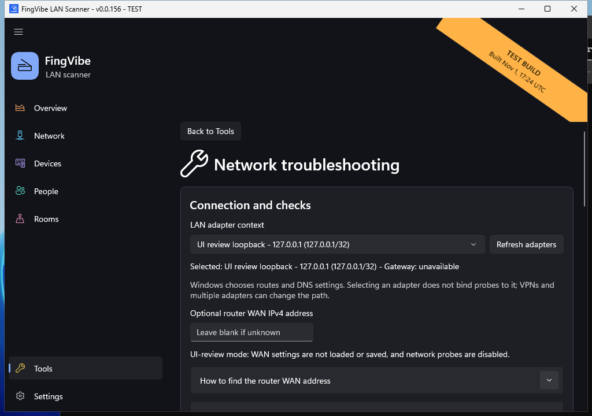
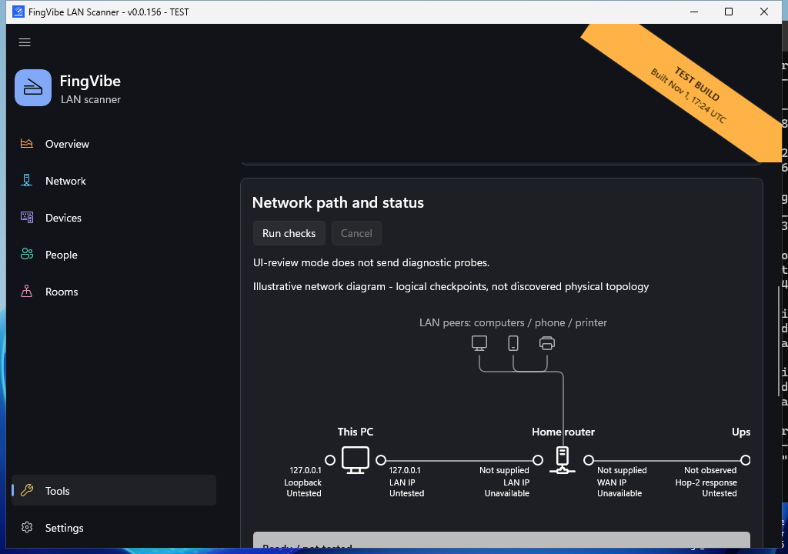

# Network troubleshooting

Open **Tools > Network troubleshooting**, review the LAN adapter context, and
select **Run checks**. Use **Refresh adapters** after changing connections.
No diagnostic probes run automatically. Run is blocked while a LAN scan,
Cloudflare speed test, or another diagnostic run is active or stopping.
Cancel, Back, navigation, network changes, and window close stop probes safely.
The page separates **Connection and checks**, **Network path and status**,
**Detailed checkpoint diagnostics**, and **Traceroute** into bordered cards.
Network-request disclosure and interpretation notes are expandable within
their relevant cards.
**Run checks**, **Cancel**, and run progress appear near the top of the
**Network path and status** card, above the diagram.

Native UI-review capture using a loopback adapter, not a private LAN.
Review mode disables diagnostic probes and WAN preference loading/saving.
[Capture provenance and reproduction](screenshots/README.md#tool-screenshots).

## Checks and network requests

The independent checkpoints are loopback (`127.0.0.1`), this PC's selected LAN
IPv4, the configured gateway when available, an optional router WAN IPv4,
both `1.1.1.1` and `8.8.8.8`, and DNS. Each public provider has separate
IP-ping and DNS-query results. DNS tests resolve **example.com**, a stable
reserved example domain, using Windows' configured resolver and direct UDP
port 53 queries to Cloudflare and Google. A configured resolver can answer
from cache; that check does not prove a new packet reached a DNS server.
Truncated UDP replies are reported explicitly; TCP DNS fallback is not tested.

ICMP probes have a **1.5-second timeout** and a 32-byte payload. Traceroute sends
one probe per hop toward `1.1.1.1`, up to **16 hops**, stopping when the destination
responds. DNS operations also have a 1.5-second deadline. A fully unanswered run
takes approximately 38 seconds plus Windows scheduling overhead. Hops show
responding IPs and available timings; TTL-expired response timings are elapsed
probe time, while successful echoes use Windows' ICMP round-trip timing.
Unanswered hops and an incomplete trace are explicit.

Public providers receive your public source address and DNS query. Windows
chooses the routing and configured DNS context; selecting a LAN adapter does
**not** bind these probes to it. VPNs and multiple adapters can alter the path.
No new public-IP lookup service is contacted by this tool. FingVibe's existing
optional Network-page public-IP/ISP lookup is unchanged.

## Optional router WAN address and persistence

Leaving WAN blank does not prevent a run. Open the router administration page
in a browser, usually at the displayed gateway address. Sign in there, find
**Internet**, **WAN**, or **Status**, and copy the **WAN/Internet IPv4 address**,
not the LAN address. Never enter router credentials into FingVibe.

Valid edits are saved immediately in the current user's
`%LOCALAPPDATA%\FingVibe\router-wan.json`, using atomic JSON replacement.
Clearing removes only that network's value. Invalid input does not overwrite a
previously saved valid address. Load/save errors are visible; a failed load
disables persistence to protect existing settings.

The key is the **Windows Network List Manager network-profile GUID** associated
with the selected adapter's interface GUID. It is not the PC's LAN IP, subnet,
gateway IP, interface name, or one global value. Different Windows network
profiles with identical private addressing retain independent WAN addresses;
returning after a restart restores the profile's value. If Windows cannot
uniquely identify the network, persistence is explicitly unavailable and no
other profile's value is reused. Windows controls profile identification;
if it recreates or conflates profiles, FingVibe cannot establish a stronger
physical-network identity. Router WAN addresses can change, so the field remains
editable. Network changes cancel results and refresh the context.

## LAN diagram

Native review-mode view of the diagram's **LAN portion**, scrolled to
**Network path and status**. The viewport shows illustrative peers, this PC,
and the home router; scroll the diagram horizontally to see the remaining
upstream and public-provider checkpoints. Hollow ports and **Untested** labels
are deliberate: this capture is not a successful diagnostic run or a real
network map. [Capture details](screenshots/README.md#tool-screenshots).

### Interpreting the illustration and status

Gray LAN peers are shown above this PC and the router, schematically connected
to the router with curved-corner elbow connector lines. The PC-to-router,
router-to-hop-2, hop-2-to-globe, and globe-to-Google links are straight and
horizontal; the Cloudflare branch also retains curved elbows.
Left/right logical ports show loopback/LAN IP on the PC,
LAN/WAN IP on the router, and IP ping/DNS on each provider. Hop 2 is only
an observed responder; its ownership and relationship to the home router
are unknown. The globe omits later route details. This is **not discovered
physical topology**, real packet tracking, or continuous monitoring.
Cloudflare sits above Google; Google's lower checkpoints align with the PC,
router, and hop checkpoints rather than extending below the rest of the path.

Ports are hollow circles before testing, with the checkpoint IPv4 beside each
circle. The horizontal order is **left IP, left circle, device icon, right circle,
right IP**, with IP text just below the straight line and labels/outcomes
beneath their respective sides. Responses fill the circle green;
failed/unanswered checks fill it red,
with textual results. Direct-DNS ports show the resolver IP, not the resolved
hostname's address. Hop 2 shows its observed responder IP, or **Not observed**;
an unavailable optional WAN address is **Not supplied**.
Port descriptions use concise names such as **Loopback**, **LAN IP**,
**WAN IP**, **IP ping**, and **DNS**, without left/right suffixes.
Detailed hop and traceroute text shows **Responder** first and labels
**Trace target** separately, so `1.1.1.1` is not mistaken for the responding
upstream router. A destination actually reached at hop 2 remains an observed
destination response rather than a guessed router.
Untested, unavailable, running, and cancelled checks stay hollow and have
distinct neutral textual states. Windows high contrast uses system colors.
The two-row status below the diagram explains the evidence and next action,
not just a color. Ready, running, cancelled, errors, and insufficient evidence
remain neutral/partial. **All good** means the local, gateway, both public-IP,
and DNS checks passed, not that every service is healthy.

Loopback and self-ping do not verify cable/Wi-Fi. Hop 2 is not necessarily the
gateway's configured upstream gateway. An unanswered intermediate hop is not
evidence of failure if later hops respond. A red optional WAN or hop alone
does not make the overall status red. ICMP filtering can explain unanswered
external probes; check a browser and report targets, outcomes, and time.
DNS failure with a successful numeric-IP probe suggests DNS settings or
resolver filtering; configured DNS and direct public DNS failures are explained
separately. These probes do not identify an exact faulty device.

**Public egress IP** is not necessarily router WAN IP: double NAT, carrier-grade
NAT, or a VPN/proxy can make them differ. An optional WAN probe can fail even
with working internet access. Automatic router-management discovery, HTTPS
connectivity tests, and probe-flow animation are outside this delivery.

## Regression checks

Core regression tests use injectable probes and temporary settings files; they
do not depend on public endpoints. `tests\NetworkTroubleshooting.Ui.Tests.ps1
-AppPath <built-exe>` checks the native Tools entry, visible WAN validation,
section headings, checkpoint IP labels, provider alignment, straight main-path
and curved branch geometry, review-mode privacy, navigation reset, and the
existing speed-test entry on an interactive Windows desktop.
It launches its own app in UI-review mode, which
does not load/save WAN preferences or send diagnostic probes. Verify live
Windows high contrast separately using system accessibility settings.
With `-ScreenshotDirectory`, it also checks the rendered untested-circle
outline and empty center next to the IP label, and the straight PC-to-router
line above the IP text.
