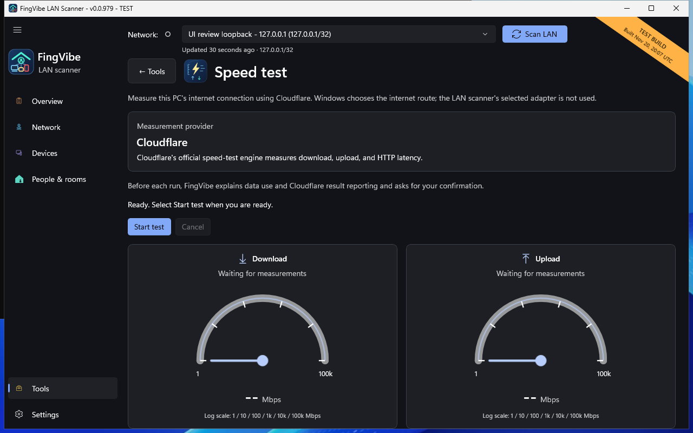

# Cloudflare speed test

Open **Tools > Speed test** and select **Start test**. Review and confirm the
data-use disclosure before measurements begin; use **Cancel** to stop a run.
Download, upload, and HTTP latency describe this PC's internet connection,
not throughput between LAN devices.

<a href="screenshots/manual/speed-test.png"></a>

Complete native UI-review capture with its actual test-build ribbon.
No live speed test was run and no measured results are implied.
[Capture provenance and reproduction](manual/screenshots.md).

## Engine and privacy

FingVibe bundles Cloudflare's official `@cloudflare/speedtest` browser engine at version **1.15.0**. The committed `src/FingVibe.App/Assets/SpeedTest/speedtest.js` was copied from the npm package; its SHA-256 is `49f86775d394bc2196b74fabd96bb2e331d707e0c899630613d2cee6cc211adb`. The package's MIT notice is included alongside the asset. The app does not load a mutable third-party script at runtime.

The engine runs in a WebView2 page served from FingVibe's local virtual host. That page permits scripts only from its bundled assets and connections only to `https://speed.cloudflare.com`; it exposes no native host objects. The bridge accepts only validated messages from the exact local page and current test run. Cloudflare's default engine configuration is used with manual start, no packet-loss/TURN test, and the default `__results` reporting endpoint; bandwidth measurements use Cloudflare's `__down` and `__up` endpoints.

Before every run, the native UI discloses internet data use and result reporting to Cloudflare, links the [Cloudflare Privacy Policy](https://www.cloudflare.com/privacypolicy/), and waits for the user's confirmation. The official default plan can transfer over 1 GB on fast connections; FingVibe does not set a data cap, and actual use depends on the connection and engine measurements. The test measures the PC's internet route, not LAN throughput; the scanner's selected adapter is not used. The pinned engine's result summary has no serving-location field, so the UI says the location is unavailable rather than guessing.

The pinned engine's `pause()` aborts the active latency or bandwidth fetch through its `AbortController`, and clears the bandwidth retry timer. FingVibe uses only the engine's pausable latency/download/upload measurements, detaches callbacks on cancellation, and keeps the scan-coordination lease until the cancellation call has completed. Navigation away and window close use the same stop path. A cancelled run is never rendered as a completed result.

## Live gauge

Separate native download and upload gauges show provisional estimates from the official engine's `onResultsChange` callback and bandwidth getters. Updates arrive after intermediate measurements, not as a continuous stream. Both gauges use a fixed logarithmic scale from 1 Mbps to 10 Gbps (zero and sub-1 Mbps readings sit at the left end; larger readings pin the needle at the right end but retain their exact numeric value). Major marks represent 1 Mbps, 10, 100, 1 Gbps and 10 Gbps, with minor marks at 2 and 5 within each step. The scale never changes during a run. The page groups its Test, Live measurement and Results cards in that order; gauges stack on narrow windows.

Each arc shows a red-yellow-green speed-quality gradient for its direction, and gauge and result values show a Slow / Fair / Good word with the same colors. `SpeedRating` holds the fixed thresholds (download 25/100 Mbps, upload 5/20 Mbps, after the FCC 100/20 benchmark and its earlier 25 Mbps download floor) and rates the displayed two-decimal value; `SpeedGaugeMotion` maps values to the arc. Theme dictionaries supply light/dark colors; high contrast uses system colors without a gradient, and accessible names include the rating. HTTP latency is not rated.

For native UI review, `FINGVIBE_UI_REVIEW_SPEED_TEST` (only with `FINGVIBE_UI_REVIEW=1`) lists comma-separated `provisional`, `failed` or `results` fixtures consumed one per run after the normal data-use confirmation. They feed scripted bridge messages through the same parser and session state instead of WebView2, including the engine's cancellation confirmation, so no internet traffic is sent.

Needles smoothly approach the latest estimate from their current displayed position, without overshoot or animation restarts, when Windows animations are enabled. Numeric values remain the actual estimates, not interpolated data. Intermediate latency phases and switching directions retain each gauge's estimate and mark it as the latest provisional value, avoiding repeated returns to zero between rounds. Cancellation, errors, completion, and navigation stop the animation and clear provisional values. Final results remain separate. Bridge samples are validated for the current run, positive finite bandwidth, and download/upload phase.

For practical user steps and WebView2 troubleshooting, see the
[Speed test manual](manual/speed-test.md). The engine and validation notes here
are contributor reference material.

## Deferred Azure preparation (contributors only)

Azure download measurement is not implemented or approved for resumption.
[DI-001](deferred-ideas.md#di-001-azure-hosted-speed-test-downloads) records why it
stopped: an enforceable spending cap has not been established. Reconsider only
under its recorded conditions. The historical preparation below is not a user
setup step or a promised next speed-test stage.

Generate a 256 MiB random binary payload outside the checkout, rather than committing a large file:

```powershell
.\tools\New-SpeedTestPayload.ps1 -Path "$env:TEMP\fingvibe-speedtest.bin"
```

Use `-SizeMiB` to change the size (1-4096 MiB). The generator streams fresh cryptographic random data in 1 MiB chunks, refuses to overwrite an existing file, and surfaces write errors. A failed write may leave a partial file; delete that specific output and regenerate before uploading. Upload as a block blob with content type `application/octet-stream`, no content encoding/compression, and `Cache-Control: no-store`. These headers do not enforce traffic limits. Payload size alone does not ensure reliable measurement on fast connections.

The future app configuration needs only the HTTPS blob URL and non-secret measurement limits. Never include storage account keys, connection strings, or write credentials. A public-read URL is configuration, not a secret. A read-only SAS is a bearer credential: injecting it through a repository secret during a build does not keep it secret in a distributed app. Keep publishing credentials in CI secrets or use Azure federated identity; do not ship them.

For a public blob, app-side duration/byte limits and cooldowns reduce normal traffic but cannot prevent reuse of the URL outside FingVibe. Azure budgets notify; they are not a hard spending cap. Blob Storage has no configurable per-blob monthly egress spending ceiling. Disabling anonymous access or blocking access is an emergency stop, not a precise byte cap. Stronger quotas require a server-side admission mechanism (for example, short-lived read-only SAS issuance with per-user limits); even a SAS limits time and permissions, not downloaded bytes. That adds infrastructure and can incur costs before enforcement takes effect.

## Live-service validation limitation

The pinned package review established its version, license, endpoints, units,
callbacks and `pause()` request-abort path. Documentation ready-state captures
and deterministic bridge checks are not evidence of a completed live-service
measurement or observed network-request termination. No live test was run for
this documentation refresh. Such verification requires separate consent because
it consumes data and reports results to Cloudflare; it should check successful
metrics, request termination on Cancel and retry after failure. Cloudflare
documents no public numeric quota or availability commitment; its
[website terms](https://www.cloudflare.com/website-terms/) apply.
