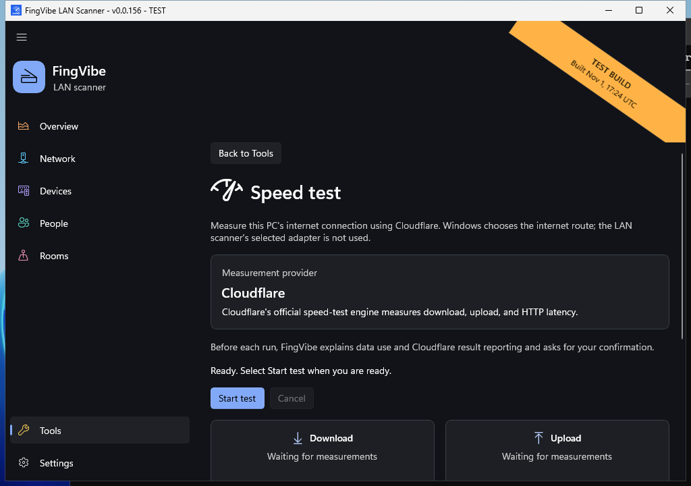

# Cloudflare speed test

Open **Tools > Speed test** and select **Start test**. Review and confirm the
data-use disclosure before measurements begin; use **Cancel** to stop a run.
Download, upload, and HTTP latency describe this PC's internet connection,
not throughput between LAN devices.

<a href="screenshots/speed-test.png"></a>

Native UI-review capture in the ready state: no live speed test was run and
no measured results are implied. The gauges and upload card continue below
this viewport.
[Capture provenance and reproduction](screenshots/README.md#tool-screenshots).

## Engine and privacy

FingVibe bundles Cloudflare's official `@cloudflare/speedtest` browser engine at version **1.15.0**. The committed `src/FingVibe.App/Assets/SpeedTest/speedtest.js` was copied from the npm package; its SHA-256 is `49f86775d394bc2196b74fabd96bb2e331d707e0c899630613d2cee6cc211adb`. The package's MIT notice is included alongside the asset. The app does not load a mutable third-party script at runtime.

The engine runs in a WebView2 page served from FingVibe's local virtual host. That page permits scripts only from its bundled assets and connections only to `https://speed.cloudflare.com`; it exposes no native host objects. The bridge accepts only validated messages from the exact local page and current test run. Cloudflare's default engine configuration is used with manual start, no packet-loss/TURN test, and the default `__results` reporting endpoint; bandwidth measurements use Cloudflare's `__down` and `__up` endpoints.

Before every run, the native UI discloses internet data use and result reporting to Cloudflare, links the [Cloudflare Privacy Policy](https://www.cloudflare.com/privacypolicy/), and waits for the user's confirmation. The official default plan can transfer over 1 GB on fast connections; FingVibe does not set a data cap, and actual use depends on the connection and engine measurements. The test measures the PC's internet route, not LAN throughput; the scanner's selected adapter is not used. The pinned engine's result summary has no serving-location field, so the UI says the location is unavailable rather than guessing.

The pinned engine's `pause()` aborts the active latency or bandwidth fetch through its `AbortController`, and clears the bandwidth retry timer. FingVibe uses only the engine's pausable latency/download/upload measurements, detaches callbacks on cancellation, and keeps the scan-coordination lease until the cancellation call has completed. Navigation away and window close use the same stop path. A cancelled run is never rendered as a completed result.

## Live gauge

Separate native download and upload gauges show provisional estimates from the official engine's `onResultsChange` callback and bandwidth getters. Updates arrive after intermediate measurements, not as a continuous stream. Both gauges use a fixed logarithmic scale from 1 to 100,000 Mbps (zero and sub-1 Mbps readings sit at the left end; larger readings saturate the needle but retain their exact numeric value). Tick marks represent 1, 10, 100, 1k, 10k, and 100k Mbps. The scale never changes during a run. Cards stack on narrow windows.

Needles smoothly approach the latest estimate from their current displayed position, without overshoot or animation restarts, when Windows animations are enabled. Numeric values remain the actual estimates, not interpolated data. Intermediate latency phases and switching directions retain each gauge's estimate and mark it as the latest provisional value, avoiding repeated returns to zero between rounds. Cancellation, errors, completion, and navigation stop the animation and clear provisional values. Final results remain separate. Bridge samples are validated for the current run, positive finite bandwidth, and download/upload phase.

Azure testing is deferred; the payload generator below is preparation only.

## Preparing an Azure download payload

Azure download measurement is not implemented yet. The intended extension runs Cloudflare first, then a separate Azure download measurement from the same Start action, keeping the two providers' results distinct.

Generate a 256 MiB random binary payload outside the checkout, rather than committing a large file:

```powershell
.\tools\New-SpeedTestPayload.ps1 -Path "$env:TEMP\fingvibe-speedtest.bin"
```

Use `-SizeMiB` to change the size (1-4096 MiB). The generator streams fresh cryptographic random data in 1 MiB chunks, refuses to overwrite an existing file, and surfaces write errors. A failed write may leave a partial file; delete that specific output and regenerate before uploading. Upload as a block blob with content type `application/octet-stream`, no content encoding/compression, and `Cache-Control: no-store`. These headers do not enforce traffic limits. Payload size alone does not ensure reliable measurement on fast connections.

The future app configuration needs only the HTTPS blob URL and non-secret measurement limits. Never include storage account keys, connection strings, or write credentials. A public-read URL is configuration, not a secret. A read-only SAS is a bearer credential: injecting it through a repository secret during a build does not keep it secret in a distributed app. Keep publishing credentials in CI secrets or use Azure federated identity; do not ship them.

For a public blob, app-side duration/byte limits and cooldowns reduce normal traffic but cannot prevent reuse of the URL outside FingVibe. Azure budgets notify; they are not a hard spending cap. Blob Storage has no configurable per-blob monthly egress spending ceiling. Disabling anonymous access or blocking access is an emergency stop, not a precise byte cap. Stronger quotas require a server-side admission mechanism (for example, short-lived read-only SAS issuance with per-user limits); even a SAS limits time and permissions, not downloaded bytes. That adds infrastructure and can incur costs before enforcement takes effect.

## Smoke-test status

The package version, license, default endpoints, result units, bridge callbacks, and cancellation implementation were reviewed from the pinned npm package. The package's active latency/download/upload request is aborted when paused. A bounded live-service run and runtime verification of request termination were **not performed** in the Linux coding environment: WinUI/WebView2 cannot be launched here, and a live speed test consumes internet data and reports results to Cloudflare. The Windows/WebView2 live smoke test remains to be performed with user consent; it must verify successful metrics, a bounded run, request termination on Cancel, and retry after failure. Cloudflare documents no public numeric quota or availability commitment; its [website terms](https://www.cloudflare.com/website-terms/) apply, so users should run tests manually and respect service limits.
